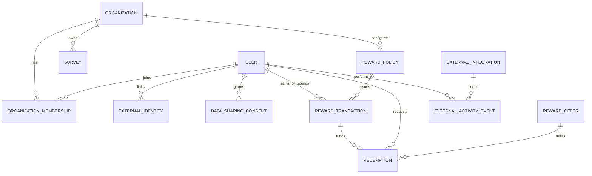
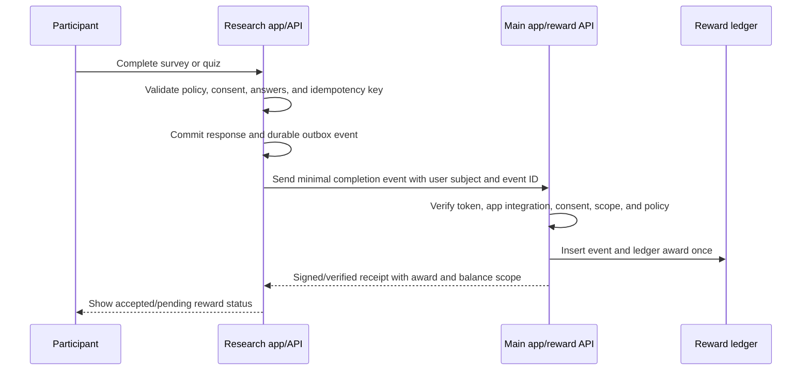

# Feedora Rewards and Cross-App Sharing Schema

## Purpose and status

This document defines an implementable schema and delivery path for organization-scoped and platform-wide rewards, starting with the existing research survey app sending completion rewards to the user's main app. It is a design proposal, not an applied database migration. Names below are Django/Postgres-oriented and can be adjusted to the host app's conventions.

The design keeps one global user identity, supports membership in many organizations, separates each organization's reward balance, and allows the platform to issue a distinct global reward. Survey answers remain in the research system. The reward system receives only the minimum verified event needed to issue a reward.

## What “redeemable” means

Points are **redeemable** when a user can exchange them for a defined benefit. Examples include an organization voucher, a participation certificate, access to a workshop, or an entry in a prize draw. A redemption consumes points and has a request/fulfillment lifecycle. If no benefit can be claimed and points only appear in progress or a leaderboard, they are **recognition points**, not redeemable points.

Treat points as an app-defined score until a program explicitly gives them an exchange value. Do not describe them as cash or promise a cash value by default. A reward offer must identify its issuer, eligibility, cost, availability, expiry, and delivery method. The organization that funds an offer is responsible for fulfillment.

## Current repository state

Observed in the Gihini Django backend:

- `accounts.User` is the account identity. `OrganizationMembership` supports multiple memberships, while the existing `Organization.user` one-to-one field still couples each organization row to one user.
- `surveys.Survey.organization` currently points to `accounts.User`, so a survey is effectively creator-owned in the current database schema rather than attached to an independent organization row.
- `surveys.Response` stores `points_earned`, a nullable user, guest participant ID, and client submission ID. The endpoint checks for a repeated submission ID, but the model does not yet declare a database uniqueness constraint for that idempotency key.
- `RespondentProfile.total_points` is a cached account-wide total. Organization standings are calculated from scoped responses; the profile total is not a safe organization balance.
- `surveys.points` calculates question points and supports optional variable reward behavior. Survey settings are primarily carried in `Survey.features` JSON.
- There are no first-class reward account, reward ledger, offer, redemption, external integration, or data-sharing consent models.

These constraints mean the proposal must be added gradually. In particular, do not reinterpret a creator user ID as an organization ID or infer organization membership from email, display name, or an organization name.

## Product decisions and categorical controls

Use constrained choices for durable policy and booleans for true yes/no gates. Keep policy versioned so a survey or organization cannot silently change the reward terms for a participant who is already in progress.

| Setting | Type / allowed values | Initial default | Meaning |
|---|---|---|---|
| `audience_scope` | `organization`, `platform` | `organization` | Which independent audience owns the activity and its standings. A global activity must be explicitly marked. |
| `guest_policy` | `allowed`, `allowed_then_claim`, `account_required` | `allowed_then_claim` for the current pilot | Whether guests can participate and whether an account is needed to save or redeem rewards. |
| `incentive_mode` | `none`, `recognition_points`, `quiz_score`, `draw_entry`, `fixed_benefit` | `none` for ordinary research surveys | What the participant is offered. A survey must state this before participation. |
| `repeat_policy` | `deny`, `unlimited`, `max_attempts`, `cooldown` | `deny` | Whether and when the activity can be repeated. Store numeric cap/duration separately when needed. |
| `repeat_reward_policy` | `first_attempt_only`, `score_delta`, `unrestricted`, `blocked` | `first_attempt_only` | How repeat completions affect rewards. `score_delta` awards only improvement over the previous best. |
| `redemption_mode` | `disabled`, `organization_catalog`, `external_fulfillment` | `disabled` | Whether recognition points can be exchanged and who fulfills a benefit. |
| `expiry_policy` | `never`, `after_duration`, `at_date` | `never` for the pilot | Expiry is explicit and disclosed; duration/date is stored in a separate field. |
| `sharing_mode` | `none`, `completion_only`, `completion_and_score` | `completion_only` when enabled | Which fields a connected app may send to the reward service. Never implies answer sharing. |
| `requires_consent` | boolean | `true` for cross-app sharing | A user must explicitly approve sharing for that app and purpose. Revocation blocks future events. |
| `is_active` | boolean | `false` for offers/integrations until configured | Fast pause switch without deleting history. |

`requires_account` is a useful boolean policy field where appropriate, but it should not replace `guest_policy`: an allowed-then-claim flow is a distinct product behavior.

### Recommended pilot choices

For your own organization and feedback app:

1. Keep the user's account global and organization membership independent.
2. Mark each survey/quiz as organization-scoped and assign it to your organization.
3. Allow a guest to complete an eligible survey, then invite them to create/sign into the global account to claim saved progress. Make reward redemption account-only.
4. Use `recognition_points` for a survey only if the study has an approved reason to incentivize participation. Use `quiz_score` for a quiz with a declared scoring policy.
5. Set `redemption_mode=disabled` initially unless there is a real offer, budget, and fulfillment owner. Points can still appear in progress and a scoped standing.
6. Send a completion event to the main app only after a verified, accepted response. Send no response answers.

## Proposed logical schema



### Identity and organization

**`User`** remains the global account. Do not create one user row per organization.

**`Organization`** should eventually be an independent tenant record with a stable UUID/ID, canonical name, status, created timestamp, and settings. Organization ownership and membership belong in `OrganizationMembership`, not as a required user field on the organization itself.

**`OrganizationMembership`** should have a unique `(organization_id, user_id)` pair, role (`owner`, `admin`, `researcher`, `member`), status (`invited`, `active`, `left`, `suspended`), joined timestamp, and optional audit fields. A user can have no membership, one membership, or memberships in many organizations.

**`ExternalIdentity`** links a global user to a verified identity from an issuer: `issuer`, `subject`, `user_id`, `created_at`, `last_seen_at`. Add a unique constraint on `(issuer, subject)`. For Supabase OAuth, use the stable verified subject (`sub`) and issuer. Do not link accounts solely by email; email can change and may not be verified.

### Survey policy

Keep the engine schema generic. Feedora owns organization and reward policy. A versioned `SurveyRewardPolicy` (or normalized fields on `Survey` initially) should include:

- `survey_id`, `organization_id`, `version`, `is_active`;
- `audience_scope` and optional explicit `global_program_id`;
- `incentive_mode`, `guest_policy`, `repeat_policy`, `repeat_reward_policy`;
- `base_points`, optional score thresholds/points map, and optional max reward;
- `redemption_mode` and `expiry_policy` references where applicable;
- `terms_version`, `published_at`, `created_by`, and `created_at`.

Freeze the selected policy version on a completion/reward transaction. Changing the current policy should affect new attempts, not rewrite prior ledger rows. Store quiz score and scoring version separately from research answers if the reward depends on a score. Do not let client-calculated score decide an award.

### Reward policy and offers

**`RewardPolicy`** defines the issuer and earning rules. Suggested fields: `id`, `scope_type` (`organization` or `platform`), nullable `organization_id`, `program_key`, `version`, `incentive_mode`, `redemption_mode`, `expiry_policy`, `is_active`, `effective_from`, and `effective_until`.

Enforce a check constraint: organization scope requires an organization ID; platform scope requires it to be null. A platform-wide reward should be a separate policy/program, not an aggregate of organization points.

**`RewardOffer`** is an optional catalog item backed by one policy: `id`, `policy_id`, `title`, `description`, `reward_kind` (`voucher`, `event_access`, `certificate`, `draw_entry`, `physical_item`, `other`), `cost_points`, `inventory_limit` (nullable for unlimited), `starts_at`, `ends_at`, `terms_version`, `fulfillment_mode` (`manual`, `code`, `integration`), and `is_active`. Keep fulfillment credentials/codes out of public survey JSON and client logs.

### Reward events, ledger, and balances

Use an append-only **`RewardTransaction`** ledger as the accounting source of truth. Suggested fields:

- `id` UUID, `user_id` or a canonical participant reference, `scope_type`, nullable `organization_id`, `program_key`;
- `transaction_type` (`earn`, `redeem`, `expire`, `reversal`, `adjustment`);
- `points_delta` signed integer; positive for earned/returned points, negative for spend/expiry;
- `source_type` (`survey_response`, `external_activity`, `manual_adjustment`, `redemption`), `source_id`;
- `idempotency_key`, `policy_version`, `created_at`, `metadata` with a strict allowlist.

Add a unique constraint for the idempotency key in its issuer/source namespace. For example, a source app integration plus external event ID must be unique. Retries must return the existing transaction instead of awarding again. Never update or delete an earned row to correct it; append a reversal and, if needed, a new correct transaction.

The balance for a user is the sum of ledger deltas for exactly one scope/program. It is not a single mutable `total_points` field. A cached balance can be added for speed, but it must be rebuildable from the ledger and keyed by `(user_id, scope_type, organization_id, program_key)`. Organization balances must never be mixed with platform-wide balances.

Guests need a stable guest participant key on server-accepted activity. When they create an account, an explicit claim operation associates eligible guest activity with that user idempotently. Store an audit record and resolve duplicate/conflicting claims deterministically. A guest cannot redeem until claimed to an account.

### Redemptions

**`Redemption`** records a user's request to exchange a scoped balance for an offer: `id`, `user_id`, `organization_id`/program scope, `offer_id`, `points_cost_snapshot`, `status` (`requested`, `approved`, `fulfilled`, `rejected`, `cancelled`), `requested_at`, `fulfilled_at`, `external_reference`, and terms snapshot/version.

Requesting a redemption must be one database transaction: lock/check the scoped balance, validate active offer and eligibility, create the redemption, and append the negative ledger transaction. A unique idempotency key protects repeated taps/network retries. Rejection/cancellation returns points with a compensating positive transaction when policy allows. Fulfillment must be auditable. Do not let a client subtract points locally as the authority.

If `redemption_mode=disabled`, do not show a redeem action. With `organization_catalog`, only that organization's offers can be purchased from that organization's balance. `external_fulfillment` is for an explicitly configured provider or admin process; it does not mean arbitrary apps can take points.

### Cross-app sharing

**`ExternalIntegration`** registers an app allowed to submit activity: `id`, `organization_id` or platform program, OAuth `client_id`/issuer, display name, allowed event types, allowed data fields, status, creation/rotation timestamps, and owner. The backend maps OAuth client ID to the permitted organization/program. Client ID is an app identifier, not proof that an event is truthful on its own.

**`DataSharingConsent`** records the user choice: `user_id`, integration ID, purpose text/version, allowed data categories, granted timestamp, revoked timestamp, and notice version. Consent is per user and integration; revocation prevents later sharing. Do not bundle it into generic account terms.

**`ExternalActivityEvent`** is a minimal verified event: `integration_id`, `external_event_id`, verified user subject/user ID, `event_type`, `occurred_at`, `received_at`, verification status, policy/program ID, and a narrowly validated payload. Unique `(integration_id, external_event_id)` blocks duplicates. Prefer only `survey_completed` or `quiz_completed` plus an opaque survey identifier and optional server-verified score band. Never send answers, free text, demographics, or research data to the main app just to grant points.

Supabase OAuth Server currently provides standard identity scopes; its scopes do not currently provide app-specific database permissions. The OAuth access token still has access according to RLS. For this flow, the main app's backend should validate the JWT and its issuer, audience, expiry, subject, and `client_id`; verify consent and integration policy; accept an idempotent event; calculate/record the award server-side; and return a receipt. Do not expose a service-role key or allow the partner app to write reward ledger rows directly.

### Monetization boundary

Keep organization billing separate from participant rewards:

- `OrganizationSubscription` or billing-provider customer record attaches to the organization, not to a respondent.
- A categorical plan can gate platform capabilities: researcher seats, active surveys, response volume, retention, export, integrations, branding, and support.
- Reward funding is an organization budget/allowance with a currency and period where tangible benefits exist. Points are not the billing currency.
- Reward offers need an issuer and fulfillment budget. Platform-wide benefits are funded and managed by the platform; organization-specific offers are funded and managed by that organization.
- Price model can be selected later (`subscription`, `usage`, `institutional_contract`, or `hybrid`). Keep measured usage (responses, active researchers, storage, integrations) auditable so pricing can change without changing reward accounting.

Do not make respondents pay to join a study or redeem an organization-funded incentive unless the organization has explicitly designed and disclosed that program. Monetization of the research platform is an organization contract; participant incentives are a separate program.

## End-to-end flow for the pilot



Use a transactional outbox in the research service: save the response and outbox row in one transaction, then retry delivery until the main app returns a receipt. Retries use the same event ID. The app can show “pending sync” before receipt, but must not describe unconfirmed points as final. If both apps share one database, still keep the ledger write behind a server-owned transaction/service boundary; client-side direct writes remain unsafe.

For a survey completed by a guest, decide whether the pilot's reward is merely visible locally or retained server-side against a guest identity. To make it portable to the main app, retain a pseudonymous guest event on the server and only attach it to a global account after the user signs in and explicitly claims it. Consent to share the event and consent to merge guest history are separate decisions.

## API shape for the first integration

An app-to-app endpoint can accept a small contract such as:

```json
{
  "eventId": "stable-uuid-generated-by-source",
  "eventType": "survey.completed",
  "participant": { "issuer": "https://issuer.example", "subject": "stable-user-subject" },
  "organizationId": "org-stable-id",
  "activityId": "opaque-survey-id",
  "occurredAt": "2026-10-19T09:00:00Z",
  "result": { "scoreBand": "pass" }
}
```

The server obtains identity from the verified bearer token; the body subject is for correlation only and must match the token subject. `organizationId`, activity ID, event type, and `scoreBand` are validated against the registered integration and reward policy. Do not accept client-supplied `points`, balance, `is_verified`, raw answers, or arbitrary user IDs. Return a stable receipt with transaction ID, points delta, scoped balance, policy version, and whether the event was already processed.

For ordinary surveys, omit the `result` object. For scored quizzes, use a server-verified score band or score result and record the scoring-policy version. Do not send individual answers across apps.

## Authorization and privacy rules

1. Verify JWT signature and expected issuer/audience/expiry; use the stable subject for identity mapping.
2. Bind every integration to an organization or platform program and an allowlist of event types and fields.
3. Require active, purpose-specific consent for cross-app activity. Store notice version and grant/revocation timestamps.
4. Use least-data event payloads. Research answers stay in the research system unless a separate, explicit research data-sharing purpose exists.
5. Enforce access in Django/API or Postgres RLS as appropriate. UI-hidden fields are not access control.
6. Rate-limit and validate event size/schema. Audit issuance, reversals, redemption, manual adjustments, consent, and integration changes.
7. Make revocation stop future event access. Define deletion/retention rules for consent and event metadata without deleting financial/accounting audit requirements where retention applies.
8. Treat OAuth sign-in and consent to activity sharing as different actions. Login does not grant reward sharing automatically.

## Migration and delivery plan

### Stage 1: Make the current own-org path reliable

- Establish one stable organization ID for the pilot and identify whether the main app or research API owns the authoritative reward ledger. Recommendation: the main app owns the cross-app ledger; the research API owns responses and sends completion events.
- Add response idempotency constraints and a transactional outbox event. Make retries return the same reward receipt.
- Add a stable account identity mapping by verified issuer/subject. Do not merge by email alone.
- Add scoped ledger transactions and a non-redeemable recognition-points program. Preserve `Response.points_earned` temporarily as a compatibility/receipt value, not a second source of truth.
- Keep `redemption_mode=disabled` until an actual offer and fulfillment owner exist.
- Write explicit consent copy for completion-only sharing; transmit no answers.

### Stage 2: Separate organization ownership from user identity

- Migrate `Organization` from the current user one-to-one relation to an independent organization table and owner/admin/member memberships.
- Migrate `Survey.organization` to a real organization foreign key while preserving creator ownership separately (e.g. `created_by`).
- Add organization/global scope constraints to policies, reward transactions, and offers.
- Backfill historical surveys and responses only when ownership is unambiguous; quarantine ambiguous legacy rows rather than guessing.

### Stage 3: Organization reward catalogs and redemption

- Add offers, inventory/budget reservation, redemption status transitions, atomic ledger spend, idempotency, and fulfillment audit.
- Provide org controls for offer terms and pause/close actions.
- Add expiry only after a clear policy and participant-facing disclosure exist.

### Stage 4: Multi-org partner platform and monetization

- Add org-owned integration registration, OAuth client mapping, consent revocation, event categories, rate limits, metering, and audit logs.
- Add plan/usage records for org billing independently of reward balances.
- Add operator tools for org suspension, integration revocation, event replay, ledger audit, and support reconciliation.

## Acceptance criteria

- One global account can join multiple organizations and keeps separate scoped balances in each.
- An organization cannot read another organization's members, responses, rewards, redemptions, or integration events.
- A global program is identified explicitly and cannot be inferred by summing organization scores.
- Replaying a survey submission or partner event never awards twice, including concurrent retries.
- Survey response answers remain only in the research system for the completion-only integration.
- A participant can see the scope and issuer of points before earning them; a reward offer clearly states what points buy and who fulfills it.
- Redemption cannot make a scoped balance negative; a retry cannot double-spend; a rejection produces an auditable return if policy allows.
- Revoked consent blocks future external activity submissions; prior ledger entries retain their source and consent context.
- Guest progress can be explicitly claimed once without merging unrelated device or participant histories.
- Billing usage and incentives can be reconciled separately; changing an organization's subscription does not alter participant ledger history.

## Open implementation decisions

These choices must be settled before migrations, not guessed inside a migration:

1. Is the main app's identity provider Supabase, Django/allauth, or a staged bridge? Pick one canonical issuer and store external identity mappings for any bridge period.
2. Does the main app already have a user/reward database and API? If yes, use it as ledger owner and avoid a second authoritative point balance in Gihini.
3. Are guest points portable across devices before account creation? If yes, require a server guest principal and explicit claim; otherwise state that guest progress is local-only.
4. Which concrete first reward exists, if any? Until an issuer, value, eligibility, budget, and fulfillment method are specified, use recognition points only.
5. Does a quiz reward depend on score? If so, define score calculation, attempts, tie/redo behavior, policy version, and the minimal score result shared with the main app.
6. Which org billing model will be evaluated first (`subscription`, `usage`, institutional contract, or hybrid)? Keep the schema capable of metering without setting prices in code.

## References

- Existing Feedora lifecycle architecture: `feedora-multitenant-survey-lifecycle.md`.
- Gihini models: `accounts/models.py`, `surveys/models.py`.
- Current point rules: `surveys/points.py`.
- Current submission and policy enforcement: `feedora_project/api_views.py`.
- Supabase OAuth Server scopes and tokens: <https://supabase.com/docs/guides/auth/oauth-server/oauth-flows> and <https://supabase.com/docs/guides/auth/oauth-server/token-security>.
