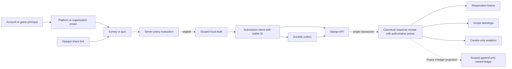

# Feedora Enterprise Foundation and First Vertical Slice

## Decision

Build the boundaries that prevent cross-organization data leakage and duplicate or lost submissions now. Defer enterprise product features until there is a customer or workflow that needs them. Feedora remains a modular Django application with a hexagonal Expo client; the form-builder engine remains organization-agnostic. Do not split services in this phase.

The existing [multi-organization survey lifecycle](feedora-multitenant-survey-lifecycle.md) is the detailed product contract. The [rewards and cross-app schema proposal](2026-10-19-feedora-rewards-and-cross-app-schema.md) is the longer-term reward and integration design. This document organizes those contracts into phases and defines the first implementation slice.

## Product and capability map

| Capability | Foundation required now | Product capability to add when needed |
|---|---|---|
| Identity | Global principal IDs; guest IDs; authentication separated from authorization; provider adapter boundary | OAuth providers, account linking, enterprise SSO |
| Scope and membership | Explicit platform and organization scope IDs; organization membership independent of person and creator; every resource has one scope | Organization invitation, roles, administration and audit UI |
| Research content | Survey/quiz has creator, owner scope, lifecycle and versioned policy | Template libraries, multi-author review and approvals |
| Participation | Server checks policy; stable submission ID; canonical receipt; scope-safe history | Advanced cohort scheduling, offline conflict tools |
| Rewards | Scope-keyed, auditable ledger; points are server-authoritative; reward visibility is explicit | Offer catalog, redemption, fulfillment integrations and budgets |
| Sharing | Opaque share link resolves server-side to a resource and its policy | Branded campaign pages and conversion analytics |
| Offline | Drafts are principal + scope + resource scoped; outbox preserves submission identity and retries safely | Long-running offline collaboration and operator replay tools |
| Reporting | Respondent sees personal progress; creator analytics require creator permission | Exports, retention controls and organization analytics |
| Monetization | Keep organization usage separate from respondent rewards | Plans, metering, billing and institutional contracts |

## Domain boundaries and invariants

### Identity and scope

- A **principal** represents an account or a guest participant. A person has one global account, not one account per organization.
- A **scope** is either `platform` or `organization`. The platform is a named global scope, not a synthetic organization row.
- An **organization membership** links an account principal to an organization and carries role/status. It does not change identity and is not required merely to answer a publicly available survey.
- A **survey or quiz** has exactly one scope and a creator. Organization selection is a view/filter choice; it is never proof of access.
- Federated identity mapping uses verified `(issuer, subject)`. Email is contact/profile data and must not be used to merge accounts.
- Guest-to-account transfer is explicit, idempotent, and conflict-aware. A client must not silently reassign guest history when a session changes.

### Research and policy

- The engine owns generic form evaluation, validation, progress, and draft behavior. Feedora owns organization, identity, authorization, participation eligibility, and reward policy.
- A policy is versioned. Each attempt is evaluated against one policy version, recorded on its receipt, and is not retroactively changed by an edit.
- The server evaluates account requirement, prerequisites, sequence, cooldown, attempt limits, redo, and reward strategy. Client lock states explain the server policy but do not enforce it.
- Research answers stay in the research system. Respondent progress and public standings expose only the fields appropriate for that role.

### Submission and rewards

- A submission has one stable client-generated `submissionId`. Every retry reuses it.
- Django is authoritative for accepted response ID, policy outcome, points, and standing. The client can label an unsynced submission as pending; pending points are not spendable or shown as final.
- Accepted response and its authoritative points are written atomically. When the dedicated ledger arrives in Phase 4, it must be committed with the response; it will be append-only, with corrections represented as reversals/adjustments.
- A points balance is scoped by `(principal, scope, program)`. Organization points never roll into platform points.
- Redemptions and external reward transfer are not part of the first slice.

## Data flow



## Architecture contracts

Application ports use Feedora-owned types and do not leak Django, Supabase, Expo, or SQLite types into domain code.

```ts
type ScopeId = string;
type PrincipalId = string;
type SubmissionId = string;

type ScopeRef =
  | { kind: 'platform'; id: ScopeId }
  | { kind: 'organization'; id: ScopeId };

interface SubmissionIntent {
  submissionId: SubmissionId;
  principalId: PrincipalId;
  scope: ScopeRef;
  surveyId: string;
  policyVersion?: string;
  answers: Record<string, unknown>;
  createdAt: string;
}

interface SubmissionReceipt {
  submissionId: SubmissionId;
  responseId: string;
  principalId: PrincipalId;
  scope: ScopeRef;
  surveyId: string;
  acceptedAt: string;
  policyVersion: string;
  pointsAwarded: number;
  pointsTotal?: number;
  replayed: boolean;
}

interface IIdentityPort {
  currentPrincipal(): Promise<{ id: PrincipalId; kind: 'account' | 'guest' } | null>;
  claimGuest(guestPrincipalId: PrincipalId): Promise<void>;
}

interface ISubmissionPort {
  submit(intent: SubmissionIntent): Promise<SubmissionReceipt>;
  getReceipt(submissionId: SubmissionId): Promise<SubmissionReceipt | null>;
}

interface IScopedDraftPort {
  load(principalId: PrincipalId, scopeId: ScopeId, surveyId: string): Promise<unknown | null>;
  save(principalId: PrincipalId, scopeId: ScopeId, surveyId: string, draft: unknown): Promise<void>;
  clear(principalId: PrincipalId, scopeId: ScopeId, surveyId: string): Promise<void>;
}
```

The concrete transport validates and serializes these contracts. Draft storage and outbox storage are adapters. The form engine needs no organization-specific dependency.

## Phased implementation roadmap

### Phase 0 — Baseline and compatibility contract

- Reconcile existing in-progress Expo and Django changes before adding schema or changing endpoint behavior.
- Identify the actual owner of each record and preserve existing local data. No destructive reset or guessed tenant backfill.
- Record current API shapes and migrations; preserve old clients where safe with additive fields.
- Confirm one identity provider for each deployment at the composition root; keep provider substitution behind ports.

**Exit:** current migrations are understood, no existing user diff is overwritten, and every record in the first slice has a stable owner/scope interpretation.

### Phase 1 — Principal, scope, membership, and resource ownership

- Make `PrincipalId`, `ScopeId`, `ScopeKind`, membership, and resource ownership explicit domain concepts.
- Keep account identity global. Make organization membership unique per account + organization and active/status-aware.
- Give surveys an explicit organization or platform scope. Keep `created_by` separate from scope ownership.
- Retain legacy creator ownership during an additive migration; map only records with unambiguous organization ownership. Leave ambiguous data quarantined/unscoped for review.
- Enforce scope at API query boundaries and include scope IDs in local cache/draft keys.

**Implementation status (2026-10-23): complete for the current single-Django deployment.** Organization ownership is represented by active memberships; creator fields are provenance; surveys require explicit platform or organization scope unless quarantined for review. The minimal `owner`/`admin`/`member` membership roles are present, with active owners and admins able to manage scoped surveys; invitations and role assignment operations remain Phase 6. See [Phase 1 ownership hardening](2026-10-23-phase-1-ownership-hardening.md) for acceptance evidence and [Phase 2 policy and eligibility](2026-10-23-phase-2-policy-and-eligibility-plan.md) for the next slice.

**Exit:** the same account can participate in two organizations with distinct history, and a guessed/altered scope ID cannot read another scope.

### Phase 2 — Versioned research policy and eligibility

- Harden the existing partial access-policy implementation into a canonical, immutable, server-authoritative policy contract shared by catalog, metadata, attempt start, and submit.
- Enforce account/membership requirements, access-code admission, prerequisites, sequence, cooldown, and attempt limits; provide stable reason codes and a truthful UI projection.
- Make policy revisions and attempt allocation auditable and concurrency-safe; preserve guest/account continuity and offline drafts through stale rules or expired grants.
- Do not advertise access-code or score gates as protective until server enforcement and trusted scoring are in place. See the [Phase 2 policy and eligibility plan](2026-10-23-phase-2-policy-and-eligibility-plan.md) for current-state gaps, contracts, migration order, and hostile test matrix.

**Exit:** UI and API agree on why a participant is locked; policy edits do not rewrite existing attempts.

### Phase 3 — Reliable participation and canonical receipts (first vertical slice)

- Create a stable submission ID once, persist the complete submission intent, and reuse its ID on retries.
- Enforce idempotency in Django with database constraints and transaction-safe handling.
- Store account submissions under the authenticated account and guest submissions under a stable guest principal.
- Return a canonical receipt containing response ID, submission ID, principal/scope/resource IDs, accepted time, policy version, and authoritative points.
- Write the accepted response and its point receipt in one transaction. Return the prior receipt for a replay; keep `Response.points_earned` as the current pilot source until Phase 4 introduces the ledger.
- Apply local completed history and standing only from a receipt. Keep offline work visibly pending; do not award final points locally before sync.

**Exit:** one accepted submission produces exactly one response and one award under direct submit, concurrent retry, or outbox replay; the receipt reconciles local history and scoped standing. The first implementation uses `Response.points_earned` as the pilot authority; Phase 4 adds the separate ledger.

### Phase 4 — Durable rewards and respondent/creator projections

- Add an append-only reward ledger keyed by principal, scope, and program; derive balances from ledger rows or a rebuildable projection.
- Keep global and organization programs separate, and make whether points are visible a policy setting.
- Treat guest earnings as claimable only through a distinct explicit account-claim operation.
- Share standing presentation while separately authorizing respondent progress and creator analytics.

**Exit:** balances can be audited and rebuilt; no local total is an authority; each role sees only allowed fields.

### Phase 5 — Share links and invitation flows

- Add opaque, revocable, expiring share tokens mapped server-side to a survey or organization landing page.
- Resolve link to resource + scope + current policy; a link never grants organization membership or bypasses policy.
- Support open guest participation and optional sign-in/join paths according to policy.

**Exit:** link revocation takes effect server-side and link routing does not cross scopes.

### Phase 6 — Organization operations and monetization

- Add invitations, role assignment/promotion and ownership-transfer operations, audit views, retention/export controls, organization settings, and integration registration when demanded. The Phase 1 roles are only the authorization foundation.
- Meter usage independently from respondent reward balances. Add billing only with a defined customer, plan, and billing owner.
- Add reward offers/redemption only after an issuer, funding source, terms, and fulfillment owner are concrete.

**Exit:** enterprise admin and billing operate on organization records without changing participant identity or reward accounting.

## First slice: exact implementation scope

The first slice is a **scope-safe, idempotent survey completion from Expo to Django and back**. It includes account and guest submissions, direct and offline retry identity, policy decision preservation, receipt-based local reconciliation, and scoped standings. It does not include a provider migration, a reward redemption catalog, or billing.

### Compatibility boundary for the pilot

This paragraph described the pre-Phase-1 pilot compatibility boundary. The 2026-10-23 Phase 1 migration replaced the one-to-one ownership relation with creator provenance plus membership-owned organizations, and renamed survey authorship to `Survey.created_by`. Explicit organization scopes are now required for respondent access; ambiguous legacy surveys are quarantined for review. Historical response rows and their stored scope IDs are preserved.

The current API records the access-policy fingerprint on the accepted response and rejects stale client policy versions. It does not yet retain historical policy snapshots, so a policy change requires the client to reload the current survey rules before a response is accepted.

### Implementation progress

- The Django response now stores a policy version and answer fingerprint, has per-principal idempotency constraints, returns a canonical receipt with principal/scope/response IDs, and rejects scope/principal mismatches or reuse of an idempotency key with different answers.
- The Expo transport sends one submission ID and immutable principal/scope/policy context. The outbox reuses that ID and context and invokes receipt reconciliation before acknowledging delivery.
- Local profile and history updates now come from the canonical receipt and are deduplicated atomically in the local store. Pending offline responses no longer add final local points before server confirmation.
- Survey creator and organization scope are now separate, and the additive migrations preserve existing organization and survey IDs. Unscoped legacy surveys are marked for review and excluded from respondent access. Policy snapshot history and the append-only reward ledger remain later work; server guest claim is implemented.

### Verification completed

- Django scoped submission, policy compatibility, and hostile concurrency suites: **27 passed**.
- Engine production TypeScript build: passed. Showcase TypeScript check: passed. Submission contract tests: **7 passed**.
- `makemigrations --check --dry-run`: no model/migration drift. Migration `0011_response_submission_receipt` was applied to the existing local SQLite database after checking for duplicate submission keys; all 42 existing responses remained present and received the `org-1` scope backfill.
- React Doctor reports no errors after moving the two event-handler ref updates out of render. It still reports 17 warnings (complexity, list render allocations, and existing fetch/effect patterns); the wider cleanup is outside this vertical slice.
- The RN Terrain CLI was not installed in this workspace, so its CLI audit could not run. Expo app TypeScript validation completed successfully.

Implementation sequence:

1. Inspect and reconcile existing uncommitted membership, guest ID, policy, outbox, and client changes in both repositories.
2. Write hostile tests first for duplicate submission replay, guest isolation, cross-scope history/standing, offline retry reusing identity, and not applying points before acceptance.
3. Add/apply additive response fields/constraints as required; preserve earlier migration numbering and existing SQLite data.
4. Refactor the submit endpoint into explicit validation, principal resolution, policy evaluation, transaction, and receipt serialization. Ensure retry response is semantically the same receipt.
5. Extend `ITransportPort` with a typed submission intent/receipt contract and stable submission ID. Ensure the outbox reuses the ID, scope, guest/account owner, and policy/session metadata.
6. Change the Expo submit flow so pending submissions do not increment authoritative profile/history. Once a receipt arrives, reconcile response history, profile/standing, and visible points from that receipt.
7. Verify catalog/history and leaderboard queries are scoped to the selected organization/platform scope and that creator-only analysis remains permission-checked.

### Slice acceptance criteria

- The app creates one submission ID and reuses it for every retry, including process restart/outbox replay.
- An account and two guest principals submitting the same survey are isolated.
- Replaying the same principal + survey + submission ID returns the same receipt without another response or award.
- Replayed/failed requests do not increment local final points or completed history.
- A server-accepted receipt updates the correct selected scope and only then clears/marks the pending intent complete.
- Switching account or scope cannot cause a queued submission to be attributed to a different principal/scope.
- A locked/invalid request does not create a response, receipt, or reward entry.
- One scope cannot read another scope's respondent progress or standing.

## Hostile review and operational tests

| Failure | Guard | Adversarial acceptance case |
|---|---|---|
| Lost HTTP response followed by replay | Unique submission key + transaction + canonical prior receipt | Submit once, discard response, replay concurrently; assert one response and one reward |
| Same idempotency key reused by another participant | Namespace key by survey and principal; bind intent owner | Account A and guest B use same raw key; neither can retrieve the other's receipt |
| Account changes while an offline intent waits | Bind intent to principal; reject mismatched authenticated principal | Queue as A, sign in as B, flush; assert no attribution to B and intent remains recoverable |
| Organization selection changes before replay | Persist scope with intent and validate against survey's server scope | Queue in org A, switch to org B, replay; assert A's canonical scope or explicit rejection, never B |
| Policy changes while a draft is open | Pin policy version or require re-evaluation with explicit response | Change policy before submit; assert the documented policy transition and no silent award change |
| Storage hydration stalls or data is corrupt | Bounded restore with safe invalidation and recoverable pending intent | Empty/corrupt SQLite and delayed storage; app reaches usable state without losing accepted receipt |
| Retry storms / stale subscriptions | Single-flight outbox flush, bounded retries, teardown subscriptions | Rapid reconnect/unmount cycles cause no duplicate sends, timers, or listeners |

## Scaling and resource constraints

- **Architecture:** one Django deployment and database transaction boundary for the first slice; no microservices.
- **Queries:** filter by indexed scope/resource/principal keys, select related display fields, and paginate lists. Avoid per-render polling or full response scans.
- **Idempotency:** database uniqueness is the correctness mechanism; process-local locks are only an optimization.
- **Client operations:** submission intent serialization is O(payload size); history/standing reconciliation touches only the affected principal + scope. Form-engine field updates stay incremental.
- **Storage:** drafts and outbox entries are keyed by principal + scope + resource. Bound payload size and retry metadata; preserve records until canonical receipt.
- **Network:** timeout requests, retry only transient errors with backoff, and treat policy/validation 4xx responses as terminal until user action changes the intent.
- **Runtime/bundle:** no new mandatory runtime library for tenant or reward concepts; adapters implement the ports.
- **Hosting:** local SQLite remains suitable for development. Move the hosted multi-writer API to PostgreSQL before sustained concurrent research use.

## Deferred decisions and explicit non-goals

- Whether Supabase, Django, or another provider is the canonical production issuer; select one before implementing federated account linking.
- Whether a guest can claim progress across devices; requires a server-issued guest credential and an explicit claim policy.
- Exact reward points, visibility defaults, reward offers, redemption, expiry, and negative reinforcement; each needs an organization policy and user-facing disclosure.
- Organization billing model and pricing.
- Service extraction, event streaming, advanced experiments, and enterprise admin UI.

These are deferred product features, not reasons to omit stable IDs, scope ownership, policy versions, idempotency, and auditability now.
