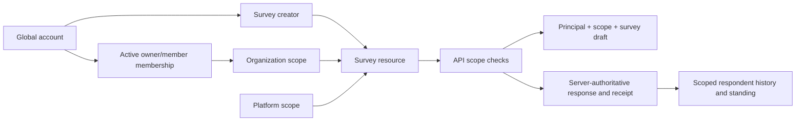

# Phase 1 Ownership Hardening

## Goal and acceptance

Complete principal, scope, membership, and resource ownership boundaries across the Feedora Django API and Expo client while preserving existing survey, response, and organization data.

Acceptance requires that one account can create/manage multiple organizations; membership is the authorization relation and supports multiple owners; survey creator is distinct from its organization scope; changing creator membership does not rewrite the survey scope; public and respondent endpoints resolve resources by their canonical scope; and the client persists drafts and receipts under canonical principal/scope/resource identities.

## Capability and integration matrix

| Capability | Authority | API/data | Client integration | Hostile acceptance |
| --- | --- | --- | --- | --- |
| Global account | Django user/provider boundary | User PK remains globally unique | Auth composition and profile | Same account across two organizations has one identity |
| Organization ownership | Active owner memberships | Unique user + organization; status-aware | Entity list and owner controls | Multiple owners and multiple organizations work concurrently |
| Resource authorship | `Survey.created_by` | Creator FK separate from `organization_scope` | Survey catalog/meta and creator views | Creator departure does not move or expose the resource |
| Resource scope | Explicit platform or organization scope | Required organization FK for organization surveys | Canonical scope in drafts, receipts, history | Altered scope cannot query, create, or submit across organizations |
| Legacy migration | Additive state/data migration | Preserve response rows; fail closed on ambiguous ownership | Stable IDs continue to resolve | Migration never guesses from organization names or silently drops rows |

## Data flow topology

## Hostile failure vectors and test gates

1. A creator's account is disabled or leaves an organization after publishing: the survey remains under its explicit scope; creator analytics still require creator/admin permission.
2. A user owns two organizations and submits the same survey in each: scope/history/standing cannot merge, and owner controls remain scoped.
3. A member changes a client-supplied organization ID: API authorization and survey-scope validation reject the operation before any write.
4. Legacy rows lack a provable scope: migration stops with an actionable error; no owner is inferred from names and no response is moved.
5. Platform resources are passed an organization ID or vice versa: canonical scope resolution rejects the mismatch.
6. Switching organization while a form is open: draft, pending outbox intent, receipt, and completed-history keys retain the survey's canonical scope.

## Scaling and compatibility limits

- Organization authorization remains an indexed membership lookup; no per-response fan-out is introduced.
- Survey scope is stored on the resource and response. Creator identity is provenance and permission input, never a substitute for resource scope.
- The migration is additive/renaming and preserves primary keys and response rows. It must be reviewed against production migration state before deployment.
- Django remains the API and database authority. The form engine remains organization-agnostic and receives no Django or Expo dependencies.

## Implementation rounds

1. Add hostile API tests and migration guards for multi-organization ownership, creator/scope separation, and cross-scope denial.
2. Replace creator-linked organization ownership with membership-owned organizations and separate survey creator from scope; update API queries and serializers.
3. Resolve client draft, outbox, history, and receipt identity to canonical scope; run client and server suites.
4. Run hostile review of the final diff, migration behavior, API authorization paths, and residual compatibility code. Update the architecture roadmap only after all acceptance checks pass.

## Local implementation evidence

- Applied account migration `0007_organization_created_by_membership_ownership` and survey migration `0014_survey_creator_scope_separation` to the existing development database after writing a SQLite backup to `C:\projects\phase1-snapshots\gihini-research-pre-phase1.sqlite3`.
- Applied survey migration `0015_survey_scope_kind_matches_owner`, which rejects organization/platform scope contradictions and normalizes platform resources to the platform scope.
- Applied account migration `0008_alter_organizationmembership_role` to add the admin choice without changing existing membership rows.
- Added the minimal membership role set (`owner`, `admin`, `member`): owner/admin manage scoped surveys, while aggregate-sharing approval remains owner-only. Role assignment and invitation workflows remain deferred to Phase 6.
- Before and after migration, the local database retained 1 organization, 1 active owner membership, 21 surveys, and 42 responses; all 21 surveys already had explicit organization scope, so none required quarantine.
- Verification: Django full suite **58 passed**; final ownership suite **12 passed**; Django system check passed; migration drift check reports no changes; Expo showcase typecheck passed; focused client auth/submission suite **9 passed**; full engine suite **512 passed**; survey-builder JavaScript syntax check passed.
