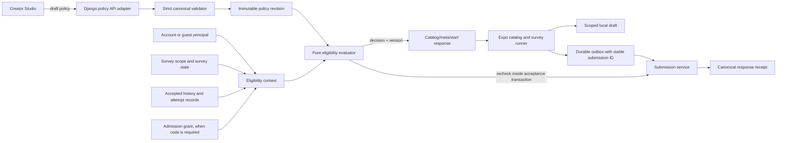

# Phase 2 Survey Policy and Eligibility Plan

## Purpose

Make survey and quiz participation rules explicit, consistently enforced by the Django authority, understandable in the Expo client, and safe across guest/account identity, organization/platform scope, offline drafts, policy edits, and concurrent submissions.

This phase hardens the policy foundations already present. It does not replace Phase 1 identity and scope, introduce a reward ledger, or move generic form logic into the Feedora application. The form-builder engine remains organization- and provider-agnostic.

## Phase 1 seam and ownership

Phase 1 owns:

- global account and guest principal identity;
- organization membership and role/status;
- platform or organization scope for each survey;
- survey authorship independent of its scope;
- canonical submission receipts and scoped history.

Phase 2 consumes those contracts. It may decide whether a principal can start or submit a scoped survey, but it does not create organization roles, infer membership from a selected organization, or change response scope. The new organization `admin` role can manage surveys; invitations, role assignment, and audit workflows remain Phase 6.

Policy authority belongs to Django. The Expo client renders server decisions and may use cached data to explain likely state while offline, but a client-side evaluation never authorizes a submission. The form-builder engine continues to own form validation, branching, progress, and draft mechanics; it does not own research eligibility or rewards.

## Existing implementation: verified baseline

| Rule or seam | Present behavior | Phase 2 disposition |
| --- | --- | --- |
| Account required | `requiresAccount` is normalized and checked on submit | Preserve, canonicalize, and expose as a reasoned eligibility result |
| Redo and max attempts | Submit checks prior accepted responses; legacy aliases and title-based quiz defaults remain | Preserve compatible behavior, remove title-derived defaults after a compatibility migration, and make limits atomic under concurrent submits |
| Cooldown | Submit checks server completion time and returns `unlocksAt` | Preserve server clock authority; define exact boundary and timezone serialization |
| Prerequisites | Submit checks completed surveys and same-scope membership | Preserve; validate configuration at write time and support typed completion/score conditions only when score data is trusted |
| Sequence | Submit checks earlier published surveys in the same scope; client derives visible sequence state | Define one canonical sequence contract, reject ambiguous order, and share server eligibility projection with the UI |
| Policy fingerprint | A normalized subset is hashed and stale versions are rejected on submit | Preserve stale-policy rejection; add immutable snapshots to support audit and stable running attempts |
| Access-code requirement | Catalog and survey UI can show a code lock; UUID metadata and submit routes do not consistently require proof of the code | Treat as an access-control defect; enforce a server-issued survey admission grant at metadata/start/submit boundaries |
| Minimum score | Metadata exposes `minScorePercent`, and the client can use it in its local evaluation | Do not advertise it as enforced until the server has a trusted score and validates the threshold |
| Guest/account continuity | Claimed guest responses are included in the account principal's policy history | Preserve one stable eligibility history across claim; do not double-count linked guest rows |
| Offline drafts/outbox | Drafts and submission intents are persisted; submission retries retain stable IDs and receipts | Preserve. Offline drafts remain editable; final acceptance waits for current server eligibility or a valid server-issued attempt grant |

The baseline is intentionally fail-closed for unsupported rules. Legacy values must be normalized for reading and reported for cleanup; newly saved values must be validated against the canonical policy contract.

## Threat model and hostile findings to close

1. **Code-gate bypass:** a respondent who knows or obtains a survey UUID can call metadata or submit directly even when the UI shows an access-code lock. Close this before describing a code-required survey as restricted.
2. **Score-gate bypass or false promise:** the client can display a minimum-score lock, but the server does not currently calculate and enforce that prerequisite score. The current question/option data does not provide a complete trusted quiz answer key. Keep score gates unavailable until scoring is server-authoritative.
3. **Concurrent attempt oversubscription:** two distinct submission IDs may both observe capacity before either response is written. Idempotency prevents replay of one ID; it does not by itself make `maxAttempts=1` atomic across different IDs or database backends.
4. **Policy mutation during an offline run:** a client can hold a stale policy fingerprint. The current submit rejects stale versions, which is safer than accepting a changed contract, but the user-facing recovery and audit record must be deterministic and must preserve the outbox intent.
5. **Configuration drift:** the server accepts several historical aliases and may silently coerce malformed policy fields. A creator must not believe an invalid or unsupported condition is active.
6. **Cross-scope prerequisites:** malformed or stale prerequisite IDs must not leak titles/data or unlock a survey in another organization/platform scope.
7. **Identity transition:** guest claim must not reset attempt counts, cooldowns, or prerequisite completion, and must not count the same guest response twice after linking.

## Canonical policy contract

Create an application-owned, versioned policy value object in Django. Keep it independent of `HttpRequest`, ORM models, Expo, and form-engine classes. Adapters translate survey storage, authenticated/guest identity, time, and query results into policy input; the evaluator returns a deterministic decision.

Initial canonical document (field names are illustrative until the contract round is approved):

```json
{
  "schemaVersion": 1,
  "participation": {
    "accountRequired": false,
    "organizationMembershipRequired": false,
    "accessCodeRequired": false
  },
  "attempts": {
    "maximum": 1,
    "cooldownSeconds": 0,
    "repeatReward": "first_attempt_only"
  },
  "prerequisites": [],
  "sequence": null
}
```

Rules:

- Use one canonical field per concept. `allowRedo` is derived from `maximum`; do not persist contradictory `allowRedo=false` with unlimited attempts.
- An empty prerequisite set means no prerequisite. A prerequisite identifies one survey by immutable UUID and may require completion. A score threshold is not accepted until the scoring capability below is delivered.
- A sequence has a scope-local stable group ID, positive step number, and explicit enforcement flag. Duplicate step positions or invalid references fail validation rather than silently changing order.
- `organizationMembershipRequired` is independent from `accountRequired`. Joining an organization is not implicitly required to answer its public research survey.
- Reward calculation is not client-authoritative. Keep existing server calculation and response points for this phase; ledger, redemption, and external reward transfer remain Phase 4.
- Require an explicit policy version from metadata when starting/submitting. No title-based `quiz` default is allowed in new policies; migration preserves current effective behavior until each survey is explicitly reviewed.
- Unsupported policy fields must be rejected on save with a field-level error. The response must never claim that an unsupported requirement is enforced.

### Eligibility result contract

The evaluator returns one stable outcome for both catalog display and submit authorization:

```ts
type EligibilityDecision = {
  eligible: boolean;
  policyVersion: string;
  reasons: Array<
    | { code: 'account_required' }
    | { code: 'organization_membership_required'; scopeId: string }
    | { code: 'access_code_required' }
    | { code: 'attempt_limit_reached'; maximum: number }
    | { code: 'cooldown_active'; unlocksAt: string }
    | { code: 'prerequisite_unmet'; surveyId: string; title?: string }
    | { code: 'sequence_locked'; requiredSurveyIds: string[] }
    | { code: 'policy_changed' }
    | { code: 'survey_unavailable' }
  >;
  evaluatedAt: string;
};
```

The API can return a compact public decision and withhold private titles or progress where disclosure would reveal restricted research metadata. The client renders the returned reason code with accessible text; it does not recreate policy authority from local response counts.

## Architecture and seams



### Server modules

- `surveys/policy/types.py`: canonical value objects, reason codes, validation errors.
- `surveys/policy/normalize.py`: one-time-compatible reader for legacy feature JSON; strict canonical writer; no request/database calls.
- `surveys/policy/evaluator.py`: pure deterministic rule evaluation from an immutable context and supplied `now` value.
- `surveys/policy/repository.py` or a small application service: ORM projections and persistence, keeping query logic out of API views.
- API views remain adapters: parse/authorize input, call application service, serialize contract. One shared service is used by catalog, metadata, attempt-start, policy update, and submit.

Do not introduce a policy microservice, new policy framework, or generic rules engine. Keep the Django modular monolith and the existing database.

### Client modules

- `ITransportPort` gains typed policy read/update and eligibility/start calls without Django-specific types.
- Expo Studio edits canonical policy data, submits it to the API, and displays server validation errors and a human-readable policy summary.
- Survey catalog renders the API decision and safe reason labels. Its local state is a presentation cache only.
- Survey runner persists a draft and outbox intent with the existing principal + canonical scope + survey key. It carries the policy revision and, when present, server-issued attempt/access grant IDs.
- On `policy_changed`, `eligibility_changed`, or expired grant, preserve the draft/outbox record, refresh current metadata, explain the changed rule, and require respondent confirmation before submitting under the new version. Never mutate old answers or silently discard the intent.
- The form-builder engine receives only generic survey schema and progress settings. No Django policy evaluator or Feedora role type enters the engine package.

## Persistence and transaction design

Additive schema only; preserve every existing `Survey`, `Response`, `Answer`, submission ID, scope ID, and guest link.

1. **`SurveyPolicyRevision`**: survey FK, monotonically increasing revision, canonical JSON snapshot, schema version, full content hash, creator, created timestamp, and optional superseded timestamp. Unique `(survey, revision)`. Revisions are immutable after creation.
2. **Active revision pointer:** survey points to the current revision. Policy edits validate then create a new revision and advance the pointer atomically. Existing feature JSON remains a compatibility source during migration, then is read-only/removed in a later cleanup after legacy usage is measured.
3. **`SurveyAttempt`**: stable attempt UUID, survey, principal kind and stable principal key, scope snapshot, policy revision, admission grant reference if required, lifecycle state, start/expiry/completion times, and eventual response FK. Unique idempotency key prevents a client retry from starting duplicate attempts. Account and guest keys remain distinct; claimed guest history is resolved by the same principal service as current history.
4. Attempt allocation and response acceptance run through one transaction-safe service. For concurrent limits, lock or reserve a principal+survey counter/attempt slot and rely on a database uniqueness constraint for the allocated slot. Do not rely only on `COUNT(*)` followed by insert. Document backend-specific behavior and exercise the production database backend in CI before rollout.
5. Response receipts record the accepted policy revision/version and attempt ID. Replays return the original receipt and do not re-evaluate or re-award.
6. **`SurveyAdmissionGrant`** (or a signed, revocable server token after a threat review): created only after code verification; bound to survey, scope, principal when known, and policy revision; expires; can be revoked/rotated; cannot authorize another survey/scope. Rate-limit code verification and avoid exposing whether a code is valid for arbitrary survey UUIDs.

### Access-code behavior decision

For `accessCodeRequired=true`, a code is an admission credential, not merely a catalog filter. A successful code-verification route issues an opaque server grant. Restricted metadata, attempt start, and submit require a valid grant. Catalog responses do not disclose protected question content. Codes are not accepted from an arbitrary client JSON boolean, and a locally unlocked card grants nothing. Preserve existing codes during migration; define a high-entropy future code format and rate limits before allowing code changes at scale.

The grant expiry must fit the product's offline contract. A respondent may draft offline, but cannot be represented as having passed a current restricted gate without a valid server-issued grant. On reconnection, an expired grant triggers a recoverable eligibility refresh; the draft remains intact. The implementation round must settle a conservative default lifetime and the UI copy before release.

## Scoring boundary

`minScorePercent` is not a valid enforced gate merely because the UI can display or calculate it. The current server schema does not define authoritative correct answers for all quiz questions. Phase 2 must either:

1. keep score-based eligibility unavailable and return an explicit unsupported-policy validation error; or
2. include a separately reviewed, server-owned assessment answer-key/scoring contract as a prerequisite work item before enabling it.

Do not store correct answers in public survey metadata. Do not trust client-submitted score, percent, marks, or reward total. Surveys remain completion-based; quiz marks require a distinct assessment capability and should be designed with privacy and creator disclosure boundaries.

## API contract changes

Keep existing routes additive where safe; add versioned fields and a dedicated attempt/admission path. Exact route names are chosen in the API contract round, but responsibilities are fixed:

- **Policy update:** creator/active owner/admin may update only a survey they author or manage under its scope. Strictly validate and persist a new immutable revision. Owner/admin organization capability is checked by Phase 1 scope authorization.
- **Catalog:** return safe policy summary, current version, attempts remaining where disclosure is appropriate, and stable eligibility reason codes. Batch history queries; do not return per-person research data.
- **Metadata:** return survey schema only if the access policy permits public metadata or the request carries a valid admission grant. Include current policy version and eligibility.
- **Start/resume:** authorize current eligibility, idempotently create or resume an attempt, return a server attempt ID and pinned policy version. Public surveys may start as guest; account-required surveys require an authenticated account.
- **Submit:** require stable submission ID and current/attempt-pinned policy version. Recheck eligibility and attempt reservation in the transaction. Derive principal and scope server-side. Return canonical denial codes with no response write on rejection.
- **Receipt/history:** preserve response IDs and scope; expose policy revision and attempt reference only where useful. Preserve current response JSON compatibility fields while clients migrate.

The creator can preview the effective rules in plain language before publishing. The respondent sees the relevant requirement and unlock condition before starting. Neither UI implies that a rule is active until the API confirms the saved revision.

## Compatibility and rollout

1. Inventory current `features` JSON and effective normalized policy for every survey; export a review report keyed by survey UUID and scope. Do not infer rules from titles after this inventory.
2. Create revision 1 for each survey from the current resolver output. Record malformed, unsupported, contradictory, and title-derived policies for creator review. Do not silently widen access or tighten eligibility during conversion.
3. Deploy additive database schema and dual-read compatibility code. Continue exposing old fields while the client reads canonical policy/version fields.
4. Deploy server enforcement and tests first. For code-required or unsupported score-threshold surveys, fail closed with a clear creator remediation state; never leave a UI-only lock.
5. Ship Studio and respondent UI that consume the canonical API decision. Monitor denial reason counts, stale-policy conflicts, and grant expiry without recording answers or raw access codes.
6. Remove legacy alias writes only after all clients use the canonical contract. Retain legacy reads through the planned deprecation window and provide a rollback to the previous API version without reversing data migrations.

Rollback must not delete policy revisions or attempts. A rollback may temporarily restore the compatible reader, but cannot accept submissions that violate an already-created attempt slot or bypass code admission. Any intentionally changed survey policy requires an auditable new revision.

## Scaling and performance budgets

- Catalog remains capped at 50 items initially. Eligibility aggregation must use bounded batched queries/annotations, not one history query per survey. Target a fixed maximum of 8 database queries for one catalog request regardless of whether it returns 1 or 50 surveys (excluding authentication middleware queries); measure this in the test suite.
- One eligibility evaluation is O(R + P) where R is the bounded relevant attempt/history set and P is the configured prerequisite count. Set and validate a maximum of 25 direct prerequisites and 20 sequence steps per group for the first release; reject larger policies rather than unbounded loops.
- Enforce prerequisites by querying only required survey IDs and the current principal's accepted response IDs. Never scan answer rows for ordinary completion gates.
- Avoid per-keystroke network or storage work. Policy fetch occurs at catalog/meta/start transitions; draft persistence keeps the engine's existing debounce.
- No new client runtime dependency. The TS client carries data contracts and renders decisions; the server performs authoritative evaluation.
- Add indexes for attempt reservation lookup (survey, principal kind/key, state) and active policy revision pointer only after query-plan evidence. Keep response history indexes aligned with actual principal/survey filters.

## Implementation sequence and exit gates

### Round 0 — Contract freeze and policy inventory

- Generate a report of effective rules for all live surveys, legacy aliases, title-derived defaults, unsupported min-score/code gates, and cross-scope references.
- Approve canonical field names, eligibility reason codes, access-code grant lifetime, and compatibility behavior.
- No production behavior changes in this round.

**Exit:** every existing survey has a recorded effective policy and remediation classification; no hidden conversion rule remains.

### Round 1 — Canonical domain policy and pure evaluator

- Add canonical value objects, strict validation, deterministic normalization, and a pure evaluator with injected `now` and resolved evidence.
- Preserve current behavior for supported legacy policy values; reject unsupported new writes and surface legacy warnings.
- Add unit tests for each rule, boundary time, malformed input, and compatibility mapping before wiring views.

**Exit:** policy behavior can be tested without Django requests, database, Expo, or network.

### Round 2 — Immutable revisions and attempt reservation

- Add additive migrations for revisions, attempts, uniqueness, and query indexes.
- Backfill revision 1 without modifying responses; report ambiguous/malformed legacy policies instead of guessing.
- Make start/resume and attempt slot allocation idempotent and concurrency-safe on SQLite and the eventual hosted database.
- Store policy version/attempt on accepted response while preserving prior receipt fields.

**Exit:** two concurrent distinct submissions cannot exceed a one-attempt limit; retrying the same start or submit produces one attempt/response/award.

### Round 3 — Shared API enforcement and restricted admission

- Route catalog, metadata, code verification, attempt start, and submit through the same policy service.
- Enforce account/membership/code/prerequisite/sequence/cooldown/max-attempt rules server-side and in the acceptance transaction.
- Add rate limiting to code checks, protect metadata for restricted surveys, reject malformed policy with stable reason codes, and ensure no writes happen on rejection.

**Exit:** direct HTTP calls cannot bypass any advertised gate; denial leaves response, answers, points, and attempt capacity unchanged unless a valid start reservation exists.

### Round 4 — Creator and respondent product surfaces

- Studio edits canonical policy, validates server-side, previews plain-language rules, and displays unsupported or legacy remediation states.
- Catalog and survey details render API eligibility with visible locked reasons and prerequisite sequence; no duplicate local evaluator can grant entry.
- Resume and offline paths preserve drafts and pending submissions through stale policy, expired grant, sign-in, guest claim, and transient network failures.
- Keep account prompts and org membership requirements independent.

**Exit:** creators can configure only supported rules; respondents can tell what is required and recover without losing work.

### Round 5 — Hostile gate, staged rollout, and legacy retirement

- Run API, migration, property, concurrency, Expo type, and supported UI checks against clean and upgraded databases.
- Test on the actual hosted database engine before enabling concurrent attempt claims in production.
- Enable canonical writes behind a server flag; monitor safe aggregate policy outcomes; migrate existing clients; remove legacy writes after compatibility evidence.

**Exit:** all adversarial acceptance cases pass; no unresolved code/min-score false promise remains; rollback and data restoration are documented.

## Required hostile test matrix

Create tests before implementation work and keep them in the relevant suites:

| Adversarial case | Expected invariant |
| --- | --- |
| Anonymous direct UUID metadata/submit for code-required survey | Denied without valid grant; no question disclosure or response write |
| Expired, wrong-survey, wrong-scope, or wrong-principal grant | Denied; grant never transfers across tenant or principal boundaries. A valid grant may be reused for its bound survey until expiry. |
| Brute-force/access-code timing and malformed values | Rate limited; response does not reveal whether survey exists or code nearly matched |
| `minimumScorePercent` on a non-assessed survey or client-supplied score | Policy save rejected or gate remains explicitly unsupported; client score never unlocks |
| Two concurrent distinct submission IDs at `maxAttempts=1` | At most one accepted attempt, response, and award |
| Same submission retried concurrently | One response; identical canonical receipt returned |
| Policy edit between start, offline draft, and submit | Old attempt follows the declared pinned-version rule; stale unstarted work gets recoverable conflict and is retained |
| Guest completion followed by claim, then account retry | One effective completion in eligibility history; no reset or double count |
| Prerequisite in another organization/platform scope, deleted, draft, or self-referential | Configuration rejected at save or fails closed at submit without leaking restricted metadata |
| Duplicate sequence order, invalid order, missing earlier step | Policy write rejected or an explicit stable lock reason; never silently unlock |
| UTC boundary, DST/local timezone change, cooldown equality | Server clock determines one deterministic allow/deny result |
| Invalid types, huge nested JSON, floats/NaN, negative attempts, unknown enum | Bounded validation error; no coercion into a more permissive policy |
| Catalog with 1 and 50 surveys | Same bounded query count; no per-survey response-query storm |
| Migration from current data with malformed legacy features | All rows/responses retained; report/explicit quarantine; no inferred access widening |
| API outage during outbox replay or expired admission | Draft/intent remains recoverable; no false points or lost pending work |

## Explicit non-goals

- Reward ledger, redemption, funding, external app transfer, or monetization (Phase 4/6).
- Invitations, member role assignment UI, owner transfer, and organization audit console (Phase 6). The Phase 1 owner/admin/member membership contract is consumed as-is.
- Cross-organization prerequisites or global eligibility aggregation.
- Treating ordinary survey completion as quiz correctness, marks, or a score threshold.
- Putting organization, Django, Supabase, or Expo dependencies in `@intuitui-labs/form-builder-engine`.
- Deploying to PythonAnywhere as part of this planning document.

## Phase 2 completion definition

Phase 2 is complete when every saved rule is canonical, validated, versioned, explainable, and enforced at the server boundary; code-restricted surveys cannot be reached by bypassing the UI; unsupported score rules cannot appear active; attempt capacity is concurrency-safe; offline and guest/account transitions preserve drafts and eligibility history; and creator/respondent surfaces display the same server-owned decision. Every migration and denial/replay behavior must pass the hostile matrix above.

## Implementation log — 2026-10-23

Status remains **in progress**. The following rounds are implemented and verified as a partial Phase 2 slice; they do not satisfy the completion definition above.

### Round 0 — Baseline and diff analysis

- Confirmed both repositories already contain substantial, uncommitted Phase 1 and earlier work. No reset, checkout, or cleanup was performed.
- Django repository: `C:\projects\gihini-research`, branch `feat/phase-1-backend-hardening`.
- Engine/showcase repository: `C:\projects\packages\form-builder-engine`, branch `main`.
- Focused diff review covered the policy module, API policy/catalog/submit adapters, admission model/migrations/tests, and Expo catalog/transport/studio adapters. The surrounding repositories still contain unrelated uncommitted work, so a repository-wide authorship attribution is intentionally not claimed.

### Round 1 — Pure policy contract

- Added `surveys.policy`, which has no Django imports and validates canonical participation, attempt, prerequisite, and sequence values.
- Added deterministic eligibility evaluation with injectable server time, stable denial reasons, unsupported-score warnings, cooldown boundaries, and per-prerequisite waiting periods.
- Added tests for invalid booleans, attempt bounds, unsupported score rules, cooldown equality, and prerequisite delay equality.

### Round 2/3 — Restricted admission and API projection (partial)

- Added hashed, expiring `SurveyAdmissionGrant` rows bound to one survey and either one user or guest principal. A grant becomes invalid when the survey policy fingerprint changes and remains usable after its guest is claimed by that same account.
- Added access-code verification and a privacy-preserving source-address throttle. The public survey catalog and respondent metadata no longer disclose the access code. Direct UUID metadata and new submissions require a valid grant when the rule is enabled.
- Accepted submission replays are resolved before checking current admission expiry; this preserves an outbox receipt after a long offline period.
- The catalog now includes a server-evaluated eligibility decision, strips unsupported score thresholds, batches response/question counts, and avoids returning prerequisite titles from another organization/platform scope.
- Creator policy saves reject unsupported score rules, malformed boolean/range values, excessive prerequisite lists, and duplicate/out-of-range sequence steps. Organization-membership and access-code requirements can be configured in Studio and are enforced on submit.

### Round 4 — Expo integration (partial)

- Added `verifySurveyAccessCode` to the application transport port and Django HTTP adapter. The server-issued grant is sent on metadata and submit requests; the client no longer compares a code against catalog data.
- The catalog renders server eligibility denials and keeps the access-code entry flow; Studio exposes account, organization-membership, access-code, attempt, prerequisite, and sequence controls.
- No form-engine policy logic, Django dependency, or storage implementation was added to the generic engine core.

### Verification evidence for this partial slice

- The Django full suite passed 76 tests after the legacy code-link grant regression test. A final explicit throttle timestamp update followed; the 18-test focused policy suite passed after that update.
- The focused policy suite passed 18 tests, including expired-grant receipt replay, claimed-guest grant continuity, legacy code-link grant issuance, and code-guess throttling.
- Showcase TypeScript check passed after transport/catalog wiring and again after server eligibility typing.
- `makemigrations --check --dry-run` reported no model/migration drift after adding admission grants and the throttle model.
- The engine Vitest suite passed 512 tests across 79 files. This checks shared engine regression behavior; it does not verify the Django/Expo runtime flow.

## Implementation log — next slice (2026-10-23)

### Round 5 — Durable reservations, policy snapshots, and shared submit evaluation

- Added `SurveyPolicyRevision` snapshots keyed by the effective policy fingerprint, seeded a legacy baseline during migration, and create snapshots when a creator saves rules or a respondent starts.
- Added durable `SurveyAttempt` reservations bound to a survey, effective policy revision, principal, and Phase 1 scope. Start is idempotent, returns the existing active reservation on retries, reserves max-attempt capacity before drafting, and marks changed-policy attempts stale while preserving their local draft identity.
- Submit now validates attempt ownership, active status, scope, policy version, and stable submission ID, links the accepted `Response` to its reservation, and completes both in the same transaction. Accepted idempotent replays still return before checking expired admission grants. Attempt start retains Django CSRF protection and receives the metadata CSRF token from the Expo adapter.
- Replaced the submit route’s second eligibility implementation with the same canonical evaluator used for catalog projection and attempt start. The check runs under the survey row lock before writing the response. Access grants supplied in either the header or the legacy JSON body are passed into the evaluator.
- Expo now reserves before opening a remote form, stores the server’s canonical attempt ID in the existing platform store, carries it through the durable outbox, and clears it only after an accepted receipt. A sanitized metadata cache plus an existing attempt ID lets the form restore offline; it never caches access grants or CSRF credentials. A changed policy keeps the draft and opens under a fresh reservation after the current policy is fetched.
- Sequence catalog projection now finds earlier steps across the full same-scope sequence group even when they fall outside the first 50 catalog entries.

### Verification evidence for Rounds 5–11

- Django full suite: 100 tests passed against the current Round 11 state, including shared explicit/automatic guest claims, concurrent starts and replays, policy edits, scoped submissions, MySQL configuration validation, response-key migration backfill, and strict creator-policy rejection on create/update.
- Django migrations applied successfully in test databases; policy snapshot and active-key migration backfill tests passed. `makemigrations --check --dry-run` reported no model/migration drift.
- Engine suite: 512 tests across 79 files passed.
- Showcase TypeScript build and typecheck passed after transport metadata and offline resume wiring.
- Expo doctor environment check passed. React Doctor scanned the showcase and reported 41/100 with 35 existing broader diagnostics; the effect-cleanup error is in `studio.tsx`, outside this slice. No findings pointed to the new reservation method or offline metadata helper.
- Final `makemigrations --check --dry-run`: no model/migration drift. `git diff --check` on the round’s edited code paths reported no whitespace errors after preserving repository LF line endings.

### Round 6 — Portable active-attempt uniqueness

- Replaced conditional per-principal partial unique indexes with a normal nullable unique `active_key`. The key is present only while an attempt is in progress; completion and policy staleness release it.
- Added migration `0019` to populate keys for already-active attempts, retain the oldest reservation when historical duplicate active rows exist, and stale the rest without deleting their draft-linked attempt records.
- This design relies on ordinary nullable unique-index behavior supported by SQLite and MySQL. MySQL documents that a unique index permits multiple `NULL` values ([MySQL reference](https://dev.mysql.com/doc/refman/8.0/en/create-index.html)).
- Added a threaded 8-request start test proving SQLite contenders converge on one guest reservation, plus backfill coverage for policy snapshots and active attempt keys.

### Round 7 — Guest claim reservation consolidation

- Hostile review found that a user and one of their guest identities could each hold an active attempt for the same survey before claim. Once linked, both reservations were visible to policy history but had different unique keys, so either draft could potentially consume the same one-attempt capacity.
- Guest claim now locks and consolidates active reservations per survey. It retains the oldest attempt, transfers it to the account when needed, releases and marks duplicate attempts stale, and preserves the attempt records and their local draft identifiers.
- Attempt start now rejects a same-policy stale reservation with `attempt_not_active` rather than returning it as resumable. A stale reservation from an older policy continues to return `policy_changed` so the client can refresh rules.
- Added regression tests for guest-only transfer, duplicate account/guest reservation consolidation, and stale same-policy attempt rejection.
- Focused verification after the final API change: 14 tests passed across guest principal and attempt reservation suites; the final full suite passed 89 tests.

### Round 8 — Database configuration and portable receipt uniqueness

- Moved local SQLite/MySQL settings into an environment-driven builder. SQLite remains the default. MySQL requires explicit database name, username, password, and host; connection age is validated and defaults to zero, with health checks enabled only for persistent connections.
- Added `requirements-mysql.txt` and the `mysql` project extra with `mysqlclient==2.3.0`. Django 6.0 supports MySQL 8.0.11+ and requires `mysqlclient` 2.2.1+; PythonAnywhere's current MySQL offering depends on account eligibility ([Django database requirements](https://docs.djangoproject.com/en/6.0/ref/databases/#mysql-notes), [PythonAnywhere database options](https://help.pythonanywhere.com/pages/KindsOfDatabases), [PythonAnywhere MySQL setup](https://help.pythonanywhere.com/pages/UsingMySQL/)).
- Replaced backend-dependent partial response uniqueness with a nullable unique receipt key, derived from survey, principal, and submission ID. Migration `0020` backfills singleton receipts and preserves every legacy duplicate row while leaving ambiguous collisions nullable. API idempotency lookup continues to resolve legacy duplicates.
- Added model-level validation for survey scope consistency and exactly-one-principal admission grants, supplementing database checks on engines or versions that do not enforce them.
- Routed explicit account claims and authenticated submit-time guest claims through the same reservation-consolidation transaction. This closes the second identity-linking entry point found in the hostile follow-up.
- Added configuration tests for SQLite defaults, MySQL settings, missing secrets, unknown engines, and invalid connection ages; added unique receipt and legacy-backfill tests.
- Updated the Phase 1 scope regression to assert the new model-level validation error before reaching the database constraint.
- Focused verification across database configuration, receipt migration, reservation, and guest identity passed 20 tests after shared claim handling. The final full suite passed 97 tests with no Django system-check issues. `makemigrations --check --dry-run` reported no drift and `pyproject.toml` parses. A MySQL server and PythonAnywhere account are not available locally, so hosted migration and concurrency behavior remain unverified.

### Round 9 — Server-owned catalog eligibility and strict creator policy writes

- Removed the Expo catalog's second eligibility evaluator and title-based quiz inference. Lock state now comes from the API decision; a missing decision fails closed. Local scoped history and server attempt counts only inform completion labels, never unlock a survey.
- Offline survey preparation now requests a fresh server reservation when a saved attempt was invalidated, completed, or made stale. It preserves the saved form answers while letting the API enforce the current policy.
- Creator policy writes now reject unknown access, prerequisite, and sequence keys with field-specific errors, then validate the assembled canonical schema-v1 policy through the pure domain validator before changing survey features or creating a revision.
- Added tests proving unknown access and sequence rules are rejected without modifying the stored survey.
- Showcase build and typecheck passed. React Doctor remained at 41/100 with 21 diagnostics, matching the prior scan; the catalog giant-component warning and broader Studio/account diagnostics are preexisting cleanup, outside this policy slice.
- Round 9 backend-focused suite passed 15 tests; the final full Django run passed 97 tests.

### Round 10 — Expo restart and outbox replay harness

- Extracted survey participation preparation into `prepareSurveyForParticipation`, keeping persistence and API access behind the existing store and transport ports. It reserves/resumes the attempt, caches metadata without bearer/CSRF credentials, supports offline restoration only with an existing attempt, and re-reserves when the server reports a completed, stale, or policy-invalidated reservation.
- Added app-level restart cases for sanitized metadata, same-principal/scope draft restore, offline cached metadata, mismatched cached survey rejection, and recovery from `policy_changed`, `attempt_not_active`, and `attempt_completed`.
- Added a simulated process-restart outbox replay case proving the same submission ID, attempt ID, policy version, and answers survive persistence and are replayed together. This exercises the actual engine `OfflineOutboxQueue` with shared durable storage; it is still a simulation, not a physical Expo Go kill/relaunch test.
- Verification: showcase TypeScript check and engine build passed; focused restart suite passed 8 tests; full engine suite passed 520 tests across 80 files. RN Terrain CLI/TCDI AST gate was unavailable; the project TypeScript compiler and Vitest were used. Native device bridge remained unavailable in this session.

### Round 11 — Strict policy validation on survey creation

- Hostile review found that creators could submit an unknown access or sequence field during survey creation even though the policy-edit endpoint rejected those same fields. Creation now rejects unknown keys, builds a canonical schema-v1 policy, and validates it before any survey row is written.
- Prerequisite delays are validated as whole milliseconds in `[0, one year]` on create and update. Fractional and negative values now return field-specific errors instead of being truncated or clamped.
- Added creation tests for unknown policy keys and fractional delays, plus update tests for fractional/negative delay rejection.
- Verification: focused creator-policy suite passed; the final full Django suite passed 100 tests; `makemigrations --check --dry-run` is clean. React Doctor remained at 41/100 with 21 existing diagnostics; changed findings remain in Feedora's composition/effects and large catalog, not in the extracted restart orchestration.

### Round 12 — Authenticated attempt-start identity continuity

- Hostile review found a race between sign-in and the client’s asynchronous guest-claim request. An authenticated attempt-start request carrying the guest credential previously evaluated only the account identity, so a completed guest attempt could be invisible at that boundary.
- Attempt-start now claims and consolidates the verified guest identity before eligibility is evaluated. A guest token already claimed by another account returns `guest_already_claimed`; same-account claims remain idempotent.
- Added a regression proving a completed guest attempt still blocks a new account attempt, links the guest identity to that account, creates no reservation, and leaves the response count unchanged.
- Verification: focused guest, policy-hardening, and concurrency suites passed 42 tests. Full Django suite passed 101 tests with clean system checks. `makemigrations --check --dry-run` reports no drift. Native Expo Go and hosted MySQL checks remain unavailable.

### Round 13 — Read-only legacy policy inventory

- Added `python manage.py survey_policy_inventory` with streaming JSON/CSV output and optional file output. It reports effective rules, source scope, title-derived behavior, recognized legacy aliases, unsupported score rules, malformed/unknown fields inside policy containers, and a `needsReview` marker.
- The report never reads response or answer rows and never writes survey records. Streaming keeps memory bounded by one survey record plus the database iterator chunk.
- Added adversarial tests for title-derived attempt/reward behavior, aliases, unsupported and unknown policy fields, format validation, and read-only behavior.
- The locally configured SQLite database contains 21 organization surveys; this inventory run found no review markers, derived title defaults, unsupported fields, or normalization warnings. This is local development evidence only and is not a substitute for running the command against the hosted production database.
- Focused inventory suite passed 5 tests. The final full Django suite passed 106 tests with clean system checks; `makemigrations --check --dry-run` reports no drift.

### Round 14 — Legacy prerequisite resolution and actionable lock reasons

- Hostile review found that the catalog eligibility projection compared legacy numeric prerequisite IDs with UUID-based completion history. A respondent who had completed the prerequisite could therefore see a permanently locked catalog item. The catalog now resolves numeric or UUID references through the same scope-checked lookup, then evaluates and returns the canonical survey UUID.
- Eligibility reasons now include a prerequisite title only when the referenced survey is active and in the same scope. The Expo catalog presents that title, sequence titles already present in the scoped catalog, configured attempt limits, and server-provided unlock times for cooldown and prerequisite delays.
- Added backend tests for completed numeric prerequisites, named same-scope prerequisite locks, and cross-scope title privacy. Added pure presentation tests for lock copy, unlock timestamps, sequence labels, and safe fallbacks.
- Verification: full Django suite passed 109 tests with clean system checks; engine suite passed 524 tests across 81 files; showcase typecheck passed; Expo doctor passed. `makemigrations --check --dry-run` reports no drift. React Doctor remains at 41/100 with the same 21 diagnostics as the prior scan; it reports no new eligibility-helper issue, though the existing large-component diagnostic still points at `SurveyCatalogModal`.

### Round 15 — Repeatability derived from the attempt limit

- Hostile review found that creator create/update accepted `allowRedo=false` with `maxAttempts>1` and `allowRedo=true` with `maxAttempts=1`. The eligibility limit followed `maxAttempts`, while catalog and Studio could display the contradictory boolean.
- Creator writes now reject either contradictory pair before any survey/policy write. When a creator supplies only a maximum, the API derives `allowRedo` (`true` for unlimited or more than one attempt; `false` for one attempt), stores the pair consistently, and exposes the same derived value for legacy records.
- Studio now keeps the repeat toggle and maximum field synchronized. Enabling repeats with no maximum means no fixed maximum; setting one attempt disables repeats; setting two or more enables them.
- The policy inventory now flags explicit legacy access-policy conflicts for owner review. It does not rewrite those survey records.
- Added create/update no-write regressions for both conflicting directions, derivation tests for API create/update/read behavior, and inventory coverage for legacy conflict reporting.
- Verification: full Django suite passed 115 tests with clean system checks; engine suite passed 524 tests across 81 files; showcase typecheck passed; Django migration drift is absent. React Doctor remained at 41/100 with 21 diagnostics; findings match the prior scan categories, with no new repeatability-specific issue.

### Round 16 — Metadata admission and replay continuity

- Hostile review found that UUID metadata could serialize protected question content before checking account, membership, prerequisite, sequence, attempt-limit, cooldown, and access-code rules. Non-manager metadata now runs the shared server eligibility decision before question serialization. Survey managers retain metadata access for Studio editing, while respondent policy remains enforced on participant routes.
- Code-based metadata now verifies the access code, evaluates the remaining rules against the resulting grant, and removes a newly issued grant when another rule denies access. Metadata responses use `Cache-Control: private, no-store`.
- Serializer review found that creator metadata could reveal titles and UUIDs for a prerequisite in another organization, and malformed UUIDs could raise a server error. Prerequisite projection now requires an active, published, reviewed, same-scope survey and safely ignores malformed references.
- The follow-up hostile pass found that same-scope sequence discovery also needed to exclude drafts. Both eligibility and metadata projection now consider only active, published surveys, preventing a draft from locking a respondent or leaking its title.
- A restart edge case was closed with the metadata gate: when the client has no cached schema but has an already accepted outbox submission, a policy denial from metadata no longer prevents replaying the original idempotent receipt. The adapter submits the preserved code-keyed answers so the API can resolve that receipt before re-evaluating current eligibility; transport and unrelated errors remain retryable failures.
- Regression coverage includes account, membership, access-code plus other-rule denial, prerequisite, sequence, draft-sequence exclusion, attempt-limit, cooldown, manager editing, foreign/malformed prerequisite privacy, and accepted receipt replay without cached metadata.
- Verification: targeted metadata/admission suite passed 14 tests and the focused metadata suite passed 5 tests after the draft-sequence fix; engine receipt contract passed 8 tests; full Django suite passed 121 tests with clean system checks; full engine suite passed 525 tests across 81 files; showcase typecheck passed; migration drift is absent. Both repositories pass diff hygiene checks.

### Round 17 — Safe prerequisite reference resolution

- The fresh local inventory still contains 21 organization surveys with default policies and no review markers. That confirms local compatibility data is clean, but it does not provide production inventory evidence.
- Hostile review traced malformed legacy prerequisite references past normalization into UUID-field ORM lookups. A malformed stored reference could raise during eligibility evaluation, and malformed creator input could return a server error instead of a validation response.
- Added one server resolver for numeric legacy IDs and UUIDs. It parses UUIDs before querying and rejects empty, malformed, and out-of-range numeric references without passing them to the ORM. Respondent evaluation marks unresolved references unsupported and fails closed; create/update reject them before writing. Both write paths also reject draft prerequisites.
- Added regressions for malformed legacy metadata, malformed create, and malformed update, including no-write assertions.
- Verification: focused metadata and creator-policy suites passed 16 tests; full Django suite passed 124 tests with clean system checks; migration drift is absent. The local inventory returned 21 surveys, all with default policy and no review markers.

### Round 18 — Scope-aware creator prerequisites

- Hostile UI/API review found that the Studio prerequisite picker listed every creator-visible survey. With multiple organizations, it allowed selecting a prerequisite from a different scope; the API rejected the save, but only after the creator had configured the rule.
- Creator survey list responses now include authoritative `scopeId` and `scopeKind`. The client filters prerequisite choices to active, published surveys in the target scope and excludes the target survey itself. New surveys send the selected organization scope explicitly, reusing the app's selected entity context; Django still checks active manager membership.
- Added pure choice-filter coverage for cross-organization, platform, draft, inactive, and self references, plus API coverage for creator-list scope projection.
- Verification: focused creator policy tests passed 17 cases and the client choice tests passed 2 cases; full Django suite passed 125 tests with clean system checks; full engine suite passed 527 tests across 82 files; showcase typecheck passed. React Doctor remains at 41/100 with 21 diagnostics, matching the earlier scan. RN Terrain stack audit reported 16 advisory warnings, including existing `Alert.alert` usage in Studio; the runtime-seams audit found no touch, worklet, or lifecycle collisions. Migration drift is absent.

### Round 19 — Explicit consent after policy changes

- Diff analysis found that a stale attempt could be silently replaced with a fresh reservation. A rejected response was retained by the outbox, but its machine-readable `policy_changed` code was discarded by the Feedora adapter, leaving no reliable way to reopen the right review state after restart.
- Participation preparation now returns current rules with a confirmation-required state while retaining the old attempt identifier. It does not reserve the replacement attempt until the respondent explicitly continues. A missing reservation is handled as a valid review state rather than dereferenced.
- The outbox persists the rejection code and can rebind only the policy/attempt transport context of an existing dead-letter envelope. The answer values and original submission ID remain unchanged. The survey review presents current eligibility rules and requires an explicit continue action before the saved response is retried.
- The global offline banner routes a policy-rejected response back to that survey's review flow; it no longer offers a blind retry that would immediately repeat the same rejection. Other correctable dead letters retain their retry action.
- Hostile review found and fixed two concrete defects in the slice: the no-reservation null dereference and the blind policy retry in the banner. Restart and DLQ tests cover consent gating, stable answers/ID, and metadata rebind.
- Verification: focused policy/restart/outbox suites passed 13 tests; full engine suite passed 530 tests across 83 files; engine build and showcase typecheck passed; Expo Doctor passed 20/20 checks; React Doctor scored 41/100 with 22 warnings (including the new OfflineSyncBanner complexity warning); RN Terrain reported 16 advisory warnings and no runtime-seam collisions. Full Django suite passed 125 tests with clean system checks, and migration drift check is clean.
- Release validation is still incomplete: hosted MySQL migration/concurrency and physical Expo Go process-kill/offline replay have not been exercised.

### Round 20 — PythonAnywhere test database configuration

- Current official deployment documentation confirms that PythonAnywhere supports Python 3.13 on its current system image, compatible with this repository's Python 3.12+ and Django 6.0.4 pin. Django 6.0 requires MySQL 8.0.11+ when using that backend; the PythonAnywhere account's database server version remains unknown.
- PythonAnywhere's managed MySQL availability depends on account plan and creation date. Its Django testing instructions require a pre-created test database where the account cannot create databases. Added optional `DJANGO_DB_TEST_NAME` configuration and tests for configured and blank values, so the full suite can target a provider-created test database.
- Hostile review: the setting is opt-in and affects only Django's test runner database name; local SQLite and production `NAME` remain unchanged. Do not run a test suite against a production database name. Deployment readiness remains unproven until the target account plan/version is known and the dedicated database is exercised.
- Verification: database configuration tests passed 7 cases; migration drift check reports no changes. The full backend suite passed 128 tests before the final deterministic lock regression was added; the latest focused hostile-concurrency and database-configuration suites passed 13 tests.

### Round 21 — Retry reads without replaying committed responses

- Full backend verification exposed an intermittent integrity defect: the endpoint-level SQLite retry wrapper could restart a completed survey submission if a later receipt aggregate hit a table lock. For an older request without `submissionId`, this created a second response and correctly suppressed its repeat award, so the caller saw `pointsEarned: 0` despite a successful first response.
- Removed whole-request retry from survey submission. The existing transaction-local retries remain around the write path; a bounded helper now retries only safe reads, including survey/guest lookup, validation reads, idempotent receipt lookup, and post-commit receipt aggregates. This prevents a read contention event from re-executing a committed mutation.
- Added a deterministic hostile regression that forces the first post-commit scope aggregate read to fail with SQLite `database table is locked`, then asserts a positive award, one response row, and exactly three answer rows. The no-id concurrent submissions test passed 10 consecutive runs after the change.
- Verification: latest full Django suite passed 128 tests with clean system checks; the 13-test focused hostile-concurrency/database-config run passed and includes the new deterministic regression. Migration drift remains clean. The Expo Go and hosted MySQL gates are unchanged.

## Hostile engineering review — current findings

1. **High — hosted database setup and concurrency remain unverified.** SQLite/MySQL selection and required configuration are now implemented, and both active reservations and submission idempotency use nullable unique keys. PythonAnywhere version compatibility is plausible on Python 3.13 and MySQL 8.0.11+, but there is no local MySQL server/driver or target account credentials, so migration and concurrency behavior have only been exercised on SQLite. PythonAnywhere MySQL availability also depends on account eligibility. Confirm target server version/account access, configure a dedicated pre-created test DB, and run the migration/concurrency suite against that database before release.
2. **High — abandoned reservations have no explicit lifecycle.** An in-progress reservation is intentionally durable so offline drafts do not expire, but there is no explicit abandon/replace policy or creator-visible cleanup. Respondents can recover by reopening the survey and receiving the existing attempt ID; deletion of local data can therefore reopen a blank draft against that reservation. Define the product rule before adding automatic expiry, since silent expiry can invalidate offline work.
3. **Medium — policy snapshot immutability is enforced by the Django model `save()` guard, not by a database trigger.** Bulk updates and direct SQL can bypass it. Restrict write paths and consider database-level immutability if policy auditability becomes a compliance requirement.
4. **Medium — native Expo Go restart and restricted-code re-entry remain unverified.** App-level restart and outbox replay simulations now pass, but this session could not reach Argent (transport closed) or agent-device (daemon owner unreachable), so physical Expo SQLite kill/relaunch, connectivity restoration, and access-code re-entry still need device validation.
5. **Low — catalog still returns at most 50 surveys.** Eligibility for the displayed surveys now resolves sequence dependencies beyond that window, but catalog pagination itself is a separate scaling task.
6. **Closed in Round 7 — guest/account attempt oversubscription after claim.** Two reservations with separate guest and account keys could survive identity linking. Claim now consolidates them transactionally per survey, and the API no longer presents the stale duplicate as resumable. Regression tests cover transfer, duplicate consolidation, and stale-start rejection.
7. **Closed in Round 8 — conditional response uniqueness was not portable to MySQL.** SQLite's partial unique indexes protected submission receipts, while MySQL may ignore their conditions. A nullable deterministic key now gives fresh receipts a portable unique constraint; legacy duplicate data is retained and API replay lookup remains authoritative for those rows.
8. **Closed in Round 9 — catalog and API could disagree about access.** The client had been re-evaluating legacy rules and guessing quiz defaults from titles. The catalog now gates on Django's decision and fails closed when it is absent; creator writes reject unsupported policy properties instead of silently dropping them.
9. **Closed in Round 11 — create and update policy contracts diverged.** Survey creation now rejects unsupported policy fields and validates the canonical policy before writes. Fractional/negative prerequisite delays are rejected on both policy paths.

10. **Closed in Round 12 — sign-in could race guest-history consolidation at attempt start.** Authenticated attempt-start now claims the supplied verified guest before policy evaluation; the regression verifies denial at the attempt limit without allocating a new reservation.

11. **Closed in Round 13 — the legacy inventory could miss silently ignored policy fields.** The report now flags unknown keys and malformed shapes in recognized access, prerequisite, and sequence containers, and streams one survey at a time. Unknown unrelated feature fields remain outside the policy inventory by design.

12. **Closed in Round 14 — legacy numeric prerequisites could stay locked after completion.** Catalog evaluation now resolves numeric IDs to UUIDs before comparing server history and only exposes active prerequisite titles from the same participation scope.

13. **Closed in Round 15 — repeatability toggle and attempt limit could disagree.** New create/update policy writes reject contradictory inputs, maximum attempts determine the effective repeat flag, and Studio synchronizes the toggle and limit field. Existing conflicting stored records are flagged by the read-only inventory for review.
14. **Closed in Round 16 — metadata exposed question content before respondent eligibility.** UUID and code metadata routes now gate respondents on the shared eligibility decision, while preserving manager access for Studio. Foreign-scope or malformed legacy prerequisite references no longer expose names/UUIDs or crash serialization. The adapter preserves accepted outbox replay across an empty metadata cache.
15. **Closed in Round 17 — malformed prerequisite IDs could reach UUID ORM lookups.** A shared resolver now preserves numeric-ID compatibility, validates UUID syntax before lookup, and makes unresolved legacy policies fail closed; creator create/update return validation errors without writes.
16. **Closed in Round 19 — a changed policy could be accepted without respondent review, or leave a rejected response stuck.** The client preserves the rejection code and original answer envelope, shows current rules, and only rebinds attempt/policy metadata after explicit consent. The global banner opens this review flow instead of retrying a stale policy context.
17. **Closed in Round 21 — a SQLite read lock after commit could replay a non-idempotent legacy submission.** Mutation retries are contained within the write transaction; post-commit reads retry independently. Regression tests verify exactly one response and answer set after forced read contention.
18. **Closed in Round 23 — pending responses were shared across identities and not durable in the showcase.** Feedora now stores each principal's active queue and dead letters under distinct keys in the app storage port, disables inactive-identity reconnect flushes, preserves unclassifiable legacy entries, and transfers guest work only after server claim. A later broad suite exposed a separate unguarded `platformPoints` receipt read; that safe read now retries SQLite locks, with a focused regression and full-suite pass.

The Round 14 hostile pass checked the legacy ID-to-UUID path, scope and active-state checks before title serialization, server timestamps for unlock labels, unknown reason-code fallback, and title lookup bounded to the already loaded scoped catalog. Round 16 separately checked metadata denial before question serialization, manager-only authoring access, access-grant cleanup on compound denial, same-scope prerequisite projection, malformed identifier handling, and outbox receipt replay after metadata denial. Round 17 checked the remaining ORM reference boundaries, legacy numeric compatibility, UUID parse failures, oversized numeric IDs, and create/update no-write behavior. Round 19 checked policy-change consent, exact answer/submission preservation through dead-letter rebinding, safe no-reservation metadata refresh, and user navigation from the global retry banner. React Doctor reports a new component-complexity warning in `OfflineSyncBanner`; this is a maintainability item, not an identified data-integrity failure.

## Diff review and remaining work, 2026-10-23

The working tree contains overlapping Phase 1 and Phase 2 work across two repositories, including preexisting uncommitted changes. The reviewed diff inventory is grouped by responsibility so the current branch state is explicit:

| Repository | Changed areas in the working tree | Review boundary |
| --- | --- | --- |
| `gihini-research` | Organization membership/roles, guest principals, scope and aggregate sharing, survey/response models and migrations, policy/admission/attempt API, database configuration, creator UI/API, and backend tests/docs | Current backend includes Phase 1 foundations plus Phase 2. Latest full Django suite passed 136 tests; migration drift is absent. No claim is made that every historical working-tree line originated in this Phase 2 task. |
| `form-builder-engine` | Offline outbox retry/concurrency, showcase entity/auth/scope adapters, contribution transport, catalog and studio UI, local scoped drafts/guest credentials, and app-level restart/replay tests/docs | This is a mixed engine/showcase diff. The current engine suite passes 536 tests across 84 files, showcase typecheck passes, Expo Doctor passes 20/20 checks, and React Doctor reports 41/100 with 22 warnings from the prior scan. No claim is made that every historical working-tree line originated in this Phase 2 task. |

The line-level review for the latest rounds followed guest identity through claim, attempt-start, and submit; policy normalization through catalog and eligibility; respondent lock presentation; and creator attempt-limit input through persistence and API projection. The attempt-start race, numeric prerequisite mismatch, and contradictory repeatability write are closed with regression coverage. Django migration drift is absent. Preserve all other current worktree changes when committing or branching.

The inventory command is invoked as `python manage.py survey_policy_inventory`, optionally with `--format csv` or `--output <path>`. The latest local SQLite run covers 21 records and found no review markers, derived defaults, unsupported fields, or conflicts. Run it against each deployed database before changing or removing legacy policy interpretation; local results do not establish the production state.

### Hostile review: dependency-ordered release phases

1. **Phase A — contract and compatibility inventory.** The read-only export tool, repeatability-conflict detection, and local SQLite inventory are complete. Run it against every deployed database, classify title-derived defaults and malformed aliases there, and establish explicit migration decisions before removing compatibility reads. This prevents silently changing existing access or attempt limits.
2. **Phase B — database and concurrency proof.** Run migrations, lock/reservation races, receipt replay, uniqueness/backfill, and rollback checks on the actual PythonAnywhere MySQL version/account. SQLite success does not prove MySQL locking semantics or migration compatibility.
3. **Phase C — native offline recovery.** On Expo Go, kill/relaunch with an open draft and pending outbox item; test airplane mode, reconnect, policy change, access-code expiry, guest claim, and the same stable attempt/submission identifiers. Simulation does not validate native SQLite lifecycle or OS process death.
4. **Phase D — creator/respondent decision parity.** Exercise create, edit, publish, catalog, restricted metadata, start, resume, submit, and replay for each supported rule. Verify denial explanations, no-write behavior, and that UI never locally unlocks a server-denied survey.
5. **Phase E — measured rollout and retirement.** Add bounded catalog/query measurements and safe denial/stale-policy counters, roll out behind compatibility controls, then remove legacy title inference and aliases only after survey inventory and client adoption evidence are complete.

### PythonAnywhere compatibility check — 2026-10-23

- The backend pins Django 6.0.4 and declares Python 3.12 or newer. PythonAnywhere's current `innit` system image lists Python 3.13, and Django 6.0 supports Python 3.12–3.14. Django 6.0's MySQL backend requires MySQL 8.0.11 or newer and `mysqlclient` 2.2.1 or newer. Check the deployed database server version; PythonAnywhere's public guide does not identify the version assigned to this account.
- PythonAnywhere provides MySQL only on paid accounts or free accounts created before 2026-01-15 (2026-01-08 in EU). Its documentation says SQLite is not recommended for production. The account's plan and region therefore determine whether the current MySQL deployment path is available.
- PythonAnywhere documents that Django's default test database creation can fail without database-creation privileges. The backend now accepts optional `DJANGO_DB_TEST_NAME`; create that dedicated database in the provider dashboard, configure the variable, and run Django's suite against it. This does not prove hosted migration or lock behavior until performed on the target account.
- Sources: [PythonAnywhere supported Python versions](https://help.pythonanywhere.com/pages/PythonVersions/), [PythonAnywhere database availability](https://help.pythonanywhere.com/pages/KindsOfDatabases), [PythonAnywhere MySQL and Django setup](https://help.pythonanywhere.com/pages/UsingMySQL/), [Django 6.0 Python compatibility](https://docs.djangoproject.com/en/6.0/faq/install/), and [Django 6.0 database requirements](https://docs.djangoproject.com/en/6.0/ref/databases/#mysql-notes).

### Hostile production risks

- **P1 — hosted MySQL behavior is unproven.** Current database guarantees depend on portable nullable unique keys plus transaction/row-lock behavior. The supported Python and minimum Django/MySQL versions are compatible on paper, but the target account may not include MySQL and its database version is unknown. Gate production concurrency on a target-engine run; retain the SQLite suite as a fast check, not the release proof.
- **P1 — native offline persistence has only simulated process restart coverage.** A real process kill can expose ordering or durability failures hidden by a shared in-memory test adapter. Validate on Expo Go before claiming offline recovery readiness.
- **P2 — title-derived legacy behavior can still obscure effective policy.** Do not delete the fallback until the survey inventory captures each effective value, owners approve conversion, and migration tests preserve prior behavior.
- **P2 — long-lived abandoned attempts remain a product/data lifecycle gap.** Automatic expiry can destroy legitimate offline drafts. Define an explicit resume/abandon policy and user-visible recovery before implementing cleanup.
- **P2 — anonymous guest-session issuance has no rate limit or orphan-retention policy.** The public endpoint inserts a new principal for each request, and principals have no expiry. Lost responses or repeated requests can accumulate rows. Add bounded issuance controls and a retention rule that preserves claimed history and active/offline attempts before broad public rollout.
- **P2 — revision immutability is application-enforced.** Django model guards do not stop bulk update or direct SQL. If audit/compliance requires stronger guarantees, restrict database write privileges or add engine-specific immutable storage enforcement.
- **P3 — catalog pagination remains capped at 50.** This is acceptable for the current slice but must be addressed before larger organizations rely on complete sequence discovery or discovery lists.

**Phase 2 remains in progress.** Local policy compatibility and respondent lock presentation are further verified, but the release gates above are still open; do not describe the system as fully verified for PythonAnywhere or Expo Go until Phases B and C pass.

The next release gates are running the inventory, migrations, and concurrency/replay tests against the actual hosted MySQL version, followed by a native Expo Go restart/outbox replay pass and another hostile review against those runtime results. The device bridge is unavailable in this session, and no PythonAnywhere MySQL target is configured locally. Phase 2 remains **in progress**; this slice does not claim enterprise rollout readiness or remove legacy data compatibility.

### Round 22 — Guest survey browser proof and revision fingerprint integrity

- Started the Django API against a disposable SQLite database under the system temporary directory and opened the Expo web client against that API. A guest entered the seeded one-question survey, answered the required item, and submitted. The UI showed one accepted response, 10 awarded points, a server-saved confirmation, and the conditional account prompt to save progress. The isolated database contained exactly one response and one completed attempt, with no authenticated user and the attempt scoped to `org-1`.
- The seeded policy had `maxAttempts: 1`; canonical policy normalization and the API policy tests confirm a subsequent attempt is denied. This verifies the configured single-attempt case for the stable guest principal. It does not establish that guest identity survives a user clearing app/browser storage or reinstalling; a new guest credential is a new principal. Studies requiring strong one-person/one-attempt enforcement must require an account (and consider stronger verification where appropriate), because a client-held guest credential cannot prove a real-world identity.
- Hostile diff review found policy-revision fingerprints used `_normalized_survey_policy`, while revision documents and eligibility decisions used `normalize_legacy_features`. Legacy `maxAttempts: 1001` exposed the concrete mismatch: one projection retained 1001 and the canonical enforced snapshot capped it at 1000, so the version did not fingerprint the immutable revision document. `_survey_policy_version` now fingerprints the canonical policy and its warnings, and the compatibility projection applies the same 1000-attempt cap. A regression asserts the fingerprint and revision document agree; the focused Django test passed with clean system checks.
- The same web runtime review caught a zero-height `LegendList` in the shared organization picker: its parent had only `maxHeight`, with no bounded list viewport. The picker now derives a bounded height from the current window. Reopening the Expo web app and opening the selector rendered the organization and platform options without the prior LegendList render error/warnings. Showcase typecheck passed. React Doctor remained 41/100 with 22 warnings; the scan added no picker-specific finding.
- Creator policy copy now distinguishes a per-account attempt limit from a guest-session limit, so the UI does not imply guest identity is durable or tamper-proof. Existing API coverage confirms a completed guest principal is denied another attempt when `maxAttempts` is one.
- Expo web and the isolated API were stopped after the browser pass. Playwright CLI could not spawn Chromium in this Windows environment (`spawn UNKNOWN`), so the end-to-end interaction used the existing in-app browser. `git diff --check` is clean for the touched work with CRLF recognized as end-of-line whitespace.
- Release gates remain unchanged: this is a web-to-local-SQLite integration pass, not PythonAnywhere MySQL validation or a native Expo Go process-kill/offline-replay pass. Phase 2 remains **in progress** until those provider/device checks and the broader final regression run are completed.

### Round 23 — Identity-scoped durable outbox and safe receipt reads

- Diff review found the Feedora queue was a single shared `feedora_mobile_outbox_queue` singleton, with the engine's default in-memory storage and reconnect auto-flush. That allowed cross-account queue metadata exposure and could submit a prior identity's answers under a newly active session before Django rejected the principal mismatch. It also did not provide durable outbox recovery across app restarts.
- The showcase now creates one outbox per current account or guest principal, backed by the app's storage port. Reconnect auto-flush is disabled; the active UI can still explicitly sync its current identity queue. Queue ownership is derived from the captured principal in each submission, and identity changes destroy the prior queue instance.
- A versioned migration splits legacy active and dead-letter queues by captured principal, deduplicates by submission ID, and leaves unclassifiable legacy data untouched for recovery. Guest queue work moves to the account only after the server accepts guest claim, and guest identity rotation transfers both active and dead-letter work. Transfer checks active flush locks and writes destinations before deleting sources.
- Hostile review of the broad Django run exposed one remaining post-commit read path: `platformPoints` was aggregated inside receipt serialization without the SQLite locked-read retry. A lock there escaped after commit, making the request fail despite a stored response. This read now uses the safe-read retry helper; the locked-existing receipt path also retries its aggregate reads. The submit mutation is not retried because of this post-commit read failure.
- Added outbox tests for owner separation, legacy active/DLQ migration, idempotent migration, preservation of unknown-owner data and malformed known-owner envelopes, guest-to-account transfer/deduplication, and active-lock refusal. Focused suite passed 6/6; full engine suite passed 536 tests across 84 files; showcase typecheck passed; Expo Doctor passed 20/20 checks. A deterministic receipt-read regression passed, then the full Django suite passed 132 tests with clean system checks after the fix; `makemigrations --check --dry-run` reports no drift.
- Hostile remaining risks: guest-session issuance still lacks rate limiting/orphan retention; unknown-owner legacy queues remain intentionally preserved and require a recovery path; transfer and Expo SQLite durability have not been validated on a physical Expo Go process restart. Hosted MySQL and Expo Go remain release gates.

### Round 24 — Bounded sequence evaluation in the survey catalog

- Diff analysis against the documented catalog budget found `api_surveys_list` performed one sequence-candidate query per survey. The endpoint used 7 queries for a one-survey catalog and 56 queries for 50 surveys, violating the plan's fixed 8-query target.
- The catalog now collects enforced sequence groups from the already normalized policies, queries active sequence candidates in one batched scope/group lookup, normalizes those candidates once, and evaluates missing earlier steps from the in-memory map. Principal completion evidence remains one batched aggregate, so sequence-heavy catalog queries no longer grow with visible survey count.
- Added a hostile query-budget regression that builds catalogs with 1 and 50 enforced sequence surveys and asserts each response stays within eight DB queries. It failed before the batching fix (56 at 50) and passed after it. The sequence projection tests also verify nested legacy `group_id` and `enforceSequence` aliases survive batched lookup. Catalog sequence/query-budget checks passed; the latest full Django suite passed 134 tests with clean system checks. The production database engine is still SQLite in this local environment; query count does not prove MySQL query plan or latency.
- Hostile follow-up: sequence JSON key matching must continue to cover canonical and legacy aliases. The batched loader normalizes every fetched candidate before comparing its group/order and scopes the SQL predicate to the target tenant. Re-run the query-budget test if new sequence aliases are introduced.

### Round 25 — Revision document integrity and admission grant boundaries

- Hostile acceptance review found the policy fingerprint test compared a revision version only with `_survey_policy_version`; it did not independently hash the saved revision document. The version builder included unsupported score inputs that the immutable document omitted, so an audit could not reconstruct the version from stored data.
- One canonical revision document now contains the normalized policy, warnings, reward inputs, and unsupported score inputs. Both version calculation and revision creation use that exact object; the fingerprint is the canonical JSON SHA-256 prefix. Changing an unsupported nested score threshold creates a distinct revision while keeping the unsupported rule explicitly visible for audit.
- The hostile matrix had described grants as single-use, while the API issues a 12-hour survey/principal-bound admission credential intended for repeated metadata and submission flow. Corrected the matrix to state the actual contract. Added tests that verify repeat metadata use for the bound survey, denial on a different survey in another organization, and denial after expiry.
- Verification: focused revision and grant tests passed 3 cases; full Django suite passed 136 tests with clean system checks. SQLite remains the local engine; hosted MySQL migration/locking behavior remains unverified.
- Hostile follow-up: review any additions to legacy policy inputs against `_policy_revision_document`, since unrecorded inputs would make the version unreproducible. Keep the grant principal and survey filters in `_has_survey_admission_grant`; do not convert this reusable admission credential into an unbound bearer token.

### Round 26 — Malformed legacy policy fails closed

- Hostile diff review found that Python truthiness treated the legacy string `"false"` as enabled redo, which could project unlimited attempts. A list-valued reward enum could also escape validation as `TypeError` during catalog normalization. Legacy policy normalization now detects malformed containers, flags, bounds, prerequisite delays, reward values, and sequence settings; it emits an `invalid_legacy_policy` marker and a conservative one-attempt projection. Eligibility, catalog, metadata, and direct submit reject that marker, with submit regression coverage asserting no response write.
- The follow-up boundary check found legacy `maxAttempts: 1001` was silently clamped to the supported maximum. It now marks the policy unsupported and fails closed. A lone `enforceSequence` flag is treated as a malformed, incomplete sequence declaration.
- Verification: full Django suite initially exposed one stale fingerprint regression that expected `maxAttempts: 1001` to clamp to 1000. Updated the regression to require the new fail-closed projection (one attempt plus `invalid_legacy_policy`). Focused policy/API suite passed 54 tests; the final full Django suite passed 139 tests with clean system checks; `makemigrations --check --dry-run` reports no drift and `git diff --check` is clean apart from expected line-ending notices. Local runtime remains SQLite; no MySQL server/driver or Android device is available for this round.
- Hostile review: malformed recognized rules now fail closed across the surveyed API paths. Production release still depends on target MySQL migration/locking proof and Expo Go process-kill/offline replay. Public guest-session issuance also remains unbounded and needs rate limiting plus retention policy before broad deployment; this is a separate Phase 1/operations follow-up, not a reason to hide the current policy denial behavior.

### Round 27 — Server reservation owns remote respondent admission

- Diff analysis found the respondent form still applied `BatteryEngine.evaluateNodeAccess` to remote surveys after the Django API had already reserved an attempt. The local evaluator used device submission history and could disagree with canonical server history or a configured retry policy, incorrectly blocking a respondent after the server allowed the attempt. The server reservation now owns remote admission; policy-change confirmation still pauses entry, and the engine evaluator remains in place for local/AirDrop instruments.
- Added a pure presentation decision and adversarial cases for stale local denial versus a valid remote reservation, missing reservation, local offline locking, and policy-change confirmation. No request or storage work was added to render/keystroke paths.
- Verification: focused eligibility suite passed 6 tests; showcase TypeScript check passed; full engine/showcase Vitest suite passed 538 tests across 84 files. React Doctor changed-scope score remains 41/100 with 22 existing warnings, matching the prior scan. Django enforcement remains unchanged and passed 139 tests in Round 26.
- Hostile review: a reservation is only permission to resume the server-issued attempt, not an authorization to accept a submission. Submit remains server-validated against principal, scope, policy version, admission grant, and attempt state. The Expo Go kill/relaunch path and actual hosted MySQL transaction behavior remain release gates.

### Round 28 — Close the legacy Django respondent route policy bypass

- Diff analysis traced the actual Expo metadata adapter and public Django web responder to `/surveys/respond/<uuid>/meta/`, `/surveys/respond/<uuid>/`, and `/surveys/respond/<uuid>/submit/`. These routes previously exposed questions and accepted responses without the Phase 2 evaluator, even though the newer `/api/v1/surveys/...` endpoints enforced eligibility. The metadata route also returned the survey access code.
- The legacy metadata, HTML page, and form submission now use the same server-side eligibility/admission helpers. The access-code form throttles attempts and stores a short-lived grant in the signed Django session; browser guest participation uses a stable server-issued `GuestPrincipal` associated with that session. A valid explicit mobile guest bearer token remains authoritative over a browser session. Metadata no longer returns the access code. Forms carry the viewed policy revision; a stale revision is rejected before any response write. Accepted web responses record guest principal, tenant scope, policy revision, and a stable hidden submission ID. The survey row is locked inside the submission transaction, same-ID retries return the prior receipt, changed-answer retries are rejected, and a second one-attempt response is denied before writes. Repeat rewards now use principal-scoped history and honor `first_attempt_only` and `score_delta`. Transient SQLite lock failures retry the complete transaction.
- Hostile regressions cover account-required metadata/page disclosure, restricted access-code verification and grant use, session guest identity and response scope, one-attempt repeat denial, malformed top-level JSON with no response write, stale-policy denial, idempotent web receipts, repeat-reward strategy, and rejection of invalid bearer fallback. Focused admission/domain/inventory suite passed 24 tests; all eight legacy-route tests passed after the latest changes. The full Django suite passed 146 tests with clean system checks before the final reward and bearer-boundary additions. Migration drift check reports no changes. Local runtime remains SQLite.
- Hostile follow-up: the legacy browser form uses a durable response receipt but does not create a `SurveyAttempt` reservation. It uses the canonical evaluator and serializes on the survey row; native offline recovery continues to use the JSON API's durable attempts. Hosted MySQL transaction semantics and Expo Go process-restart replay remain release gates.

### Round 29 — Preserve mobile guest identity across the legacy submit adapter

- Diff analysis followed the new cross-route reservation guard through browser session and Expo bearer identities. A valid mobile guest bearer reached the policy check, but the HTML adapter then read the principal ID only from the Django session. The empty session value reached a UUID database lookup and raised a server error before the guard could return its expected conflict.
- The submit adapter now uses the validated `GuestPrincipal` returned by the shared guest resolver. This keeps bearer identity, active API attempt lookup, guest response history, and saved receipt associated with the same principal. The regression exercises API guest-session creation, durable attempt reservation, and a legacy HTML submit with the same bearer; it asserts a 409, no response write, and an unchanged `IN_PROGRESS` attempt.
- Hostile review checked that API attempt start and HTML submit serialize on the survey row, that the guard runs after idempotent receipt replay but before eligibility/write, that claimed guest attempts are included for signed-in principals, and that an invalid bearer is denied before a principal UUID query. No cross-route reservation bypass remains in the reviewed paths.
- Verification: the focused legacy respondent class passed 9 tests; the full Django suite passed 149 tests with clean system checks; `makemigrations --check --dry-run` reported no changes; Python compilation and `git diff --check` passed (Git emitted only expected LF/CRLF normalization notices). Local test database was SQLite. PythonAnywhere MySQL locking/migration behavior and Expo Go process-kill/offline replay remain unverified release gates.
- Hostile residual: public guest-session issuance still has no bounded orphan-retention policy, and web-only submissions intentionally do not create resumable `SurveyAttempt` records. Neither is a path to consume an existing API reservation; both remain explicit lifecycle/product follow-ups before broad public rollout.

### Round 30 — Close the legacy creator feature-policy write boundary

- Diff analysis found the older Django “Add features” endpoint replaced the entire `Survey.features` document without strict input-shape checks or participation-policy validation. A creator could change account/attempt/sequence rules through that route, save unrelated gamification settings while omitting existing policy, or replace malformed policy JSON with a permissive default.
- The route now accepts only object-shaped payloads, locks and reloads the survey before its write, preserves omitted policy fields, and compares both the raw recognized policy projection and its effective normalized policy/warnings. It rejects changed policy with `policy_editor_required`; supported policy edits continue through the strict policy API. Successful non-policy saves persist a policy revision in the same transaction, including reward inputs that affect the revision fingerprint.
- Adversarial regressions first failed against the old behavior and now verify policy-change rejection, policy-field preservation on partial feature saves, malformed feature rejection without exception, and refusal to erase a malformed legacy policy. The reviewer also checked access-code, prerequisite, sequence, score-threshold, retry, cooldown, and legacy collection retry aliases against the protected projection.
- Verification: creator and respondent boundary suites passed 13 tests; the full Django suite passed 153 tests with clean system checks; migration drift check reported no changes; `manage.py check`, Python compilation, and CRLF-aware diff check passed. The current local inventory has 21 surveys and reports zero review markers, unsupported rules, legacy aliases, or conflicts. This inventory is local SQLite only and is not evidence about PythonAnywhere data.
- Hostile residual: the legacy editor intentionally cannot change participation rules; a future UI must call the strict policy endpoint. Target MySQL behavior and native Expo Go restart/outbox replay remain unverified release gates. The full working-tree diff remains mixed with earlier Phase 1 and showcase changes; no cleanup or reset was performed.

### Round 31 — Serialize policy edits and sequence-slot allocation by scope

- Diff analysis found that attempt start and response submission lock the survey row, but creator policy validation ran before its short write transaction. Two concurrent edits could build from stale feature documents, and separate surveys could both pass the same sequence group/order check before either write committed. Survey creation performed the same duplicate check before its transaction and did not create a policy revision at creation time.
- Added `SurveyPolicyScopeLock` for the singleton platform scope. Organization policy writes lock their already-existing `Organization` row, which avoids a lazy lock-row creation race. A migration seeds the platform lock row; the helper can recreate it if a test flush or operator action removes it. Creator policy updates run in one transaction, acquire the shared scope lock before locking the target survey, recheck management authorization, validate against the fresh survey document, and save the revision. Survey creation runs transactionally, takes the same organization scope lock before checking sequence positions, and creates its initial revision with the survey. Sequence conflict reads use row locks after the scope lock so writers in the same scope cannot race through the check.
- The lock order is scope, then target survey, then candidate sequence surveys. Attempt start and submission take only survey/attempt rows and never wait on the scope lock, avoiding a reverse lock-order cycle in the reviewed paths. The dedicated scope-lock table has a unique `(scope_kind, scope_id)` constraint; organization scope serialization relies on the existing organization primary key.
- Hostile regressions failed before implementation when sequence validation ran outside an atomic block. They now verify validation is transactional, the scope lock and initial policy revision are created, and sequential create requests cannot claim the same sequence position. The test cannot simulate MySQL row-lock contention because the local database is SQLite; provider-engine concurrency remains a release gate.
- Verification: after hostile review found lazy organization lock-row creation could race on first use, the helper was changed to lock the organization row and the platform singleton was migration-seeded. The combined policy transaction, legacy creator boundary, and creator/guest integrity suites passed 24 tests; the final full Django suite passed 156 tests with clean system checks. Migration drift, system checks, Python compilation, and CRLF-aware diff checks passed. Django 6.0 documents MySQL as defaulting to `READ COMMITTED` for Django connections, while allowing a configured isolation override; confirm the PythonAnywhere connection configuration and run the contention test there before rollout ([Django 6.0 database isolation guidance](https://docs.djangoproject.com/en/6.0/ref/databases/#isolation-level)).
- Hostile residual: the lock guarantees are implemented with database row locks and have only been exercised through SQLite's transaction path. The actual MySQL engine, account permissions, and contention behavior still need provider verification. Native Expo Go kill/relaunch and offline outbox replay also remain open.

### Round 32 — Recover admission-denied offline responses

- Diff analysis followed an offline response through outbox dead-lettering and found that an expired or missing access grant had no useful recovery action. The generic 4xx refresh path could also throw when metadata remained restricted, while the catalog callback swallowed survey-open failures and could dismiss the verification prompt. The dead-letter banner now routes access-code failures to the survey catalog; a denied response refresh keeps the answer screen and draft intact, and the catalog reports open errors instead of silently swallowing them.
- After successful access verification, the selected survey is reopened to obtain a fresh attempt and policy context. A matching access-related dead letter is rebound to that context and retried with its original envelope/submission ID. Retry failures leave the response available in the outbox and do not falsely report access verification as failed.
- The recovery transaction is isolated behind the `AdmissionRecoveryOutboxPort`, with regression cases proving the same submission ID and answers are retried with the new policy/attempt metadata and that unrelated surveys do not trigger a retry. The access-code dialog remains open until reopen/recovery succeeds, so refresh errors stay actionable.
- Hostile review checked expired-grant → verify → reopen → context rebind → stable-ID retry; 4xx refresh failure; and retry transport failure. It found no local deletion path in this flow. No retry is sent before fresh metadata/attempt preparation succeeds.
- Verification: showcase TypeScript check passed; full engine/showcase suite passed 540 tests across 85 files; focused recovery/restart/dead-letter suites passed 13 tests; the current Django suite passed 156 tests with clean system checks; `makemigrations --check --dry-run` reported no changes; `git diff --check` passed. React Doctor changed-scope score is 41/100 with 22 warnings, matching the prior recorded score; no score regression was observed. The tool flags existing high control-flow complexity in the banner and large catalog modal, among other warnings. Tests cover the recovery transaction but do not mount-test the complete catalog interaction. Physical Expo Go grant expiry and process restart remain release checks.
- The read-only policy inventory was re-run against the configured local database: 21 surveys, 0 review markers, 0 unsupported fields, 0 conflicts, and 0 warnings. This is local SQLite evidence only, not an inventory of PythonAnywhere data.

### Round 33 — Preserve creator repeat reward strategies

- Diff analysis compared the canonical API reward strategies with the Studio create/edit projections. The backend accepts `first_attempt_only`, `score_delta`, `unrestricted`, and `blocked`, but the UI hard-coded every repeat-enabled survey to `score_delta`. Opening and saving a survey configured for full repeat rewards could silently change the policy. Studio now loads and persists the strategy in its draft, exposes the behaviorally distinct choices (no repeat rewards, improvement-only rewards, or full rewards each attempt), and preserves the existing strategy when the rule is unchanged. The API's `blocked` value shares the no-repeat-reward behavior; loading it shows that option and keeps its stored value unless the creator changes the choice.
- Hostile review found the first implementation could treat invalid max-attempt text as an unlimited repeat policy when redo was enabled. The pure policy builder now rejects non-integer, out-of-range attempt limits and invalid cooldown values before either create or update sends a request. This is fail-closed; invalid text cannot widen participation.
- Added policy-builder cases for all four stored strategies, authoritative single-attempt cap handling, invalid max-attempt/cooldown inputs, and validation of restored reward values. Added a Django API regression proving an `unrestricted` strategy pays full points for each allowed attempt. The creator policy payload still flows through the existing versioned API endpoint; no reward calculation moved to the client.
- Verification: showcase typecheck passed; full engine/showcase suite passed 554 tests across 86 files; focused policy-builder suite passed 14 tests; full Django suite passed 157 tests with clean system checks; `git diff --check` passed. React Doctor changed-scope remained at 41/100 with 22 warnings, unchanged from earlier rounds; it still reports the large Studio component and existing interaction/performance diagnostics.
- Hostile residual: this change validates and preserves the current point policies but does not add quiz correctness scoring; repeat `score_delta` remains based on the server's existing awarded points. Hosted MySQL transaction and migration validation and Expo Go offline process-restart replay remain unverified release gates.
- Hostile residual: the retry deliberately targets the first matching access-denied dead letter for the selected survey. If multiple saved attempts for one survey exist, subsequent attempts remain in the queue for a later verification/retry cycle; native device validation should confirm the intended ordering and user feedback. This slice does not prove server acceptance or PythonAnywhere behavior.

### Round 34 — Physical Expo Go draft recovery check

- Runtime diff analysis found no native target was previously available in the last shell check, but this turn discovered a connected Samsung Galaxy A52 (`R58T33Y0E3M`). The device automation daemon could not establish its owner, so the session used ADB to launch Expo Go. Metro selected port 8158 because port 8081 was already occupied. Expo Go bundled the current Router app successfully and opened the guest survey flow.
- The device reached Django through the Expo `hostUri` LAN address (`10.10.66.76`) and received 200 responses for current-user, guest-session, schema, and organization requests. The app rendered the survey, accepted a touch response, and reflected the local answer/points immediately.
- Stopped the local Django server while leaving Metro available, changed a second answer, force-stopped Expo Go, and reopened the same project. Both answers, the `2 of 38 answered` progress, selected values, and the 20-point local total were still present. This verifies SQLite draft rehydration after process death while the API is unavailable.
- Hostile limits: this was an API outage with Metro still reachable, not an airplane-mode cold launch; the survey was not completed, so outbox submission, server idempotency, reward reconciliation, and reconnect replay remain unverified. No guest draft was claimed to an account. The app was smoke-tested for touch and render on this one Android device only; iOS and production builds remain untested. The local Django API was restarted after the outage check.
- `git diff --check` on the accumulated dirty tree reports CRLF carriage returns as trailing whitespace in legacy Windows line-ending files (`core.autocrlf=false`). The same check with `core.whitespace=cr-at-eol` is the appropriate diagnostic; this is line-ending configuration noise, not evidence that all changed lines contain spaces. Do not normalize the broad user-owned diff as part of this Phase 2 slice.
- Hostile reviewer verdict: **local draft recovery passes; offline delivery remains an open release gate.** A force-stop after two saved answers did not lose their values or local points, but the test leaves four high-value failure paths open: outbox flush/replay after service restoration; fully disconnected cold start (Expo Go cannot fetch Metro without a link); account/guest boundary during restored draft hydration; and load/render behavior after the full 38-item instrument. Do not infer those guarantees from this smoke test. The next meaningful Phase 2 verification should complete an eligible survey, interrupt transport around submission, then prove one server response, one reward grant, and one leaderboard update after replay.

### Round 35 — Reconcile delayed receipts in the respondent screen

- Diff analysis found a feedback gap after Round 34's API outage scenario: an offline completion correctly showed zero provisional points, and the outbox callback later stored the server receipt and refreshed shared progress, but the open thank-you screen could remain at zero with its “waiting to sync” message. The screen now remembers the pending submission ID without causing an extra render, matches it to confirmed local history, then replaces the provisional total and status with the authoritative receipt values.
- Added a restart/replay test that models a server commit followed by a lost response. The next queue instance sends the same submission ID and answers; the idempotent server fixture returns its original organization-scoped receipt, and local reconciliation records one history row, one completion, and 37 points. This complements the existing local receipt deduplication test.
- Verification: complete engine suite passed 555 tests across 86 files; engine and Feedora showcase typechecks passed. Django's focused guest replay and concurrent same-submission tests both passed, including clean migrations/system checks on the SQLite test database. React Doctor remained at 41/100 with 22 warnings, the same score and warning count recorded before this UI change; the new pending ID uses a ref so no new unused-state warning remains. `git -c core.whitespace=cr-at-eol diff --check` passed for tracked changes.
- Hostile reviewer verdict: **the replay/reconciliation contract now has stronger adjacent evidence, but is not a physical end-to-end pass.** The client replay test uses an idempotent test server fixture, while Django tests independently verify API receipt behavior; neither submits a completed survey from Expo Go. The Round 34 device check verified saved answer restoration while Django was down and Metro was available. The open gate remains a completed respondent flow with a real temporary test survey and an outage at submit/reconnect, plus verification that the UI updates from the receipt without exposing another principal's history. Do not use a research survey completion as test data.

### Round 36 — Permit the actual Expo web fallback origin

- Diff analysis of the failed isolated web probe found that the API was healthy but the CORS middleware allowed only `localhost` / `127.0.0.1` on ports 8081 and 19006. The Expo web server had selected port 8160, so the browser surfaced an API-unavailable state. Django's independent CSRF origin check also needed to match the development-origin policy for protected POST endpoints.
- Added one shared local-origin predicate for CORS and a small CSRF middleware subclass. It accepts only HTTP loopback origins on Expo's default port 19006 or fallback range 8081–8199, rejects credentials/path/query/fragment and unspecified/default ports, and is disabled when `DJANGO_DEBUG` is false. Configured exact CORS origins continue to work as before. Six tests cover fallback/default acceptance, malformed and unrelated origins, production rejection, exact CORS echo, and a protected POST through Django's CSRF middleware.
- Verification: focused Django origin suite passed 6/6 with clean Django system checks. The live local API on port 8000 returned HTTP 204 to a preflight from `http://localhost:8160` and echoed only that origin. The local Django API had stopped and was restarted on port 8000. The browser rendered the guest survey view without an API-unavailable banner, but its sign-in overlay remained; no response was submitted because the shown survey did not match the disposable test survey.
- Hostile reviewer verdict: **the browser transport gate is repaired with a loopback-only debug allowlist and matching CSRF rule; no production-origin expansion was introduced.** Remaining concerns are operational: the development port range trusts any local page served on 8081–8199 while debug mode is enabled, and the UI/API round-trip has not been demonstrated end to end because the isolated Expo config was not active in the observed browser session. Keep DEBUG off in deployments and continue with a correctly isolated browser/API pairing before claiming response durability. No unrelated dirty changes in either worktree were normalized or reverted during this round.
