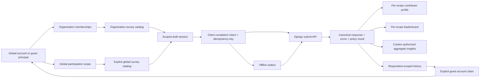

# Feedora Multi-Organization Survey Lifecycle

## Goal

Feedora must support people who have a global app identity and independent memberships in many organizations. Every response, draft, score, reward, leaderboard row, and creator resource must have an explicit owner and organization/survey scope. Guest participation must be attributable to the guest's current session and merge into an account only after an explicit account claim. Pausing must preserve progress. The UI must distinguish respondent data from creator-only research data.

This document is the product contract and implementation map for the Feedora Expo showcase and its Gihini Research Django API. The form-builder engine remains organization-agnostic; Feedora owns organization, account, reward, and research policy through application ports and API adapters.

The detailed reward ledger, redemption, cross-app event, consent, and organization billing schema proposal is documented in [Feedora Rewards and Cross-App Sharing Schema](2026-10-19-feedora-rewards-and-cross-app-schema.md). That proposal has not yet been applied as database migrations.

## User requirements

1. Organizations/entities are independent from users and surveys, keep their own history, and do not inherit a creator's personal account identity.
2. A user can belong to multiple organizations and also participate globally. Membership and contribution history are scoped; switching organization never carries points, surveys, or responses into another scope.
3. Guest participation counts in the selected organization. Before leaving the completion flow, offer account creation so a guest can claim progress and points.
4. Survey and quiz sessions expose progress, points/rewards, and only relevant timers. Paused sessions persist and resume.
5. Organization selection is shared across Survey/Home and Community: a compact dropdown below six choices; searchable selection at six or more. Show each organization once.
6. Insights and Community share reusable leaderboard/standing primitives while retaining role-appropriate data and presentation.
7. Completion records, score calculation, leaderboard updates, and server sync are idempotent and policy-driven. Redo rules come from the survey policy.
8. Transport tolerates offline use, retries safely, reports sync state, and reconciles server-authoritative results without double-awarding.
9. Creator-only analysis and respondent-safe personal progress are separated. Remove demo constants from live analysis and hide data the current role cannot access.
10. Gamification/experiment treatment, timers, variable rewards, and other reinforcement are explicit survey policy. Avoid silently applying manipulative or research-invalid behavior.
11. Check Gihini Research changes as well as app-local changes before changing API or schema contracts.

## Current implementation map and gaps

## PythonAnywhere compatibility

The Expo client uses ordinary HTTPS JSON requests and Django session cookies, so a PythonAnywhere-hosted API can serve Expo Go and native builds. Set `EXPO_PUBLIC_API_BASE_URL` to the deployed `https://<account>.pythonanywhere.com` origin before starting Metro or building the app. The app's local Expo Go fallback is for LAN development only. A separately hosted Expo web build also needs CORS configured for its exact origin.

The Django project is WSGI-based and can run through a PythonAnywhere Web app using its WSGI configuration. Django 6 requires Python 3.12 or newer; PythonAnywhere's current guidance includes Python 3.13 virtual environments. Configure the Web app and virtualenv with the same Python version, apply migrations, configure static-file collection/mapping for the Django admin, and reload the web app after deploy. The API is not deployed by running `manage.py runserver` on PythonAnywhere.

Production settings now require `DJANGO_SECRET_KEY` and `DJANGO_ALLOWED_HOSTS` when `DJANGO_DEBUG=False`, accept `DJANGO_CSRF_TRUSTED_ORIGINS`, trust PythonAnywhere's forwarded HTTPS scheme, and mark session/CSRF cookies secure outside debug mode. The project still uses SQLite by default. PythonAnywhere supports it, but its documentation recommends a server database for production workloads; select and configure MySQL/PostgreSQL before relying on this for sustained or concurrent research traffic. No PythonAnywhere domain, account, database, or deployment credentials were available in this workspace, so the hosted endpoint cannot be verified from here.

| Capability | Current location | Observed state / gap |
|---|---|---|
| Expo composition and shared state | `src/feedora.tsx` | Adapters are separated. The selected entity is independent of the user's organization field and persists per signed-in user/guest key. Respondent profiles are no longer created when an organization is selected; they appear after contribution activity. |
| Authentication / identity | `domain/ports/IAuthPort.ts`, `CompositeAuthAdapter`, provider adapters, `FeedoraContext` | Auth sign-in/register/sign-out/session-restore calls now pass through normalized Feedora context actions; UI screens no longer import the composite provider adapter. The boundary is still partial: `AuthMode` is exposed to presentation and switchable at runtime, `CompositeAuthAdapter` reaches into concrete adapter state with casts, and `IAuthPort` includes data export and persona-specific registration. Further changes should separate identity, account profile, data export, and organization authorization, then select one canonical provider for cross-app identity. |
| Organizations | `domain/types.ts`, seed, `IEntityStore`, Django `/entities/` | Canonical ID normalization/deduplication and one shared Survey/Community picker are in place. Community renders the organization once. Django stores membership separately and exposes `/entities/mine/`. Catalog choices are still all public entities, so explicit member discovery and access gating need follow-up. |
| Contribution profiles | `IContributionPort`, `FeedoraContributionAdapter`, `OrganizationStandingCard` | Profiles key by `(userId, entityId)`. Live leaderboard and signed-in standing values come from Django's scoped leaderboard endpoint. Bundled respondent names, points, and response rows were removed from client fixtures. Guest identity is a stable per-install principal; server-side guest response claiming and idempotent points receipts remain to be implemented. `formId` is still not used for idempotency. |
| Response analytics | `IEntityStore.addResponse/listResponses`, SQLite `hmsam_response` | Response matrices have no organization, survey, respondent, or response ID. Insights can mix organizations and users. |
| Completion and rewards | `src/app/index.tsx` | Local points/profile/history are still written before remote confirmation. Failed submissions are queued, so the later server result can diverge or award again. Server receipt reconciliation and stable submission IDs remain required before points can be authoritative. |
| Completion/repeat state | `BatteryEngine`, `SurveyCatalogModal`, `index.tsx` | Catalog and active survey screen evaluate attempt limits, cooldowns, explicit prerequisites, and configured sequence order against scoped completion history. Django now exposes these fields from `Survey.features` and rejects repeat/cooldown/prerequisite/sequence violations for authenticated submissions. Guest enforcement remains device-local until Django stores a stable guest principal. |
| Policy authoring and unsupported gates | Studio and API | The upstream engine defines access policies and battery prerequisites, and the current upstream `main` matches the checked-out commit. Feedora Studio still has no controls to author these fields; they currently need to be present in `Survey.features`. Score thresholds cannot be evaluated reliably because responses do not persist a score percentage. Access-code policy is a client catalog prompt, not a secure server gate yet. |
| Drafts/resume | `ScopedDraftStorage`, engine manager | Respondent drafts now auto-save and restore through the engine using the app's durable store. Keys include principal, organization, and survey; guest drafts migrate to the signed-in principal on first restore. Schema revision is inside the engine snapshot. Persisting a stable server-assigned experiment arm into each draft still needs explicit integration. A restored draft is identified in the survey screen. |
| Survey/quiz progress | `MultiStepFormManager` integration in `index.tsx` | Live step progress exists. No persisted session recovery is wired. Timer UX depends on engine schema and must only appear when a survey explicitly declares one. |
| Insights | `src/app/dashboard.tsx`, Django analysis/export API | Respondents see a shared selected-organization standing card only after activity. Arm comparisons and reliability analysis render only for creators and use server analysis; empty research arms are omitted. Django analysis and export endpoints require an authenticated creator/staff user who owns the survey. |
| Community | `src/app/community.tsx` | Uses the same organization standing card as Insights and loads organization leaderboard rows from Django. It shows loading, empty, and server-unavailable states without seeded contributor fallback. |
| Creator-owned content | `DjangoStudioAdapter`, `src/app/studio.tsx` | Existing creator listing and publishing endpoints are present. Verify that creator-only analysis and respondent history remain distinct in API and UI. |
| Offline transport | `FeedoraHttpTransportAdapter`, outbox, `src/config.ts` | Expo Go derives the Django host from Metro's host address when available; `EXPO_PUBLIC_API_BASE_URL` overrides it. The banner reports research-server reachability, not device-wide internet status. Outbox payload/receipt reconciliation still needs idempotency key and stable participant/session identity on Django. |
| Research backend | Gihini `api_views.py`, `api_urls.py` | Upstream was fetched and has no commits ahead of the current branch. The branch remains one commit ahead of `origin/feat/phase-1-backend-hardening`; preserve its uncommitted membership model/migration and API edits. The local diff includes organization-scoped leaderboard and entity-aware survey routes. |

## Invariants

- **Identity:** `User` is global. A user may have zero or more `OrganizationMembership` rows. Membership role/status belongs to the membership, not the global user or organization record.
- **Authentication:** domain and UI depend on application-owned identity types and use cases, never Supabase/Django SDK types, cookies, provider-specific session formats, or provider selection. A deployment selects one identity adapter at the composition root; local/guest identity is a separate development/guest adapter, not another visible production login provider.
- **Identity mapping:** the canonical principal is `(issuer, subject)` for federated identities, or a stable application user ID for a first-party provider. Email is profile/contact data, not a cross-provider identity key. Linking providers requires an authenticated, explicit account-link operation.
- **Authorization:** authentication establishes who the principal is. Organization membership, creator permissions, survey eligibility, and reward scope are checked by application/API policy ports; an auth provider role or UI selection never grants organization access by itself.
- **Organization ownership:** an organization has its own stable ID, creator/owner membership, settings, and audit history. Surveys explicitly target one organization or an explicitly declared global audience.
- **Scope tuple:** every contribution and personal progress record is keyed by `(principalId, scopeId, surveyId)`; scope is an organization ID or a named global scope. Never infer scope from a display name/company string.
- **Response source of truth:** the server owns accepted response IDs, eligibility, completion policy, authoritative points, and leaderboard totals. The client may show pending progress but must reconcile by response ID/idempotency key.
- **Privacy:** respondent views expose that respondent's own progress and public leaderboard fields. Raw responses, item-level analysis, arm comparisons, and research statistics are creator/authorized researcher-only.
- **Guest claiming:** guest state uses a stable per-install or per-session guest principal, never a process-wide constant shared by every guest. Claiming is an explicit, idempotent server operation with conflict handling and an audit record.
- **Repeat policy:** `allow`, `deny`, `cooldown`, or `limited` comes from the active survey access policy. The same policy drives UI affordance and server enforcement.
- **Resume:** drafts are keyed by principal + organization/global scope + survey + schema revision. They record answers, current step, experiment assignment, and timestamps. Resume does not count as completion or award points.
- **No duplicate organizations:** canonical IDs are unique at the API boundary and deduplicated before rendering; organization names are labels, not identifiers.
- **No render feedback loop:** effects subscribe/unsubscribe symmetrically, callbacks are stable, and effects that update state do not depend on the state they update without a convergence condition.

## Data flow

## Port/API contract direction

Keep engine-facing form APIs unchanged where possible. Extend Feedora-owned ports around stable domain records:

- `IIdentityProviderPort`: restore session, authenticate, register identity, sign out, reset credentials, start OAuth, and emit normalized identity/session events. Concrete adapters own Supabase OAuth/JWT or Django session/cookie handling.
- `IAccountProfilePort`: create/read/update the Feedora account profile and persona. A global identity can have a respondent profile and researcher capabilities without encoding organization membership into the authentication record.
- `ICredentialProviderPort`: provide/refresh credentials to an HTTP adapter without exposing tokens to screens or survey domain logic. The transport adapter attaches credentials to requests; the backend still verifies them.
- `IOrganizationAccessPort`: resolve membership and permissions for an organization. This stays distinct from sign-in and account roles.
- `IUserDataExportPort`: export Feedora user data. Data export belongs to the application/data boundary, not the identity provider port.

- `IOrganizationPort`: list/select organizations and memberships; join/leave; return canonical organization IDs and membership roles.
- `IContributionPort`: read profile by `(principalId, scopeId)`, apply a canonical response receipt idempotently, and read leaderboard for exactly one scope.
- `IEntityStore`: persist scoped response receipts, drafts, and offline intents; query them by principal and scope. Migrate SQLite additively and keep old local rows readable without attributing them to another organization.
- `ITransportPort`: submit `submissionId`, `surveyId`, `scopeId`, schema revision, stable participant/guest token, consent, experiment arm, answers, and client timing; return canonical response ID, accepted status, awarded points, completion policy, and sync receipt.
- Django endpoints: canonical organization and membership listing/join; survey list filtered by a real organization FK or explicit global flag; submit transaction enforces dedupe and repeat policy; history and leaderboard aggregate only responses attached to that scope; creator analysis checks creator authorization.

Every write must use an idempotency key. Network retries must replay the same key. The app must not locally add authoritative points before a receipt; it may display a pending estimate separately.

### Authentication composition and provider changes

The application core should depend on `IIdentityProviderPort` and normalized domain values such as `PrincipalId`, `IdentitySession`, and `IdentityResult`. The UI calls use cases through a context/hook and renders normalized state; it does not import `SupabaseAuthAdapter`, `DjangoAuthAdapter`, or a provider SDK. The composition root selects the adapter from deployment configuration. Production sign-in should not silently switch between Django and Supabase accounts, since those are distinct identity stores unless explicitly linked.

If Supabase becomes the shared identity provider, Django should validate Supabase-issued access tokens at its API boundary and map the verified issuer/subject to its local application user. If Django remains the identity provider, the main app must use Django-backed identity or an explicit account-linking protocol. Do not join users by email alone. In either case, organization roles and reward permissions remain Feedora-owned authorization decisions.

Provider-specific OAuth/session details stay in adapters. Passwords and provider secrets never enter domain models or persistent app state; access/refresh tokens are stored only by the selected provider's secure session mechanism. Guest identity has a separate port and explicit claim flow, and cannot be promoted by merely changing `AuthMode`.

## Capability and surface matrix

| Capability | Survey/Home | Community | Insights | Studio/API | Local storage |
|---|---|---|---|---|---|
| Current scope picker | shared selector | shared selector | filter/label current scope | organization context | persisted selection per user |
| Memberships | join prompt | membership list/manage | no implied membership | owner/member permissions | membership cache |
| Respondent history/progress | completed/resume states | personal standing | own-safe summary only | inaccessible to unrelated creators | scoped records |
| Creator surveys | only eligible respondent catalog | optional organization summary | creator-only analysis entry | owned/authorized survey list | cached metadata |
| Rewards/quiz progress | progress, points, explicit timer | badges and leaderboard | aggregate results only | policy controls | draft and receipts |
| Offline | save/resume and pending sync | cached scoped ranking | cached authorized summary | server owns final results | durable outbox |

## Delivery plan

### Phase 0 — Establish contracts and prevent contamination (current)

Document invariants, preserve working-tree changes, deduplicate organization choices at the UI boundary, stop selecting organizations from a user-owned organization field, and add an entity picker rule usable by Home and Community. Identify old local data that cannot safely be assigned a scope.

**Progress (2026-10-19):** Added `domain/entities.ts` to canonicalize Django numeric/`org-<id>` aliases and deduplicate seed/API entity lists. Auth changes no longer select the user's `organizationId`; current organization choice persists per signed-in user or install guest. Added a shared Survey/Community picker with a compact list for fewer than six choices, search at six or more, and membership labels. Survey catalog requests now filter by selected entity; removed the fabricated lock on surveys after the third and the ten-second refresh loop. Completion state now uses history for the active organization, and the form manager delegates through a current callback ref so a long-lived manager does not submit using the organization/account captured at its first render. Guest progress has a per-install identity, atomic all-organization local claim in memory/SQLite, and a completion-screen account prompt. Respondents now see scoped progress only; hard-coded local analysis/construct reference cards were removed. Research comparisons and reliability use server analysis and render only for creators, with ownership enforced by the Django analysis/export endpoints. In Gihini, added an additive `OrganizationMembership` model/migration with existing organization owners backfilled, an authenticated membership list endpoint, and a join endpoint that records membership without overwriting the user's own organization or global respondent profile. Fixed the checked-out leaderboard draft so candidates and point/completion aggregates are derived from responses inside the requested organization or global scope; respondent history now returns canonical entity IDs. The local Gihini database has the additive membership migration applied. Respondent drafts now auto-save and restore in a durable store scoped by principal, organization, and survey; guest draft lookup migrates to the account scope after sign-in. The survey completion screen offers sign-in after the first guest completion, and Insights repeats the claim nudge for guests. Local history enforces survey max attempts on this device. This does not replace server enforcement: repeat attempts, submission idempotency, stable guest attribution, and authoritative points still need Django/API work. TypeScript and prior Django system/migration-state checks pass. Expo Go verification remains unavailable because the device automation daemon cannot establish a reachable owner. The prior render/touch failure is not currently reproducible, so no render-loop root cause is claimed.

**Policy enforcement update (2026-10-19):** The Survey catalog now calls the engine's `BatteryEngine` evaluator for configured redo limits, attempt caps, cooldowns, explicit prerequisite IDs, and ordered sequences marked for enforcement. The active survey screen applies attempt and cooldown policy to direct UUID launches, and the API rejects configured limits and prerequisite/sequence violations for authenticated respondents. Django's public survey listing now exposes canonical policy fields from `Survey.features` while retaining legacy fallbacks. The upstream engine `main` has no commits ahead of this workspace. This does not yet make policies authorable in Studio; nor does it enforce guest history server-side, score thresholds (there is no persisted response score), or secure access-code gates. No test suite was run for this policy pass; the app typecheck, engine TypeScript compile, Django system check, and Python syntax compile passed.

### Phase 1 — Canonical organization membership

Add organization/membership APIs and a client port. Replace user.organizationId-as-current-scope. Make all entity lists canonical and deduplicated. Update Django serializers and migrations additively; existing organizations and creator ownership remain intact.

### Phase 2 — Scoped response lifecycle and idempotent scoring

Add a response/session identity, scoped analytics storage, draft/resume records, server authoritative repeat rules, idempotent rewards, guest claim endpoint, and retry reconciliation. Ensure leaderboard totals derive from responses within the selected survey organization/global scope only.

### Phase 3 — Shared discovery, progress, and role-aware insights

Use one threshold-based organization selector in Survey and Community. Extract shared contributor standing and leaderboard UI. Keep respondent progress and creator analysis separate. Replace hard-coded analysis with server-provided metadata and role checks.

### Phase 4 — Research-aligned experiment and reward policies

Render progress and optional timers from survey metadata. Show fixed/variable rewards only as declared by the server. Preserve experiment assignment across pause/resume and retries. Treat negative reinforcement as disabled unless an explicit, consented study policy enables it; provide clear opt-out and avoid punitive loss mechanics by default.

### Phase 5 — Resilience and native Expo Go verification

Exercise restart/hydration, offline queue replay, rapid navigation, touch behavior, duplicate submission, switching organizations, guest claim, and app background/foreground in Expo Go. Instrument bounded render counts and state transitions to detect a dormant render loop before the UI locks.

## Failure review

1. **Cross-scope leaderboard leakage:** summing all responses for a user after filtering a profile by organization leaks global totals. Scope the aggregate query before computing points and completion counts.
2. **Duplicate reward after retry:** local award + queued retry + server award produces drift. Only the server receipt (or an idempotent local receipt replay) can finalize points.
3. **Stale guest identity:** a shared guest ID merges unrelated visitors. Generate and persist a per-install guest identity; claim it once and reject ambiguous merges.
4. **Hydration/render loop:** auth bootstrap can emit cached and remote state more than once; effects must converge and async work must be cancellable. Add instrumentation and validate on Expo Go after each state-flow milestone.
5. **Schema migration data ambiguity:** existing global HMSAM matrix rows cannot be reliably attributed to a user or organization. Keep them in an explicitly legacy/unscoped analysis bucket; do not silently assign them to the active entity.
6. **Research validity:** changing reward/timer policy mid-study alters treatment. Server-assigned experiment variant and policy version must remain fixed for a participant/session and be recorded with the response.

## Gihini Research working-tree note (2026-10-19)

The checked-out Gihini repository is on `feat/phase-1-backend-hardening`, one commit ahead of its matching origin tracking branch. `feedora_project/api_urls.py` and `feedora_project/api_views.py` already had uncommitted local edits when this work began; preserve those edits. The local additions include global/entity leaderboard routes and organization-aware survey listing. This work corrected the leaderboard aggregate scoping and added the many-to-many membership model and API while preserving the existing owner-to-organization relation. The repository contains an existing idempotency/hardening test module and should be used as the backend source of truth when changes are authorized there.
