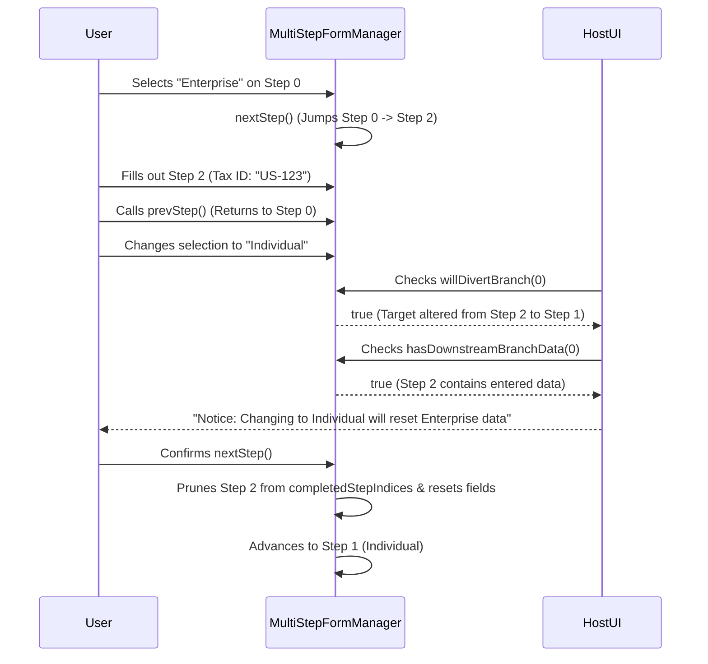

# Conditional Branching & Dynamic Visibility Engine

This document details the architecture, evaluation model, and state lifecycle for field-level reactive visibility and page-level dynamic jump routing in `@intuitui-labs/form-builder-engine`.

---

## 1. Architectural Principles

1. **Zero-Dependency Runtime (0 kB)**:
   The rule evaluation engine ([`ConditionEvaluator.ts`](../../src/core/ConditionEvaluator.ts)) is pure TypeScript with zero external parser or runtime dependencies, ensuring peak performance on React Native Hermes and web SSR.
2. **Deterministic Evaluation**:
   Conditions evaluate synchronously against the live form value state.
3. **Safe Type Coercion**:
   Operators gracefully handle cross-type comparisons common in mobile inputs (e.g., numeric string `'25'` vs number `25`, boolean `'true'` vs `true`).
4. **Stale State Protection (Pruning)**:
   Hidden fields automatically bypass validation rules and have their values pruned upon form submission when `clearValueOnHide: true` (the default). Draft inputs remain preserved in memory during live form interaction so toggling back immediately restores typed data.
5. **Non-Linear Navigation Rewinding**:
   Dynamic jumps (e.g. Page 0 &rarr; Page 2) push each transition onto an internal `stepHistory` stack, ensuring `prevStep()` unwinds exactly along the user's traversal sequence.
6. **Branch Lineage & Diversion Protection**:
   Branching decision nodes track which downstream steps were visited. If a user revisits a branching step and changes their decision, `willDivertBranch()` alerts the host application UI, and advancing down the new branch cleans only obsolete branch data while leaving shared ancestor and normal steps intact.

---

## 2. Domain Model & Schema Specification

All types are exported from `@intuitui-labs/form-builder-engine/schema`:

```typescript
export type ComparisonOperator =
  | 'equals'
  | 'notEquals'
  | 'contains'
  | 'greaterThan'
  | 'lessThan'
  | 'in'
  | 'notIn'
  | 'isEmpty'
  | 'isNotEmpty';

export interface ConditionPredicate {
  field: string;
  operator: ComparisonOperator;
  value?: unknown;
}

export interface CompoundCondition {
  logical: 'AND' | 'OR';
  predicates: (ConditionPredicate | CompoundCondition)[];
}

export type Condition = ConditionPredicate | CompoundCondition;
```

### Field-Level Visibility (`visibleIf`)

Add `visibleIf` to any field definition in `FormSchema` or `HydratedFieldDefinition`:

```json
{
  "name": "referralCode",
  "type": "text",
  "label": "Referral Code",
  "required": true,
  "visibleIf": {
    "field": "hasReferral",
    "operator": "equals",
    "value": "yes"
  },
  "clearValueOnHide": true
}
```

* When `hasReferral !== 'yes'`:
  - `formManager.isFieldVisible('referralCode')` returns `false`.
  - Validation rules for `referralCode` are automatically bypassed.
  - Existing validation errors for `referralCode` are cleared.
  - On `submit()`, `referralCode` is pruned from the submitted payload.

### Page-Level Dynamic Branching (`jumpRules`)

Add `jumpRules` to any `FormPage`:

```json
{
  "id": "step-account-type",
  "title": "Account Type",
  "fields": [
    {
      "name": "accountType",
      "type": "select",
      "label": "Select Account Type",
      "required": true
    }
  ],
  "jumpRules": [
    {
      "condition": { "field": "accountType", "operator": "equals", "value": "enterprise" },
      "targetPageId": "step-enterprise-details"
    },
    {
      "condition": { "field": "accountType", "operator": "equals", "value": "individual" },
      "targetPageId": "step-individual-details"
    }
  ],
  "defaultNextPageId": "step-common-details"
}
```

---

## 3. Evaluation Semantics

| Operator | Target Type | Semantics & Coercion Rules |
| :--- | :--- | :--- |
| **`equals`** | any | Loose numeric/boolean coercion (`'42'` equals `42`, `'true'` equals `true`). |
| **`notEquals`** | any | Negation of `equals`. |
| **`contains`** | string \| array | For strings: case-insensitive substring search. For arrays: element equality. |
| **`greaterThan`** | number | Numeric comparison with `Number(val)`. Returns false if `NaN`. |
| **`lessThan`** | number | Numeric comparison with `Number(val)`. Returns false if `NaN`. |
| **`in`** | array \| string | Array element membership or target substring containment. |
| **`notIn`** | array \| string | Negation of `in`. |
| **`isEmpty`** | any | Checks for `null`, `undefined`, whitespace-only strings `""`, `[]`, and `{}`. |
| **`isNotEmpty`** | any | Negation of `isEmpty`. |

---

## 4. Branch Diversion & Downstream Invalidation Lifecycle



Host applications can inspect `getAffordanceState().navigation` at any time:
```typescript
const { navigation } = manager.getAffordanceState();

if (navigation.isBranchingStep && navigation.willDivertBranch && navigation.hasDownstreamBranchData) {
  // Show confirmation modal before calling manager.nextStep()
}
```
