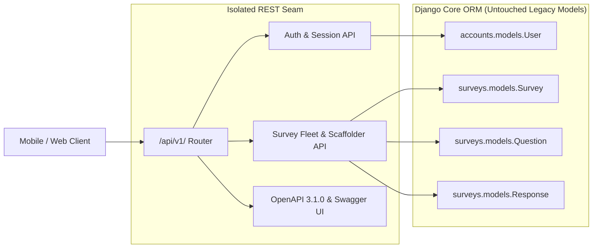

# Django REST Seam & OpenAPI Gateway Specification

> **Architectural Objective**: Establish a stable, versioned HTTP contract connecting the Django Research backend with modern headless mobile and web clients without altering Gihini's existing server-rendered HTML views or templates.

---

## 1. The Architectural Seam Strategy

Rather than refactoring Gihini's pre-existing Django controllers (`surveys/views.py`, `accounts/views.py`), which would risk breaking her server-rendered HTML templates (`home.html`, `survey_builder.html`, `dashboard.html`), all modern headless capabilities live within an isolated **REST Seam**:

- **Views Module**: `feedora_project/api_views.py`
- **Routing Module**: `feedora_project/api_urls.py`
- **Root Inclusion**: Bound under `/api/v1/` prefix in `feedora_project/urls.py`
- **Documentation**: Embedded OpenAPI 3.1.0 specification (`/api/v1/openapi.json`) and standalone Swagger UI (`/api/v1/docs/`)



---

## 2. Comprehensive Endpoint Catalog

### 2.1 Authentication & Persona Endpoints

#### `POST /api/v1/auth/login/`
Authenticates a user against Django's authentication system. Supports dual username or email resolution and includes a superuser role bypass.

- **Request Body (`application/json`)**:
  ```json
  {
    "identity": "Gihiniw",
    "password": "feedora123",
    "persona": "creator"
  }
  ```
- **Resolution Pipeline**:
  1. Attempts authentication with `identity` as `username`.
  2. If unsuccessful, performs case-insensitive lookup (`email__iexact=identity`) and retries.
  3. **Superuser Bypass Guard**: Users with `is_staff=True` or `is_superuser=True` (whose database `role` column may be `None` or empty) are automatically granted permission when logging into the `creator` persona.
- **Success Response (`200 OK`)**:
  ```json
  {
    "ok": true,
    "user": {
      "id": 1,
      "username": "Gihiniw",
      "email": "gihini.waidyalankara@aiesec.net",
      "persona": "creator",
      "role": "creator",
      "isStaff": true,
      "isSuperuser": true,
      "displayName": "Gihini Waidyalankara",
      "organization": {
        "id": "1",
        "name": "University of Moratuwa",
        "type": "university",
        "userRole": "Lead Investigator",
        "country": "Sri Lanka"
      }
    }
  }
  ```
- **Error Responses**:
  - `400 Bad Request`: Missing identity or password.
  - `401 Unauthorized`: Invalid credentials.
  - `403 Forbidden`: Account role does not possess permissions for requested persona.

#### `GET /api/v1/auth/me/`
Returns the currently authenticated session user profile or unauthenticated state.

- **Success Response (`200 OK`)**:
  ```json
  {
    "ok": true,
    "authenticated": true,
    "user": { ... }
  }
  ```

#### `POST /api/v1/auth/logout/`
Terminates the active Django session.

---

### 2.2 Survey Fleet & Creator Studio Endpoints

#### `GET /api/v1/surveys/`
Lists public active surveys available for respondent participation.

- **Success Response (`200 OK`)**:
  ```json
  {
    "ok": true,
    "surveys": [
      {
        "id": 1,
        "uuid": "ba8ca44c-dc28-481d-9730-4e12c4e281e0",
        "accessCode": "HED001",
        "title": "First Hedonic System Adoption Survey",
        "description": "Investigating user engagement and immersion.",
        "isHmsam": true,
        "questionsCount": 38
      }
    ]
  }
  ```

#### `GET /api/v1/surveys/mine/`
Lists surveys owned by the authenticated creator (or all surveys across all organizations if the user is a superuser/staff administrator).

- **Permission**: Requires active authentication and `role='creator'` or `is_staff=True`.
- **Success Response (`200 OK`)**:
  ```json
  {
    "ok": true,
    "surveys": [
      {
        "id": 1,
        "uuid": "ba8ca44c-dc28-481d-9730-4e12c4e281e0",
        "accessCode": "HED001",
        "title": "First Hedonic System Adoption Survey",
        "description": "Investigating user engagement and immersion.",
        "isHmsam": true,
        "isActive": true,
        "isDraft": false,
        "questionsCount": 38,
        "responsesCount": 14,
        "createdAt": "2026-10-15T14:32:00Z"
      }
    ]
  }
  ```

#### `POST /api/v1/surveys/create/`
Scaffolds and publishes or drafts a survey along with all associated `Question` and `MCQOption` database records within an atomic database transaction.

- **Permission**: Requires creator or staff authentication.
- **Request Body (`application/json`)**:
  ```json
  {
    "title": "Hedonic Motivation System Evaluation",
    "description": "Evaluating joy and perceived ease of use.",
    "is_hmsam": true,
    "is_draft": false,
    "questions": [
      {
        "text": "Using this system is enjoyable.",
        "code": "JOY1",
        "type": "likert",
        "construct": "joy",
        "required": true,
        "ratingMax": 5
      },
      {
        "text": "Which device do you use most frequently?",
        "code": "DEV1",
        "type": "mcq",
        "required": true,
        "options": ["iPhone / iPad", "Android Phone", "Laptop", "Desktop"]
      }
    ]
  }
  ```
- **Success Response (`201 Created`)**:
  ```json
  {
    "ok": true,
    "uuid": "7a3b4c5d-6e7f-8a9b-0c1d-2e3f4a5b6c7d",
    "accessCode": "M7K2P9",
    "surveyId": 22,
    "questionsCount": 2
  }
  ```

---

### 2.3 Respondent Participation Endpoints

#### `GET /api/v1/surveys/{uuid}/meta/`
Returns survey metadata, theming attributes, and ordered questions with choice options for mobile rendering.

- **Success Response (`200 OK`)**:
  ```json
  {
    "ok": true,
    "survey": {
      "id": 22,
      "uuid": "7a3b4c5d-6e7f-8a9b-0c1d-2e3f4a5b6c7d",
      "title": "Hedonic Motivation System Evaluation",
      "description": "Evaluating joy and perceived ease of use.",
      "isHmsam": true,
      "accessCode": "M7K2P9"
    },
    "features": {
      "points": { "enabled": true, "values": { "likert": 15, "mcq": 10 } }
    },
    "questions": [
      {
        "id": 101,
        "text": "Using this system is enjoyable.",
        "code": "JOY1",
        "type": "likert",
        "construct": "joy",
        "required": true,
        "ratingMax": 5,
        "options": []
      }
    ]
  }
  ```

#### `POST /api/v1/surveys/{uuid}/submit/`
Submits respondent answers via JSON, records answers, and calculates earned Voice Points.

- **Request Body (`application/json`)**:
  ```json
  {
    "answers": {
      "101": 5,
      "102": "iPhone / iPad"
    }
  }
  ```
- **Points Pipeline**:
  1. Inspects survey `features.points` configuration (or falls back to default scoring table).
  2. Awards base points per question type (e.g. Likert $= 10$, MCQ $= 10$, detailed text $> 20$ chars $= 20$).
  3. If user is authenticated, increments `RespondentProfile.total_points` and increments `surveys_completed`.
- **Success Response (`200 OK`)**:
  ```json
  {
    "ok": true,
    "responseId": 84,
    "pointsEarned": 25,
    "surveyUuid": "7a3b4c5d-6e7f-8a9b-0c1d-2e3f4a5b6c7d"
  }
  ```

---

## 3. OpenAPI 3.1.0 & Swagger UI Exploration

- **Dynamic Spec**: `GET /api/v1/openapi.json` returns machine-readable JSON OpenAPI 3.1.0 document declaring all paths, request bodies, and parameter models.
- **Interactive UI**: `GET /api/v1/docs/` serves a standalone, zero-dependency Swagger UI bundle styled to match Gihini's warm paper aesthetic (`#fafaf7`).

---

## 4. Future Scaling Traps & Roadmap

| Architectural Risk | Manifestation | Mitigation Strategy |
| :--- | :--- | :--- |
| **CSRF in Native Environments** | Mobile apps do not receive or echo CSRF cookies consistently across OS versions. | Mark REST endpoints `@csrf_exempt` and authenticate via Bearer API keys / JWT in Authorization headers. |
| **Unbounded Survey Responses** | `surveys.responses.count()` becomes slow as response volume exceeds $10^5$ rows. | Add denormalized counter column `total_responses` on `Survey` model updated via Django signals or Celery task. |
| **Submission Flooding** | Adversarial users or scripts repeatedly submit automated answers to inflate Voice Points. | Introduce IP and user-rate limiting (`django-ratelimit`) enforcing maximum 3 submissions per minute per IP. |
