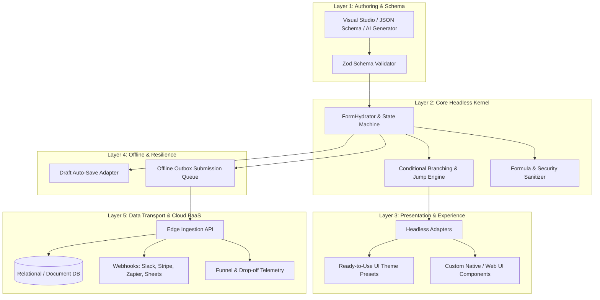
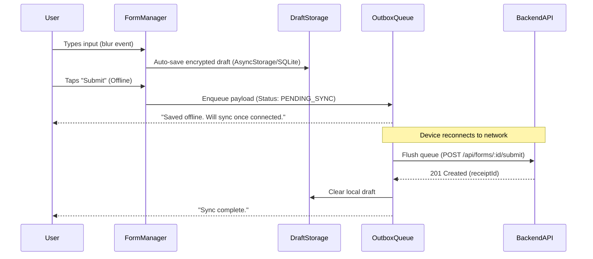

# Enterprise Form Platform Architecture & Evolution Roadmap

## 1. Executive Summary & Problem Space

In the era of AI coding agents, simple in-memory form validation libraries are rapidly commoditized. An AI agent can generate 50 lines of static Zod and form state hooks in seconds.

To deliver real, defensible enterprise value—comparable to modern form platforms such as **Typeform, Jotform, Formbricks, and Tally**—this package (`@intuitui-labs/form-builder-engine`) must transcend basic field evaluation and evolve into a **complete, headless-first Form Operating System**:



---

## 2. Pillar I: Conditional Branching & Jump Logic

### The Limitation Today
`MultiStepFormManager.ts` currently advances linearly (`currentPageIndex++`). It lacks condition evaluation, step jumping, and dynamic visibility rules.

### Target Architecture

#### 1. Schema Definitions (`src/schema/FormBranching.ts`)
```typescript
export type ComparisonOperator =
  | 'equals'
  | 'notEquals'
  | 'contains'
  | 'greaterThan'
  | 'lessThan'
  | 'in'
  | 'notIn'
  | 'isEmpty'
  | 'isNotEmpty';

export interface ConditionPredicate {
  field: string;
  operator: ComparisonOperator;
  value?: unknown;
}

export interface CompoundCondition {
  logical: 'AND' | 'OR';
  predicates: (ConditionPredicate | CompoundCondition)[];
}

export type Condition = ConditionPredicate | CompoundCondition;

/** Field-level dynamic visibility */
export interface FieldVisibilityRule {
  visibleIf: Condition;
  clearValueOnHide?: boolean; // Defaults to true to avoid stale hidden data
}

/** Page-level jump logic */
export interface PageJumpRule {
  condition: Condition;
  targetPageId: string; // ID of the next page to transition to
}

export interface BranchingFormPage extends FormPage {
  jumpRules?: PageJumpRule[];
  defaultNextPageId?: string;
}
```

#### 2. The Evaluator (`src/core/ConditionEvaluator.ts`)
* Pure, deterministic rule evaluation against the current form value state.
* Supports nested `AND` / `OR` expressions.
* Handles type coercion safely (e.g. numeric comparisons, array inclusion).
* **Stale State Pruning**: Automatically clears registered values when a field or page is dynamically hidden, preventing invalid or phantom submissions.

---

## 3. Pillar II: Drop-in UI Presets & Theming

### The Problem
If native mobile developers must write every `<TextInput>`, `<Switch>`, error banner, and step indicator from scratch, developer friction is too high.

### Target Architecture
Introduce a headless-aware UI companion module (`@intuitui-labs/form-builder-engine/ui` or `@intuitui-labs/form-builder-ui`):

```typescript
import { FormRenderer } from '@intuitui-labs/form-builder-engine/ui';

<FormRenderer
  schema={onboardingSchema}
  theme="modern-dark" // 'minimal' | 'material' | 'modern-dark'
  onSubmit={handleSubmit}
  onStepChange={trackStepAnalytics}
/>
```

### The Three Official Built-in Presets:
1. **`minimal`**: Clean borders, typography-focused, light/dark responsive, zero external UI library dependencies.
2. **`material`**: Floating label inputs, elevation shadows, ripple feedback, standardized button states.
3. **`modern-dark`**: Glassmorphism cards, glowing focus rings, dark-mode default, high-contrast accessible states.

---

## 4. Pillar III: Offline-First Persistence & Outbox Queue

### The Reality on Mobile
Network drops occur in subways, elevators, flights, and remote areas. Submissions must never be lost.



### Key Components:
1. **`FormDraftManager`**: Debounced draft auto-save on field blur. On application restart, detects and restores incomplete sessions.
2. **`OfflineOutboxQueue`**: Persistent FIFO queue using durable storage (`AsyncStorage`, `IndexedDB`, or `SQLite`).
3. **`NetworkReconnectionWorker`**: Background listener responding to NetInfo events to flush pending records with exponential backoff and idempotency keys.

---

## 5. Pillar IV: Full-Stack Ingestion & Data Transport (BaaS)

### Bridging Client to Cloud
To compete with Jotform / Typeform, the client engine must offer pre-built transport adapters to cloud backends:

```typescript
import { createSupabaseTransport } from '@intuitui-labs/form-builder-engine/transports';

const transport = createSupabaseTransport({
  url: process.env.SUPABASE_URL,
  anonKey: process.env.SUPABASE_ANON_KEY,
  table: 'form_submissions'
});

const manager = new FormManager(schema, { transport });
```

### Supported Transport Pipelines:
1. **Generic HTTP REST / GraphQL**: Configurable headers, authorization bearers, and schema endpoint mappings.
2. **Supabase / Postgres**: Direct row-level security (RLS) ingestion.
3. **Cloudflare Workers / Edge Gateway**: Sub-10ms global submission ingestion with Turnstile anti-bot verification and S3 file attachments.
4. **Webhook Dispatcher**: Fan-out upon submission to Slack notifications, Google Sheets, or Zapier webhooks.

---

## 6. Execution Roadmap

| Phase | Milestone | Scope & Deliverables | Status |
| :--- | :--- | :--- | :--- |
| **Phase 1** | **Branching & Jump Logic** | `ConditionEvaluator`, field `visibleIf`, page `jumpRules`, non-linear rewinding, diversion pruning. | **✅ Shipped & Verified** |
| **Phase 2** | **Offline Drafts & Outbox** | `DraftManager`, `OfflineOutboxQueue`, `IStoragePort`, `INetworkStatusPort`, 14-day TTL, reconnection flush. | **✅ Shipped & Verified** |
| **Phase 3** | **Drop-in UI & Theming** | Pre-baked visual components. Scoped out from core engine to prevent bundle bloat and design system conflicts (see [ADR 2026-10-11](../decisions/2026-10-11-headless-only-embedded-scope.md)). | **Scoped Out (Host App Design System Ownership)** |
| **Phase 4** | **BaaS Transport SDK** | Direct client-to-BaaS connectors. Scoped out in favor of clean `onSubmit` / `ITransportPort` boundary matching authenticated enterprise API gateways (see [ADR 2026-10-11](../decisions/2026-10-11-headless-only-embedded-scope.md)). | **Scoped Out (Host App Gateway Boundary)** |
