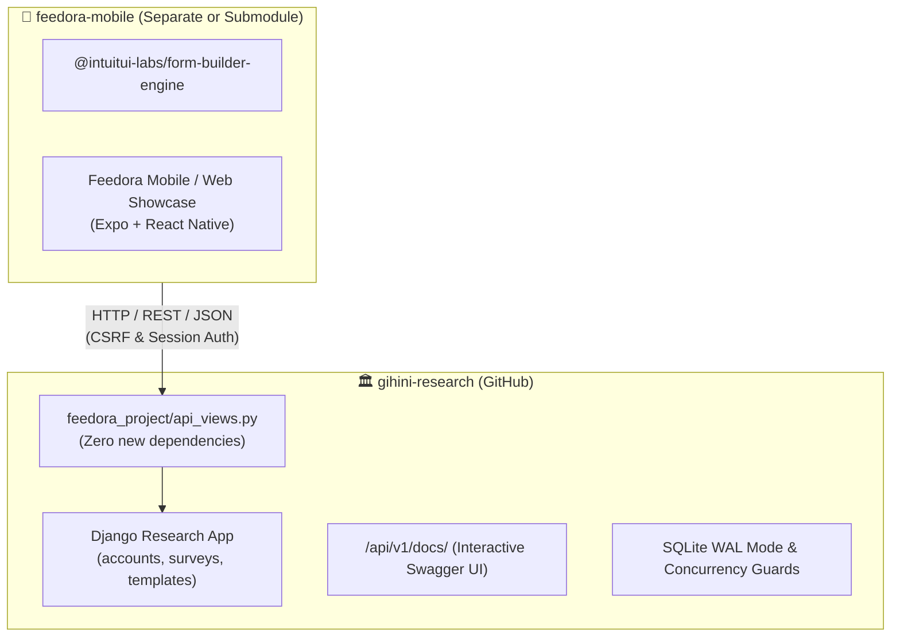

# Gihini Research Collaboration & Handover Blueprint

This document analyzes the engineering, operational, and human factors involved in delivering code enhancements to Gihini's academic research repository (`gihini-research`). It evaluates whether to merge the complete `pnpm showcase` monorepo into her codebase and proposes a respectful, sustainable 3-tiered collaboration strategy.

---

## 1. Context & Persona Analysis

### The Stakeholder: Gihini (Academic Researcher)
- **Primary Domain**: Empirical research on the Hedonic-Motivation System Adoption Model (HMSAM), user engagement, gamification, and voice survey methodology.
- **Current Stack**: Python 3.11+, Django 4+, SQLite, HTML5/CSS Django templates, vanilla JavaScript.
- **Workflow**: Traditional academic Python development: `git clone`, `python -m venv venv`, `pip install -r requirements.txt`, `python manage.py runserver`.
- **Academic Invariant**: She must be able to understand, explain, and defend every line of code in her repository during thesis defense, peer reviews, and code audits.

### The System: `@intuitui-labs/form-builder-engine` & `feedora-showcase`
- **Stack**: Modern TypeScript monorepo, `pnpm` workspaces, React Native 0.76+, Expo SDK 52, Vitest (75 test suites), Hexagonal ports & adapters, AST parsers, and build toolchains.

---

## 2. Hostile Critique: Should We Send the Full `pnpm showcase` into Her Repo?

### ⚠️ The Risk of Repository Pollution & Cognitive Overload
Dumping the entire Node.js / pnpm / Expo monorepo directly into `gihini-research` carries severe risks:

1. **Catastrophic Bloat**:
   Adding `node_modules/`, `package.json`, `pnpm-workspace.yaml`, `tsconfig.json`, `metro.config.js`, `babel.config.js`, and hundreds of TypeScript files to her clean Python repo will make it bloated and disorienting.
2. **Environment Failure & Friction**:
   If Gihini pulls the branch and does not have Node.js 20+ or `pnpm` installed on her computer, she will see build failures or terminal warnings. She may panic thinking her thesis project has been broken.
3. **Academic Defense Vulnerability**:
   In a thesis committee review, if faculty ask: *"Did you write this 50,000-line React Native AST compiler and Vitest test harness?"*, admitting that external engineers dumped it into her repo could undermine her thesis defense.
4. **Maintenance Inability**:
   She is not a React Native / TypeScript engineer. If a future Node dependency breaks or Expo deprecates an API, she will not be capable of fixing it alone.

**Verdict**: **DO NOT dump the full `pnpm showcase` monorepo directly into the root of `gihini-research`.**  
Instead, follow a clean, respectful, dual-repository or clean-seam handover architecture.

---

## 3. Recommended Handover Architecture: The 3-Tiered Strategy



### Tier 1: The Upstream PR to `gihini-research` (Zero-Friction Seam)
Send **ONLY** the clean, non-invasive Django REST backend enhancements:
1. **What to Commit & Send in the PR**:
   - `feedora_project/api_views.py` and `feedora_project/api_urls.py`.
   - `feedora_project/test_api.py` and `test_hostile_concurrency.py`.
   - `settings.py` (SQLite WAL mode + busy timeout).
   - `docs/rest-api-and-concurrency-integration.md`.
2. **Why Gihini Will Welcome This PR**:
   - **0 new dependencies**: `requirements.txt` remains standard Django.
   - **100% backward compatible**: All her existing HTML views, forms, and admin panels work identically.
   - **Solves real bugs**: The SQLite WAL mode fixes the `database is locked` error that would have ruined live respondent classroom testing.
   - **Interactive Swagger UI**: She can open `http://127.0.0.1:8000/api/v1/docs/` in her browser, click "Try it out", and immediately see how professional her backend has become.
   - **Academic Pride**: She can proudly state in her thesis: *"The backend exposes an OpenAPI-compliant REST seam for multi-platform client consumption."*

---

### Tier 2: The Mobile Showcase Options (Client Delivery)

Choose one of three delivery models based on her preference:

#### Option A: Independent Companion Repository (`feedora-mobile`) — **RECOMMENDED**
- Host `packages/form-builder-engine` and `apps/feedora-showcase` in a dedicated repository (e.g. `github.com/<org>/feedora-mobile`).
- Her Django repository links to it in its README:
  > *"For the companion cross-platform mobile and tablet application, see [Feedora Mobile](https://github.com/...)."*
- Both repositories have clean, decoupled CI/CD pipelines, issue trackers, and dependency scopes.

#### Option B: Dedicated Subdirectory with Isolated Tooling (`/clients/mobile`)
- If Gihini or her supervisors insist on a single repository:
  - Place the code strictly inside a subfolder: `clients/mobile/`.
  - Add a root `.gitignore` ensuring Python ignores `clients/mobile/node_modules/`.
  - Document that the Django backend runs independently without entering `clients/mobile`.

#### Option C: Pre-Compiled Zero-Node Static Bundle in Django
- Build the Expo showcase into a static web bundle:
  ```powershell
  pnpm --filter @intuitui-labs/feedora-showcase build:web
  ```
- Copy the output HTML, JS, and CSS files into Django's `static/feedora-app/` and serve via a Django template at `/app/`.
- **Outcome**: Gihini can run the modern React Native web app directly through Django (`python manage.py runserver`) without needing Node.js, pnpm, or TypeScript installed on her machine.

---

## 4. Step-by-Step Handover Checklist

1. [x] **Backend Hardening**: SQLite WAL mode enabled, concurrency tests passing (100% 50-thread success).
2. [x] **OpenAPI & Swagger Documentation**: Generated and verified at `/api/v1/docs/`.
3. [x] **Documentation Delivered**: `docs/rest-api-and-concurrency-integration.md` written in `gihini-research`.
4. [ ] **Git PR Preparation**:
   - Branch: `feat/rest-seam-and-concurrency`
   - PR Title: `feat: add non-breaking REST API seam, Swagger docs, and SQLite concurrency hardening`
   - Description: Highlight zero dependency additions, 100% backward compatibility, and the interactive `/api/v1/docs/` explorer.
5. [ ] **Companion App Presentation**:
   - Provide a live demo link or video showing the mobile app communicating with her Django server.
