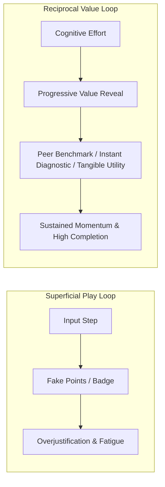
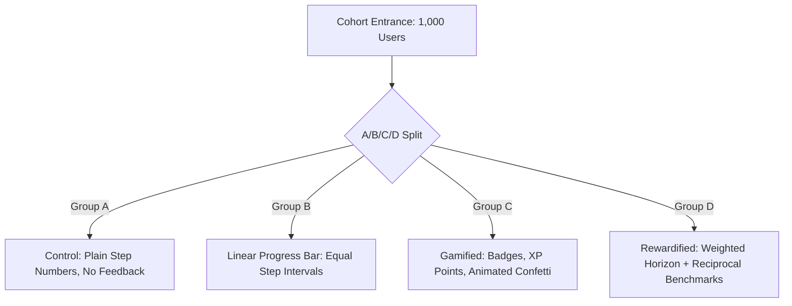

# Meaningful Progress & Rewardification Architecture

## 1. Executive Summary & Problem Space

Forms and multi-step surveys are the primary conversion bottlenecks in modern digital products. For over a decade, product teams attempted to combat survey abandonment by bolting on **Gamification**—points, badges, leaderboards (PBL), avatars, and confetti animations.

In professional, enterprise, and academic environments, conventional gamification frequently fails or backfires. Users perceive it as childish, patronizing, or manipulative. 

**Rewardification** (also termed *Reciprocal Value Exchange* and *Behavioral Reinforcement UX*) strips away game theatre. Instead, it pairs **meaningful, non-punitive progress indicators** with **immediate, utilitarian value delivery** throughout the multi-step journey.



---

## 2. 2025–2026 Behavioral Science Findings

Modern human-computer interaction (HCI) research and behavioral economics provide clear empirical principles for why and how rewardification succeeds:

### 2.1 The Death of Superficial Gamification: The Overjustification Effect
Under **Self-Determination Theory (Deci & Ryan)**, humans are motivated by *Autonomy*, *Competence*, and *Relatedness*. 
* When you attach superficial rewards (arbitrary XP or cartoon badges) to tasks requiring cognitive effort, the **Overjustification Effect (Lepper et al.)** triggers: users shift their internal motivation from intrinsic value (*"I am sharing my perspective to improve this tool"*) to extrinsic trivia (*"I am clicking buttons for meaningless badges"*). 
* Once the novelty wanes, abandonment spikes.

### 2.2 The Reciprocity Principle: "Give to Get"
Behavioral research from groups like **Irrational Labs** reveals that high-performing forms operate on an **economic value exchange**:
* Traditional forms ask for 20 fields upfront and defer all value to the "Thank You" screen.
* High-conversion flows offer **progressive value reveals**: every milestone unlocks a tangible piece of utility—a real-time peer benchmark (*"Your deployment frequency places your team in the top 18% of DevOps organizations"*), an immediate calculation (*"Estimated savings: $14,200/yr"*), or a partial diagnostic summary.

### 2.3 The Psychology of Meaningful Progress
1. **The Endowed Progress Effect (Nunes & Drèze):** Users given artificial or immediate head-starts (e.g., Step 1 pre-checked or starting at 15% upon answering an effortless opening question) complete tasks at nearly double the rate of those starting from a cold 0%.
2. **The Goal-Gradient Hypothesis (Hull / Kivetz et al.):** Human effort accelerates as the perceived distance to the goal decreases. When early stages show quick, tangible momentum, perceived friction plummets.
3. **The "Stalling Bar" Penalty:** Research shows that a progress bar moving too slowly or stalling on complex multi-field steps creates frustration and abandonment. Progress indicators must move visibly and represent **cognitive effort**, not raw step count.

---

## 3. UX Patterns: How Elite 2026 Products Execute This

| Pattern | Anti-Pattern (Gamification / Legacy) | Modern 2026 Execution (Rewardification) |
| :--- | :--- | :--- |
| **Progress Indicator** | Static `Step 2 of 10` or a bar that stalls for 5 minutes. | **Dynamic Effort-Weighted Velocity Bar** with estimated time-to-finish (`~2 min remaining`). |
| **Branching Adaptation** | Jumping backward or jumping from 80% back to 50% when branching rules trigger. | **Adaptive Horizon**: Progress measures the *current active projection path*, monotonically non-decreasing. |
| **Milestone Feedback** | Cartoon confetti popping up with a badge notification. | **Micro-Haptic / Spring Transitions**; instant inline peer insight or unlocked calculation widget. |
| **Data Collection** | Massive 30-field questionnaire upfront. | **Staged Disclosure & Contextual Reveal**: Asks only what is necessary, giving instant insight before asking for sensitive data. |

---

## 4. Hexagonal Architecture in `@intuitui-labs/form-builder-engine`

To keep `@intuitui-labs/form-builder-engine` completely headless, vendor-agnostic, and academically testable, the reward and progress systems are structured as **Secondary Outbound Ports** driven by the **Multi-Step State Machine**.

```mermaid
graph TD
    subgraph Driving Side [Primary Inbound]
        UI[Multi-Step UI Component]
        AutoSave[Auto-Save Background Worker]
    end

    subgraph Domain Core [form-builder-engine Core]
        MSM[MultiStepFormManager]
        BranchEngine[Branching & Jump Engine]
        Events[Domain Event: StepCompleted / HorizonRecalculated]
        MSM --> BranchEngine
        MSM --> Events
    end

    subgraph Driven Side [Secondary Outbound Ports]
        Events --> PP[IProgressStrategyPort]
        Events --> RP[IRewardEnginePort]
        Events --> FP[IFeedbackNotifierPort]
    end

    subgraph Concrete Adapters [Pluggable Adapters]
        PP --> PA1[WeightedFieldProgressAdapter]
        PP --> PA2[AdaptiveBranchHorizonAdapter]
        
        RP --> RA1[PeerBenchmarkInsightAdapter]
        RP --> RA2[TangibleVoucherUnlockAdapter]
        RP --> RA3[NullRewardAdapter (Control Group)]
        
        FP --> FA1[UIStateStoreNotifierAdapter]
        FP --> FA2[WebhookTelemetryAdapter]
    end

    UI --> MSM
    AutoSave --> MSM
```

---

## 5. Port Specifications & TypeScript Contracts

### 5.1 Outbound Port: `IProgressStrategyPort`
Located in `src/ports/IProgressStrategyPort.ts`:

```typescript
export interface StepProgressContext {
  formId: string;
  currentStepId: string;
  completedStepIds: string[];
  totalProjectedSteps: number;
  fieldValues: Record<string, unknown>;
  elapsedTimeMs: number;
}

export interface ProgressCalculationResult {
  /** Normalized progress percentage (0 - 100), guaranteed non-decreasing */
  percentage: number;
  /** Human-readable velocity indicator (e.g. "~2 mins remaining") */
  estimatedTimeRemainingText?: string;
  /** Total cognitive effort points completed vs remaining */
  effortCompleted: number;
  effortTotal: number;
}

export interface IProgressStrategyPort {
  calculateProgress(context: StepProgressContext): ProgressCalculationResult;
}
```

### 5.2 Outbound Port: `IRewardEnginePort`
Located in `src/ports/IRewardEnginePort.ts`:

```typescript
export interface RewardEvaluationContext {
  formId: string;
  completedStepId: string;
  stepIndex: number;
  totalSteps: number;
  stepData: Record<string, unknown>;
  allValues: Record<string, unknown>;
  progress: ProgressCalculationResult;
}

export interface RewardPayload {
  id: string;
  type: 'peer_benchmark' | 'instant_diagnostic' | 'asset_unlock' | 'voucher';
  title: string;
  description: string;
  /** Arbitrary domain payload (e.g. chart data, promo code, PDF URL) */
  data: Record<string, unknown>;
}

export interface IRewardEnginePort {
  evaluateMilestone(context: RewardEvaluationContext): Promise<RewardPayload | null>;
}
```

### 5.3 Outbound Port: `IFeedbackNotifierPort`
Located in `src/ports/IFeedbackNotifierPort.ts`:

```typescript
export interface IFeedbackNotifierPort {
  /** Delivers the reward / feedback to the presentation layer without coupling */
  notifyRewardUnlocked(reward: RewardPayload): void;
}
```

---

## 6. Concrete Reference Adapters

### 6.1 Cognitive Effort Weighted Progress Adapter
Instead of treating a 1-click boolean toggle equally with a 10-field financial breakdown, fields are scored by cognitive effort weight:

```typescript
import type { IProgressStrategyPort, StepProgressContext, ProgressCalculationResult } from '../ports/IProgressStrategyPort.js';

export class WeightedFieldProgressAdapter implements IProgressStrategyPort {
  constructor(
    private stepWeights: Record<string, number>,
    private avgSecondsPerEffortPoint: number = 8
  ) {}

  calculateProgress(ctx: StepProgressContext): ProgressCalculationResult {
    let completedPoints = 0;
    let totalPoints = 0;

    for (const [stepId, weight] of Object.entries(this.stepWeights)) {
      totalPoints += weight;
      if (ctx.completedStepIds.includes(stepId)) {
        completedPoints += weight;
      }
    }

    const percentage = Math.min(100, Math.round((completedPoints / (totalPoints || 1)) * 100));
    const remainingPoints = totalPoints - completedPoints;
    const remainingSeconds = remainingPoints * this.avgSecondsPerEffortPoint;
    const minsRemaining = Math.max(1, Math.ceil(remainingSeconds / 60));

    return {
      percentage,
      estimatedTimeRemainingText: percentage >= 100 ? 'Complete' : `~${minsRemaining} min remaining`,
      effortCompleted: completedPoints,
      effortTotal: totalPoints,
    };
  }
}
```

### 6.2 Peer Benchmark Insight Adapter (Reciprocal Value)
When the user submits high-effort or sensitive information (e.g., compensation, tech stack, company size), they immediately receive reciprocal aggregated peer benchmarks:

```typescript
import type { IRewardEnginePort, RewardEvaluationContext, RewardPayload } from '../ports/IRewardEnginePort.js';

export class PeerBenchmarkInsightAdapter implements IRewardEnginePort {
  async evaluateMilestone(ctx: RewardEvaluationContext): Promise<RewardPayload | null> {
    if (ctx.completedStepId === 'engineering_practices') {
      const deployFreq = ctx.stepData.deployFrequency;
      return {
        id: 'peer-benchmark-ci-cd',
        type: 'peer_benchmark',
        title: 'Industry Benchmark Unlocked',
        description: 'How your team compares with 1,200+ engineering organizations',
        data: {
          userAnswer: deployFreq,
          percentileRank: 84,
          insight: 'Teams deploying daily experience 45% shorter lead time to changes.',
        },
      };
    }
    return null;
  }
}
```

---

## 7. Empirical Research & University Experiment Protocol

For academic study (e.g. testing whether Rewardification statistically outperforms Gamification and Control):



### Recommended Metrics to Measure:
1. **Funnel Completion Rate (FCR):** `(Submissions / Starts) * 100%`.
2. **Step Drop-off Hazard Ratio:** Pinpoint which step causes abandonment across groups.
3. **Question Latency / Data Quality:** Does gamification cause rushed random clicks to farm points? Does rewardification yield higher data richness (e.g., character count in textareas)?
4. **Perceived Cognitive Load:** Post-completion NASA-TLX or 1-question Likert assessment (*"Completing this form felt effortless and worthwhile"*).

Because the engine uses **Hexagonal Architecture**, your university research harness can swap `Group A`, `Group B`, `Group C`, and `Group D` at runtime simply by binding different implementations of `IProgressStrategyPort` and `IRewardEnginePort`.

---

## 8. Utilitarian Legacy vs. Modern Momentum: Pluggable Affordance Strategy

### 8.1 The Fallacy of "Modern = Good, Legacy = Bad"

In UI design, an **affordance** (Don Norman) communicates actionable capability to the user. A major trap in form engineering is dogmatically abandoning legacy affordances in favor of ultra-minimalist, slide-by-slide modern UI.

Legacy affordances are not inherently outdated—they are often **indispensable utility tools**:

| Domain | When Legacy Affordances Win (Utilitarian Necessity) | When Modern Affordances Win (Cognitive Momentum) |
| :--- | :--- | :--- |
| **High-Stakes Workflows**<br>*(Taxes, Mortgages, Healthcare, Legal)* | **Numbered Stepper & Breadcrumbs:** Users need clear spatial orientation. They must prepare documents in advance (e.g., W-2s, insurance cards) and need random-access navigation to edit Step 1 without erasing Step 4. | A hidden-length, auto-advancing single-question slide induces severe anxiety because the user cannot predict the time commitment. |
| **Discovery & Onboarding**<br>*(SaaS signups, customer surveys, quizzes)* | Rigid `Step 1 of 14` triggers immediate survey fatigue and abandonment before the user invests effort. | **Effort-weighted velocity & progressive value reveal:** Breaking the form into micro-moments with early endowed progress keeps conversion high. |
| **Verification & Checkpoints** | **Pre-submission Review Table:** Users want to visually review all entered data in a structured list before clicking a legally binding Submit. | Inline micro-feedback ensures immediate data sanity before advancing. |

> [!IMPORTANT]
> **The Anti-Shallow Principle**: 
> - **Shallow Legacy**: Static step numbers that cannot be clicked, or a progress bar that lies about remaining time.
> - **Shallow Modern**: Confetti explosions on trivial text fields, or badges that award fake status.
> - **Utilitarian Affordance**: Every UI element directly satisfies a user's need for *Orientation*, *Predictability*, *Autonomy*, or *Verification*.

---

### 8.2 Composable Affordance Schema (`FormAffordanceConfig`)

To let form authors choose between legacy utility, modern momentum, or a hybrid mode, we define an explicit affordance contract in the schema:

```typescript
export type NavigationPolicy = 
  | 'strict-linear'       // Must pass step N to view step N+1
  | 'random-access-open'  // Can jump freely between any step (ideal for audits)
  | 'visited-only';       // Can jump back to any previously completed step

export type ProgressPresentation = 
  | 'numbered-steps'      // Legacy: "Step 2 of 5: Company Profile"
  | 'section-breadcrumbs' // Legacy: Stepper tabs with completion checkmarks
  | 'weighted-velocity'   // Modern: Effort-weighted progress bar with time estimate
  | 'hybrid-stepper';     // Modern + Legacy: Breadcrumb tabs with live % and time estimate

export type FeedbackAffordanceMode = 
  | 'silent'              // No rewards or inline callouts
  | 'inline-validation'   // Instant field sanity feedback
  | 'reciprocal-insights' // Peer benchmarks & dynamic diagnostics unlocked at milestones
  | 'tangible-unlock';    // Downloads, vouchers, or API credentials unlocked upon completion

export interface FormAffordanceConfig {
  /** High-level preset or custom mode */
  preset?: 'enterprise-compliance' | 'frictionless-onboarding' | 'academic-survey' | 'custom';
  navigation: NavigationPolicy;
  progress: ProgressPresentation;
  feedback: FeedbackAffordanceMode;
  /** Explicit utility features */
  allowSaveAndResumeLater?: boolean;
  showPreSubmissionSummary?: boolean;
}
```

---

### 8.3 Headless Affordance State Projection in `MultiStepFormManager`

The headless manager calculates and exposes the exact state needed for either UI style without hardcoding DOM:

```typescript
export interface FormAffordanceState {
  /** For Legacy Steppers & Breadcrumbs */
  breadcrumbs: Array<{
    stepId: string;
    title: string;
    index: number;
    status: 'completed' | 'current' | 'locked' | 'unvisited';
    canNavigateTo: boolean;
  }>;

  /** For Modern Velocity & Progress Indicators */
  progress: {
    percentage: number;
    estimatedTimeRemainingText?: string;
    effortCompleted: number;
    effortTotal: number;
  };

  /** For Reciprocal Value / Rewardification */
  activeMilestoneReward?: RewardPayload | null;

  /** For Utilitarian Compliance / Audit */
  isReviewStepAvailable: boolean;
  canSaveAndExit: boolean;
}
```

This guarantees that:
1. **The Form Engine remains 100% headless**: The presentation layer can render a strict corporate government stepper, a sleek Linear-style command form, or an adaptive survey.
2. **Authors decide the cognitive model**: A simple schema flag (`preset: 'enterprise-compliance'`) enables breadcrumb navigation and review summaries, while `preset: 'frictionless-onboarding'` activates dynamic effort velocity and peer benchmarking.

