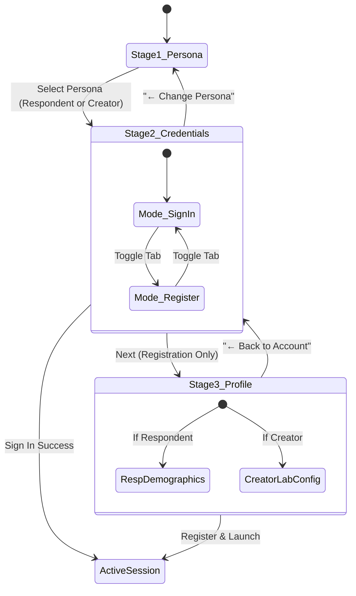

# Mobile Dual-Sided Studio & Guided Auth Stepper Architecture

> **Architectural Objective**: Transform the mobile application (`feedora-showcase`) into a dual-sided research platform powered by `@intuitui-labs/form-builder-engine`, eliminating the cramped single-bottom-sheet anti-pattern with a guided 3-stage stepper while preserving Gihini's exact visual identity, typography (`Instrument Serif`), and mascot aesthetics.

---

## 1. The Cramped Bottom-Sheet Anti-Pattern vs. Guided Stepper

### 1.1 The Anti-Pattern
In previous versions, persona selection, registration fields, login credentials, and engine switchers were crammed into a single vertical scrollview. When the mobile software keyboard appeared:
1. The viewport compressed by $\sim 50\%$.
2. Form fields disappeared under the keyboard, causing touch-target hunting.
3. Users had no progressive disclosure: respondents were confronted with complex organization and lab configuration inputs meant only for principal investigators.

### 1.2 The 3-Stage Guided Stepper Solution (`AuthModal.tsx`)



### 1.3 Stage Breakdown & Affordances

#### Stage 1: Explicit First-Class Persona Selection
- Two prominent interactive cards:
  - **`🎙️ Form Respondent`**: "Participate in academic field studies, earn Voice Points, unlock gamified badges, and level up."
  - **`🔬 Creator / Admin`**: "Scaffold validated psychometric surveys, inspect HMSAM construct distribution, and manage field studies."
- Clear visual active state (`colors.primarySoft` background, `colors.primary` border, and "SELECTED" pill badge).
- Primary forward action: "Continue as [Selected Persona] →".

#### Stage 2: Clean Credentials & Quick Real Accounts
- Breadcrumb indicator: `[ 1. Persona ✓ ]  ›  [ 2. Account ]  ›  [ 3. Details ]`.
- Back navigation button: `← Change Persona`.
- Sub-tabs for **Sign In** vs **Create Account**.
- **Sign In Engine Grounding**: Uses schema definitions from `@intuitui-labs/form-builder-engine` (`FormField` with `semanticIntent: 'username'`, `autoComplete: 'username'`, `importantForAutofill="yes"`).
- **Quick Real Django Database Pills**: One-tap pre-fill pills for real accounts in Gihini's database:
  - `👑 Gihiniw (Admin)`
  - `🔬 Creator (Lead)`
  - `🎙️ Respondent (gihinilwaid@gmail.com)`

#### Stage 3: Profile & Entity Configuration (Registration Only)
- **For Respondents**:
  - Public display name (`semanticIntent: 'name-full'`).
  - Organization / Entity picker.
  - Gender chips (`Female`, `Male`, `Non-binary`, `Not say`).
  - Age group chips with prominent WCAG privacy rationale: `🔒 Used solely for anonymous research demographic distribution.`
  - Avatar emoji selector (`🎙️`, `🎯`, `🌟`, `💡`, `🚀`, `🐱`, `✨`).
- **For Creators**:
  - First & Last Name.
  - Organization / Lab name.
  - Organization type chips (`UNIVERSITY`, `RESEARCH`, `COMPANY`, `SCHOOL`, `OTHER`).
  - Role in organization (`Principal Investigator`, `Senior Researcher`).
  - Country and Research Field.

#### Viewport & Keyboard Handling
The entire modal is enclosed in a responsive `KeyboardAvoidingView`:
```tsx
<KeyboardAvoidingView
  behavior={Platform.OS === 'ios' ? 'padding' : undefined}
  style={styles.keyboardContainer}
>
  <ScrollView keyboardShouldPersistTaps="handled" contentContainerStyle={styles.scroll}>
    ...
  </ScrollView>
</KeyboardAvoidingView>
```

---

## 2. Dual-Sided Studio (`apps/feedora-showcase/src/app/studio.tsx`)

The showcase now features a dedicated **Studio Tab** registered in Expo Router navigation (`_layout.tsx`):

### 2.1 Tab 1: Live Survey Fleet (Django Database)
- Queries `studioPort.listSurveys()` (hitting `GET /api/v1/surveys/mine/` or fallback `GET /api/v1/surveys/`).
- Renders all 21 surveys currently in Gihini's SQLite database.
- Displays:
  - Title and description.
  - Access code pill (e.g. `HED001`, `K73M9A`).
  - HMSAM psychometric badge.
  - Question count and response count metrics.
  - Live vs. Draft indicator.

### 2.2 Tab 2: Visual Form Scaffolder
- Built using `@intuitui-labs/form-builder-engine` schemas.
- **HMSAM Presets**: One-click configuration for Hedonic-Motivation System Adoption Model constructs:
  - `PEOU1` (Perceived Ease of Use)
  - `JOY1` (Hedonic Value: Joy)
  - `CUR1` (Hedonic Value: Curiosity)
  - `BIU1` (Behavioral Intention to Use)
  - `PLAT1` (Operating Platform MCQ)
- **Question Deck Builder**:
  - Dynamically add Likert, MCQ, Short Text, or Rating questions.
  - Edit question statements inline.
  - Add choice options for MCQ questions.
  - Remove unwanted questions.
- **One-Tap Django Publishing**:
  - Submits structured JSON to `POST /api/v1/surveys/create/`.
  - Automatically creates `Survey`, `Question`, and `MCQOption` database records in Django.
  - Shows success celebration banner with the generated 6-character access code and UUID!

---

## 3. Brand Identity & Visual Tokens

The user explicitly required: **"keep her ui and feel exactly"**. The implementation strictly maintains her design system:

| Token Category | Token Value | Purpose / Gihini Source |
| :--- | :--- | :--- |
| **Typography (Display)** | `Instrument Serif` (fallback `Georgia`) | Brand display headings across home and surveys |
| **Typography (Body)** | `Inter` / `DM Sans` (fallback `sans-serif`) | Clean, neutral readability for questions and forms |
| **Canvas Background** | `#FAFAF7` (warm paper) | Editorial research aesthetic from `templates/home.html` |
| **Ink Typography** | `#14140F` (charcoal ink) | High-contrast WCAG AAA reading compliance |
| **Feedora Purple** | `#7F77DD` (`primary`) / `#EEEDFE` (`primarySoft`) | Gihini's signature accent color |
| **Emerald Green** | `#0F6E56` (`teal`) / `#E1F5EE` (`tealSoft`) | Good adoption / verified status indicator |
| **Amber Bronze** | `#854F0B` (`gold`) / `#FAEEDA` (`goldSoft`) | Moderate adoption / level standing accent |

---

## 4. Future Scaling Traps & Roadmap

| Feature Area | Current State | Future Enhancement |
| :--- | :--- | :--- |
| **Question Reordering** | Array index order | Native drag-and-drop handles powered by `react-native-reanimated`. |
| **Offline Drafts for Creators** | In-memory React state | Persist in-progress survey designs to MMKV so drafts survive app termination. |
| **Conditional Branching UI** | Static question order in studio | Visual rule builder allowing creators to attach `visibleIf` and `jumpRules` to questions. |
| **Rich Multimedia Questions** | Text and Likert/MCQ | Support file uploads, audio prompts, and interactive SVG visualizations via `@intuitui-labs/form-builder-engine`. |
