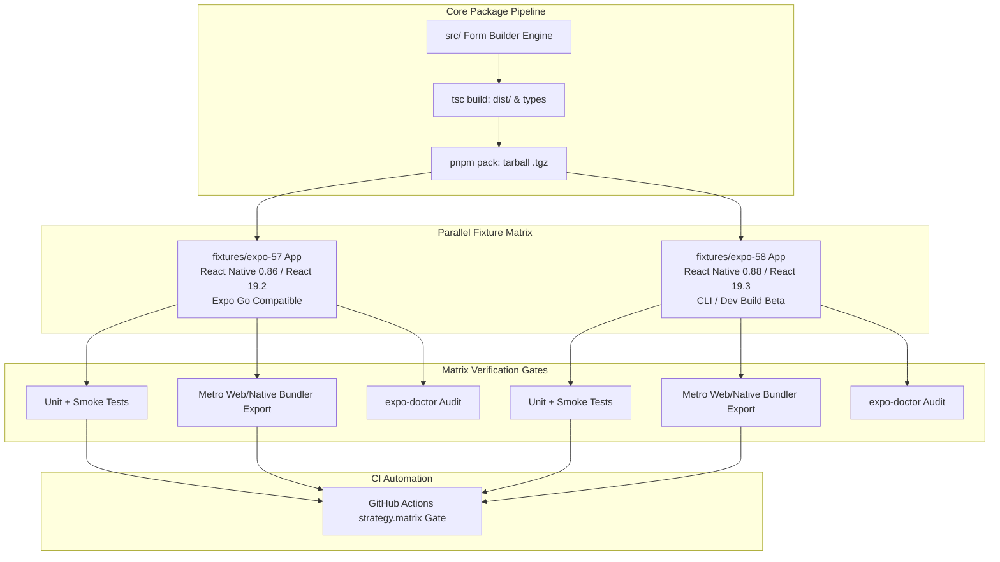

# Enterprise Multi-Version Matrix Testing Strategy & Architecture

## 1. Executive Summary & Problem Statement

Testing library packages against multiple host framework versions (such as **Expo SDK 57** and **Expo SDK 58**) is critical for ecosystem health. However, ad-hoc workflows—such as manually swapping `package.json` manifests, re-running `npm install` inside gitignored directories, and relying on `file:..` symlinks—introduce severe operational risks:

| Anti-Pattern ("Shallow Approach") | Why It Fails in Enterprise Engineering |
| :--- | :--- |
| **In-Place Manifest Swapping** (`package.sdk57.json` $\leftrightarrow$ `package.sdk58.json`) | Fragile, sequential, and prone to dirty working states. Destroys lockfile determinism and cannot run in parallel. |
| **Heavy Runtime Re-Installs** (`npm install --legacy-peer-deps` on toggle) | Downloads hundreds of megabytes on every switch, pollutes local package manager caches, and takes minutes instead of seconds. |
| **Symlink False Positives** (`file:..` / `npm link`) | Hides real-world packaging bugs: misses missing files in `dist`, ignores broken `package.json` `"exports"` mappings, and shares host `node_modules` instead of simulating an isolated consumer. |
| **Untracked / Gitignored Fixtures** | Local manual runs are invisible to pull request reviews and cannot be orchestrated in automated CI/CD pipelines. |

This specification establishes how leading software companies (such as **Software Mansion, Callstack, Expo, and TanStack**) architect multi-version compatibility testing in modern 2026 monorepos.

---

## 2. The Four Pillars of Modern Version Matrix Testing



---

### Pillar 1: Parallel, Immutable Workspace Fixtures

Rather than maintaining a single mutable directory whose dependencies are swapped, top-tier libraries maintain **dedicated, immutable fixture workspaces** side-by-side in the repository:

```text
packages/form-builder-engine/
├── src/
├── dist/
├── fixtures/
│   ├── expo-57/              # Pinned: Expo 57.0.27, RN 0.86.3, React 19.2.3
│   │   ├── package.json      # Immutable dependencies
│   │   ├── pnpm-lock.yaml    # Pinned lockfile
│   │   └── tests/            # Test suite for SDK 57
│   └── expo-58/              # Pinned: Expo 58.0.7, RN 0.88.0-rc.4, React 19.3.0
│       ├── package.json      # Immutable dependencies
│       ├── pnpm-lock.yaml    # Pinned lockfile
│       └── tests/            # Test suite for SDK 58
```

#### Key Advantages:
1. **Parallel Execution**: Both environments exist simultaneously on disk. You can run `pnpm test:matrix` and execute tests across both versions in parallel in under 5 seconds.
2. **Determinism**: Each fixture has its own `pnpm-lock.yaml`. Upgrading SDK 58 never invalidates or risks breaking SDK 57.
3. **No Dynamic Downloads**: Dependencies are installed once and cached permanently. No repeated `npm install` cycles.

---

### Pillar 2: Isolated Tarball Pack-and-Test (`pnpm pack`)

In production, consumers do not install packages via local relative file symlinks—they install tarballs unpacked by their package manager. 

Symlinks (`file:..` or `npm link`) bypass critical packaging mechanics:
* They resolve module boundaries using the parent directory's `node_modules`, masking duplicate dependency or peer-dependency errors.
* They do not test the `"files"` field in `package.json`. If a build artifact is missing from `dist`, symlinks pass while npm users get a runtime crash.
* They do not validate subpath export resolution (`./core`, `./ports`, `./schema`, `./hydration`) as handled by Metro and Node module loaders.

#### The Enterprise Pattern:
1. Run `pnpm pack` to produce `@intuitui-labs-form-builder-engine-<version>.tgz`.
2. Install the generated `.tgz` into each test fixture.
3. Run the smoke and bundler suites against the packed artifact.

---

### Pillar 3: Automated CI Matrix (`strategy.matrix`)

In modern CI/CD (GitHub Actions), version verification runs as a parallel matrix on every pull request before code can be merged into `main`:

```yaml
name: Cross-SDK Matrix Quality Gate

on:
  pull_request:
    branches: [main]
  push:
    branches: [main]

jobs:
  matrix-test:
    name: Expo SDK ${{ matrix.expo-version }} (RN ${{ matrix.rn-version }})
    runs-on: ubuntu-latest
    strategy:
      fail-fast: false
      matrix:
        include:
          - expo-version: '57'
            rn-version: '0.86.3'
            node-version: '22'
            fixture: 'fixtures/expo-57'
          - expo-version: '58'
            rn-version: '0.88.0'
            node-version: '22'
            fixture: 'fixtures/expo-58'

    steps:
      - uses: actions/checkout@v4
      - uses: pnpm/action-setup@v4
        with:
          version: 12.4.2
      - uses: actions/setup-node@v4
        with:
          node-version: ${{ matrix.node-version }}
          cache: 'pnpm'

      # Step 1: Build & Pack Engine
      - name: Build & Pack Core Engine
        run: |
          pnpm install --frozen-lockfile
          pnpm run build
          pnpm pack --pack-destination ./tarballs

      # Step 2: Install Tarball into Target Fixture
      - name: Install Packed Artifact into ${{ matrix.fixture }}
        run: |
          cd ${{ matrix.fixture }}
          pnpm install ../../tarballs/*.tgz

      # Step 3: Run Smoke Test & Typecheck
      - name: Verify Types & Smoke Tests
        run: |
          cd ${{ matrix.fixture }}
          pnpm run typecheck
          pnpm test

      # Step 4: Verify Metro Bundler Export
      - name: Verify Metro Web Bundling
        run: |
          cd ${{ matrix.fixture }}
          npx expo export --platform web
```

---

### Pillar 4: Automated Dependency Governance & Security Auditing

Real-world organizations enforce static audit gates alongside unit and bundle tests:

1. **`npx expo-doctor` Gate**: Confirms that native modules, Expo CLI configuration, and React Native bridge dependencies conform strictly to each SDK's compatibility requirements.
2. **Vulnerability Threshold (`pnpm audit --audit-level=high`)**: Fails the build if transitive dependencies introduce unpatched High or Critical CVEs (such as CVE-2024-57068).
3. **Double Gate Schema Evaluation**: Validates runtime JSON shapes via Zod before any business logic evaluates values.

---

## 3. Migration Roadmap for `@intuitui-labs/form-builder-engine`

To upgrade this codebase from the current setup to the enterprise matrix standard:

1. **Promote Showcase to Immutable Fixtures**:
   * Migrate the current SDK 57 configuration into `fixtures/expo-57/`.
   * Migrate the SDK 58 configuration into `fixtures/expo-58/`.
2. **Update Workspace Configuration**:
   * Add `fixtures/*` to `pnpm-workspace.yaml`.
3. **Add Unified Root Commands**:
   * `pnpm test:matrix`: Builds the package, packs the tarball, and runs tests across both fixtures simultaneously.
   * `pnpm build:all`: Bundles both Metro targets in parallel.
4. **Deploy GitHub Actions Matrix Workflow**:
   * Activate `.github/workflows/matrix-test.yml` to guard all pull requests automatically.
