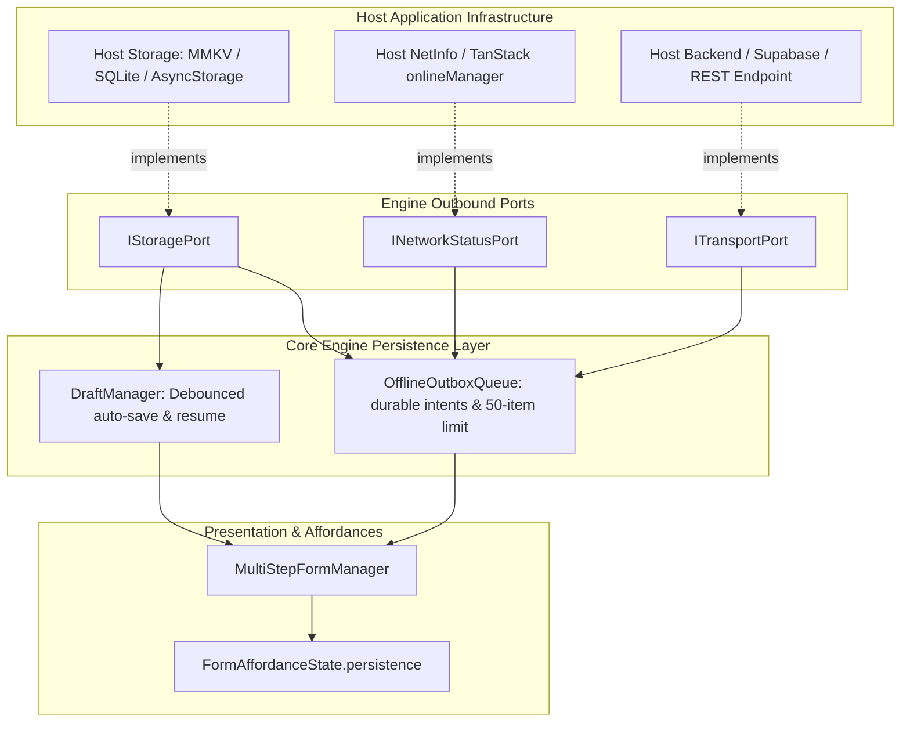

# Offline-First Persistence, Draft Management & Outbox Queue

This document establishes the architecture, port contracts, and integration models for offline draft persistence and background outbox submission synchronization in `@intuitui-labs/form-builder-engine`.

---

## 1. Architectural Doctrine: Embeddability First

`@intuitui-labs/form-builder-engine` is an **embeddable library**. Host mobile apps (React Native/Expo) and web applications already own their storage architectures (MMKV, Expo SQLite, AsyncStorage, WatermelonDB, IndexedDB) and connectivity monitors (`@react-native-community/netinfo`, TanStack Query `onlineManager`).

**The Core Rule**: The engine never imposes a native storage driver or networking dependency directly. Instead, it exposes lightweight **Outbound Ports** and includes zero-dependency fallbacks out of the box.



---

## 2. Port Specifications

### `IStoragePort` (Key-Value Storage Abstraction)
```typescript
import type { IStoragePort } from '@intuitui-labs/form-builder-engine/ports';

export interface IStoragePort {
  getItem(key: string): Promise<string | null> | string | null;
  setItem(key: string, value: string): Promise<void> | void;
  removeItem(key: string): Promise<void> | void;
  getAllKeys?(): Promise<string[]> | string[];
}
```

#### Plugging in Host Storage:
* **React Native MMKV**:
  ```typescript
  import { MMKV } from 'react-native-mmkv';
  const mmkv = new MMKV();

  const storage: IStoragePort = {
    getItem: (key) => mmkv.getString(key) ?? null,
    setItem: (key, val) => mmkv.set(key, val),
    removeItem: (key) => mmkv.delete(key),
  };
  ```
* **React Native AsyncStorage**:
  ```typescript
  import AsyncStorage from '@react-native-async-storage/async-storage';
  const storage: IStoragePort = AsyncStorage;
  ```
* **Zero-Config Defaults**:
  - Web: `WebStorageAdapter` (safe `localStorage` wrapper with quota and SSR protection).
  - Node/Testing: `MemoryStorageAdapter` (ephemeral `Map<string, string>`).

---

### `INetworkStatusPort` (Connectivity Abstraction)
```typescript
import type { INetworkStatusPort } from '@intuitui-labs/form-builder-engine/ports';

export interface INetworkStatusPort {
  isOnline(): Promise<boolean> | boolean;
  subscribe(callback: (isOnline: boolean) => void): () => void;
}
```

#### Plugging in Host NetInfo:
```typescript
import NetInfo from '@react-native-community/netinfo';

const networkStatus: INetworkStatusPort = {
  isOnline: async () => {
    const state = await NetInfo.fetch();
    return Boolean(state.isConnected && state.isInternetReachable !== false);
  },
  subscribe: (callback) => {
    return NetInfo.addEventListener((state) => {
      callback(Boolean(state.isConnected && state.isInternetReachable !== false));
    });
  },
};
```

---

### `ITransportPort` (Submission Delivery Abstraction)
```typescript
import type { ITransportPort, SubmissionEnvelope, SubmissionReceipt } from '@intuitui-labs/form-builder-engine/ports';

export interface ITransportPort<T = Record<string, unknown>> {
  submit(envelope: SubmissionEnvelope<T>): Promise<SubmissionReceipt>;
}
```

---

## 3. Session Draft Management (`DraftManager`)

The `DraftManager` coordinates debounced auto-saving on field edits to prevent excessive write amplification on mobile flash storage:

```typescript
const manager = new MultiStepFormManager(schema, onSubmit, {
  storage,
  autoSaveDraft: true,
  draftDebounceMs: 500, // 500ms debounce
  autoRestoreDraft: false, // Recommended: prompt user before restoring
});
```

### Manual vs. Prompted Restoration Lifecycle:
```typescript
// Check if an abandoned draft exists
const hasDraft = await manager.hasSavedDraft();

if (hasDraft) {
  // Show prompt: "Would you like to resume your previous submission?"
  const shouldResume = await showUserPrompt();
  if (shouldResume) {
    await manager.restoreDraft();
  } else {
    await manager.clearDraft();
  }
}
```

---

## 4. Offline Outbox Queue (`OfflineOutboxQueue`)

When a user taps **Submit** while disconnected from the network:
1. The submission is wrapped in a `SubmissionEnvelope` with a unique idempotency key (`id`).
2. The envelope is appended to the durable FIFO queue via `IStoragePort`.
3. The working draft is cleanly removed (since the submission is safely enqueued).
4. `getAffordanceState().persistence` transitions to `syncStatus: 'offline-queued'`.

### Retention & Delivery Rules:
* **No age-based deletion**: Pending responses remain until the server accepts them or they are explicitly rejected and preserved for recovery. The legacy `ttlMs` option is accepted for source compatibility but is deprecated and ignored.
* **50-Item Capacity**: When the active queue reaches 50 entries, a new submission is rejected with a recoverable capacity message. Existing saved intents are never evicted.
* **Persist before sending**: An intent is written durably before any network request. Server idempotency allows the same intent to be retried after a timeout or process restart.
* **Receipt before removal**: Hosts can reconcile the canonical server receipt before the active intent is removed. A failed reconciliation leaves the intent recoverable and replayable.
* **Dead-letter retention**: Rejected intents are preserved in the DLQ and are not silently capped or discarded. Hosts should provide a recovery/export path and monitor storage use.
* **Reconnection Auto-Flush**: Upon `INetworkStatusPort` emitting `isOnline: true`, the queue flushes pending items in FIFO order with exponential backoff (`baseDelayMs: 1000`, `maxRetries: 5`).
* **Manual Flush**: The host application can trigger synchronization manually via `manager.flushOutbox()`.

---

## 5. Native Affordance State Integration

Host UI renderers observe persistence states directly through `getAffordanceState().persistence`:

```typescript
export interface PersistenceAffordanceState {
  hasSavedDraft: boolean;
  lastSavedAt?: string;
  pendingOutboxCount: number;
  isOnline: boolean;
  syncStatus: 'idle' | 'saving' | 'offline-queued' | 'syncing' | 'synced' | 'error';
  lastSyncError?: string;
}
```

### Example React Native Component UI:
```tsx
import { useFormAffordance } from '@intuitui-labs/form-builder-engine';

export function SyncStatusBar({ manager }) {
  const { persistence } = manager.getAffordanceState();

  if (!persistence) return null;

  if (persistence.syncStatus === 'offline-queued') {
    return (
      <View style={styles.offlineBanner}>
        <Text>Offline: {persistence.pendingOutboxCount} submission(s) queued for sync</Text>
      </View>
    );
  }

  if (persistence.syncStatus === 'syncing') {
    return (
      <View style={styles.syncingBanner}>
        <ActivityIndicator size="small" />
        <Text>Syncing submissions with cloud...</Text>
      </View>
    );
  }

  return null;
}
```
